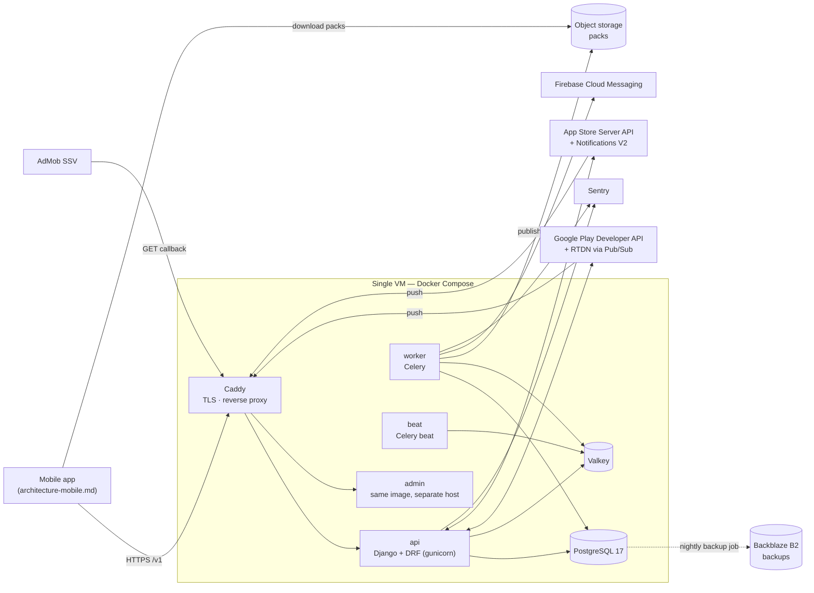
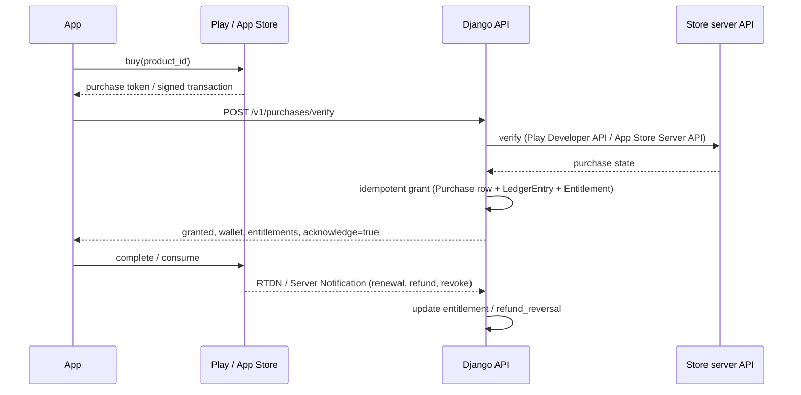
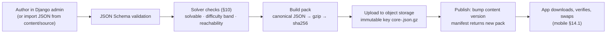
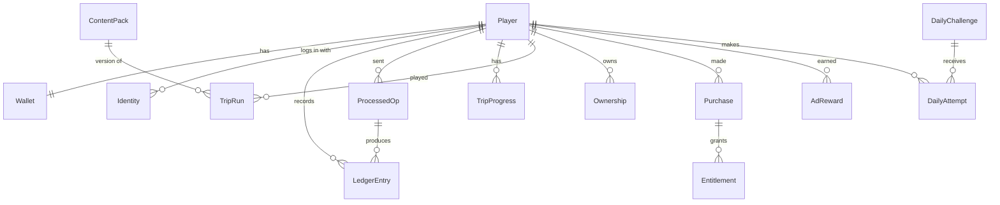

# Wassal El-Ogra — Backend Architecture

| Field | Value |
| --- | --- |
| Product | وصّل الأجرة (code name: `wassal`) |
| Document | Backend architecture (Django) |
| Companion | [`architecture-mobile.md`](./architecture-mobile.md) — read both together |
| Product spec | `docs/product-spec.md` (export of the product & business doc) |
| UX spec | `docs/ux-spec.md` (export of the UI/UX doc) |
| Status | Draft v1 for `/speckit.plan` |
| Date | 2026-10-17 |

---

## 0. How to use this document with spec-kit

1. Product and UX specs are the **what/why** input for `/speckit.specify`. This document is the **how** input for `/speckit.plan`.
2. §17 (*Engineering Principles*) is identical to mobile §18. Use it once as the seed for `/speckit.constitution`.
3. Each backend feature in §20 (`B01`…) becomes one `specs/NNN-*` folder. Most of them have a mobile counterpart (`M..`); plan the pair together and share the same `contracts/` content.
4. §6 (API), §7 (sync), §8 (purchases & ads), §9 (content) and §12 (data model) map directly to `contracts/`, `data-model.md` and `research.md`.
5. Items marked **NEEDS CLARIFICATION** are collected in §22 and must be resolved in `research.md` before `/speckit.tasks`.

---

## 1. Summary

The backend is a single Django service with background workers. It is the source of truth for **identity, premium currency (BONAT), real-money purchases, entitlements, content packs, the daily challenge, and (later) leagues, events and referrals**.

It is intentionally small: one VM, Docker Compose, PostgreSQL, Redis and Celery. The game is offline-first (mobile §11), so a backend outage degrades features, it does not stop play.

A Python **solver/simulator** (`tools/solver`) mirrors the mobile trip engine. It is used to validate every authored trip, generate the daily challenge, and replay daily-challenge results for verification. Parity with the Dart engine is enforced by shared fixtures (§10).

---

## 2. Technical Context

| Field | Value |
| --- | --- |
| Language/Version | Python 3.13, managed with `uv` |
| Primary dependencies | Django 5.2 LTS, Django REST Framework, `djangorestframework-simplejwt`, `drf-spectacular` (OpenAPI), `django-environ`, `psycopg` 3, `redis`, Celery 5 + `django-celery-beat`, `jsonschema`, `uuid-utils` (UUIDv7), `google-auth` + `google-api-python-client` (Play Developer API, ID tokens), Apple `app-store-server-library`, `PyJWT` + `cryptography` (Apple ID tokens, AdMob SSV signatures), `firebase-admin` (FCM), `django-storages` (S3-compatible object storage), `django-otp` (admin 2FA), `sentry-sdk`, `gunicorn` |
| Storage | PostgreSQL 17 (primary), Redis 7 or Valkey (cache, throttling, Celery broker, locks), S3-compatible object storage (content packs, backups) |
| Testing | `pytest`, `pytest-django`, `factory_boy`, `hypothesis` (ledger and engine invariants), `schemathesis` (OpenAPI contract fuzzing), recorded store webhook payloads, `locust` (load) |
| Target platform | Linux containers on **one Oracle Cloud Always Free `VM.Standard.A1.Flex` (ARM64), 2 OCPU / 12 GB** (the whole 2026 Always Free allowance), 100 GB boot volume, in the tenancy's home region **`me-jeddah-1`** with a reserved public IP, behind Caddy. The account stays Always Free: no paid fallback (B01 research R1). Latency baseline from Egypt (fixed and mobile ISP, `time_connect` to `/healthz`): recorded here after the first deploy (`docs/runbooks/provision-host.md`). |
| Project type | Web service: REST API + Django admin (content authoring, live ops) + Celery workers |
| Performance goals | p95: `GET /v1/bootstrap` < 150 ms, `POST /v1/sync` (100 ops) < 250 ms, `POST /v1/purchases/verify` < 2.5 s (store round-trip included) |
| Constraints | Idempotent writes (`client_txn_id`); server-authoritative BONAT and entitlements; store compliance (account deletion, Sign in with Apple, purchase acknowledgement); minimal PII; Arabic content stored as UTF-8 data, never in code |
| Scale/Scope | MVP: Egypt Android, target 10k DAU. Design point: 100k DAU (≈1.5M requests/day, ≈100 rps peak), which needs the §15 scale path beyond the 2 OCPU / 12 GB host. ~13 Django apps. |

---

## 3. Shared Contract Glossary

> **This section is identical in `architecture-mobile.md` §3 and `architecture-backend.md` §3. Change both together.** Every identifier below is used in code, content files, analytics and API payloads.

### 3.1 Money and currencies

| Concept | Identifier | Rule |
| --- | --- | --- |
| Cash amounts inside a trip (fares, change, tray) | `piasters` (integer) | 1 EGP = 100 piasters. Smallest coin is 50 (نص جنيه). Floats are forbidden for money. |
| Soft currency «الجنيهات» | `JENEHAT` | Integer. Earned from trips. Spent on apartment items, vehicles, vehicle upgrades. Never sold for real money. |
| Premium currency «البونات» | `BONAT` | Integer. Earned in small amounts, bought with real money. Spent on fuel, boosters, revive, cosmetics. |
| Energy «البنزين» | `FUEL` | Integer liters, `0..fuel_max` (5; 7 with subscription). +1 every 20 minutes. 1 per trip start. |

### 3.2 Denominations (`denomination`, piasters)

`50, 100, 500, 1000, 2000, 5000, 10000, 20000` (نص، ١، ٥، ١٠، ٢٠، ٥٠، ١٠٠، ٢٠٠)

### 3.3 Boosters (`booster_id`)

| `booster_id` | Arabic name | Effect | Price |
| --- | --- | --- | --- |
| `change_bag` | كيس فكة | Adds 50×2, 100×3, 500×2 to the tray | 10 BONAT |
| `wake_all` | صحّي النايم | Wakes every sleeping passenger | 8 BONAT |
| `ledger_peek` | الدفتر | Shows paid/unpaid badges for 10 s | 12 BONAT |
| `traffic_jam` | زحمة | +10 s to the next station | 8 BONAT or rewarded ad |
| `revive` | صالح الراكب | Continue a failed trip at 40% reputation | 20 BONAT or rewarded ad |
| `refuel_full` | تفويلة كاملة | Fuel to max | 30 BONAT or rewarded ad |
| `fuel_unlimited_1h` | بنزين مفتوح | No fuel cost for 60 min | 80 BONAT |

### 3.4 Ad placements (`ad_placement`)

| `ad_placement` | Type | Reward | Cap |
| --- | --- | --- | --- |
| `result_double` | rewarded | ×2 trip JENEHAT | 1 per trip |
| `fuel_refill` | rewarded | `refuel_full` | 3 per day |
| `trip_revive` | rewarded | `revive` | 1 per trip |
| `traffic_jam` | rewarded | `traffic_jam` | 1 per trip |
| `morning_piggy` | rewarded | JENEHAT + BONAT (server-verified) | 1 per day |
| `interstitial_between_trips` | interstitial | none | every 3 trips, never in the first 10 trips, never right after a rewarded ad, never for `remove_ads` or subscribers |

### 3.5 Store products (`product_id`)

`bonat_pack_s`, `bonat_pack_m`, `bonat_pack_l` (consumable) · `starter_pack` (non-consumable, phase 2, offered once after chapter 1 and kept in the shop until day 7) · `remove_ads` (non-consumable) · `sub_ostaz_weekly`, `sub_ostaz_monthly` (auto-renewing) · `season_pass_<season_key>` (non-consumable per season)

### 3.6 Content identifiers

| Kind | Format / values |
| --- | --- |
| `line_id` | `line_hay`, `line_gamaa`, `line_souq`, `line_masyaf`, `line_safar` |
| `vehicle_id` | `tuktuk`, `micro_old`, `micro_new`, `micro_safar` |
| `trip_id` | `<line_id>.<nn>`, e.g. `line_gamaa.12` |
| `station_id` | lowercase slug unique within a line, e.g. `kobri`, `mostashfa`, `gamaa` |
| `archetype` (passenger behavior) | `regular`, `hajja`, `sleeper`, `hurry`, `big_note`, `student`, `headphones`, `false_claimer`, `group_payer`, `chatty`, `money_changer`, `bags_lady`, `dodger`, `mother_kids`, `big_family`, `traveler`, `regular_customer`, `honest` |
| `skin` (passenger look) | free slug referencing a Rive artboard, e.g. `effendi_suit`, `student_cap` |
| `chapter_id` | `ch1_first_job`, `ch2_her_father`, `ch3_shabka`, `ch4_salon`, `ch5_kitchen`, `ch6_bedroom`, `ch7_wedding` |
| `room_id` / `item_id` | `salon`, `kitchen`, `bedroom` / `<room_id>.<slug>`, e.g. `salon.nish` |
| `event_id` (in-trip) | `bump`, `traffic`, `open_road`, `fare_increase`, `drop_me_here`, `payment_dispute`, `change_request`, `roadside_pickup` |

### 3.7 API conventions

- Base URL `https://api.<domain>/v1`, JSON, UTF-8.
- Auth: `Authorization: Bearer <access_jwt>`; refresh via `/v1/auth/refresh`.
- Every request sends `X-Client-Version` and `X-Platform` (`android` | `ios`).
- Every state-changing operation carries a client-generated `client_txn_id` (UUIDv7) and is idempotent on the server.
- Server time is authoritative. The client stores `server_time_offset` from `/v1/bootstrap`.
- The full endpoint list and payloads live in backend §6.

---

## 4. System Context & Deployment



| Service | Image | Notes |
| --- | --- | --- |
| `caddy` | `caddy:2.11` (official image), a separate Compose project `wassal-edge` on the host network | Automatic HTTPS (Let's Encrypt) for the API hostnames on the public address; HSTS; request size limit 512 KB; one edge for staging and prod. The admin hostnames bind only the WireGuard address `10.66.0.1`, with Caddy's internal CA. Hostnames are configuration: `sslip.io` names for the reserved IP until a domain is registered. |
| `api` | `wassal-backend` | `gunicorn` with `gthread` workers; `/healthz`, `/readyz` |
| `admin` | `wassal-backend` | Same code, `ADMIN_ONLY=1` URL conf; staff login with 2FA; reachable only over WireGuard |
| `worker` | `wassal-backend` | Celery queues: `default`, `purchases`, `content`, `push` |
| `beat` | `wassal-backend` | Schedules in §11.2 |
| `postgres` | `postgres:17` | Data volume on block storage; nightly backups (§15) |
| `valkey` | `valkey/valkey:8.1` | Cache, throttling and the Celery broker. Append-only file (`everysec`) so queued tasks survive a restart; `noeviction`. |

Environments: `dev` (local compose), `staging` (separate compose project, database and volumes on the same VM for MVP, hostname `staging-api.<host>`), `prod`. The app containers publish only on `127.0.0.1` (prod 8100/8101, staging 8200/8201); the edge proxies to them (B01 contracts/operations.md).

---

## 5. Project Structure

The backend lives in the same monorepo as the app (mobile §5).

```text
wassal/
├── backend/
│   ├── pyproject.toml  uv.lock  manage.py
│   ├── config/
│   │   ├── settings/      # base.py, dev.py, staging.py, prod.py
│   │   ├── urls.py  urls_admin.py  celery.py  wsgi.py
│   ├── apps/
│   │   ├── common/        # UUIDv7 ids, error envelope, idempotency, throttles, server clock
│   │   ├── accounts/      # players, identities, devices, JWT, linking
│   │   ├── economy/       # wallet, ledger, inventory, sync engine, op validators
│   │   ├── progress/      # trip progress, trip runs, ownership, story, daily state, tasks
│   │   ├── content/       # authoring models, pack builder, manifest, schema validation
│   │   ├── challenges/    # daily challenge generation, delivery, replay verification
│   │   ├── purchases/     # Google/Apple verification, notifications, entitlements
│   │   ├── ads/           # AdMob SSV callback, reward claims, caps
│   │   ├── liveops/       # store product → grants catalog, offers, seasons
│   │   ├── notifications/ # push tokens, campaigns, caps
│   │   ├── privacy/       # account deletion workflow, public deletion page, data inventory
│   │   ├── leagues/       # phase 3
│   │   └── referrals/     # phase 3
│   ├── tests/
│   └── docker/            # Dockerfile, compose.yml, compose.staging.yml, Caddyfile
├── contracts/
│   └── openapi.yaml       # generated by drf-spectacular, committed, consumed by mobile
├── content/
│   ├── schemas/           # JSON Schemas (§9.2), shared with mobile
│   └── source/            # authored content exports
├── tools/solver/          # Python solver/simulator package `wassal_solver` (§10)
└── fixtures/parity/       # engine ↔ solver fixtures (§10.3)
```

Inside each app: `models.py`, `services/` (all business logic, transactional, no HTTP), `api/` (serializers + thin views), `tasks.py`, `admin.py`, `tests/`.

---

## 6. API Contract (v1)

### 6.1 Conventions

- REST over HTTPS, JSON, UTF-8, `snake_case`. Base path `/v1`.
- Auth header `Authorization: Bearer <access_jwt>` on all endpoints except auth bootstrap, store/ad callbacks and health.
- Required headers: `X-Client-Version` (e.g. `1.4.0+57`), `X-Platform` (`android` | `ios`).
- Timestamps are ISO-8601 UTC. Money/currency values are integers (§3.1).
- The OpenAPI document is generated from code with `drf-spectacular` and committed to `contracts/openapi.yaml`. CI fails if it changes without being committed.

### 6.2 Error envelope

```json
{ "error": { "code": "insufficient_funds", "message": "Not enough BONAT", "details": { "needed": 20, "balance": 12 } } }
```

| HTTP | `code` examples |
| --- | --- |
| 400 | `validation_error`, `unknown_op_type`, `batch_too_large` |
| 401 | `token_expired`, `token_invalid` |
| 403 | `account_deleted`, `forbidden` |
| 404 | `not_found` |
| 405 | `method_not_allowed` |
| 406 | `not_acceptable` |
| 409 | `provider_in_use`, `already_granted`, `state_conflict` |
| 413 | `payload_too_large` (the edge's 512 KB limit, with a backstop in Django) |
| 415 | `unsupported_media_type` |
| 422 | `insufficient_funds`, `not_eligible`, `price_mismatch`, `cap_reached`, `trip_locked` |
| 426 | `client_outdated` (below `min_client_version`) |
| 429 | `rate_limited` |
| 500 | `server_error` (any unhandled exception; the request id is in the `X-Request-ID` header) |
| 503 | `maintenance`, `not_ready` (`/readyz`), `dependency_unavailable` (database or cache unreachable) |

B01 added `method_not_allowed`, `not_acceptable`, `payload_too_large`, `unsupported_media_type`, `server_error`, `not_ready` and `dependency_unavailable`, with their `details` in B01 contracts/api.md. Any DRF exception code that ships must be listed here first.

### 6.3 Endpoints

| Method & path | Purpose | Auth | Phase | Feature |
| --- | --- | --- | --- | --- |
| `POST /v1/auth/anonymous` | Create anonymous player from `install_id` | none | MVP | B02 |
| `POST /v1/auth/refresh` | Rotate refresh token, issue access token | refresh | MVP | B02 |
| `POST /v1/auth/link` | Link Google/Apple identity; resolve conflicts | access | MVP | B02 |
| `DELETE /v1/account` | Request account deletion | access | MVP | B09 |
| `GET /v1/bootstrap` | Session start snapshot | access | MVP | B03 |
| `GET /v1/state` | Full progression snapshot | access | MVP | B03 |
| `POST /v1/sync` | Apply batched client operations | access | MVP | B03 |
| `GET /v1/content/manifest` | Current content packs | access | MVP | B04 |
| `GET /v1/offers` | Active offers & store product display data | access | MVP | B10 |
| `POST /v1/purchases/verify` | Verify a store purchase and grant | access | MVP | B06 |
| `POST /v1/purchases/google/rtdn` | Google Play RTDN (Pub/Sub push) | OIDC | MVP | B06 |
| `POST /v1/purchases/apple/notifications` | App Store Server Notifications V2 | JWS | Phase 3 (iOS) | B06 |
| `GET /v1/ads/ssv` | AdMob server-side verification callback | ECDSA signature | MVP | B07 |
| `GET /v1/ads/rewards/{nonce}` | Client checks an SSV reward | access | MVP | B07 |
| `GET /v1/daily-challenge` | Today's challenge | access | MVP | B08 |
| `POST /v1/daily-challenge/result` | Submit attempt for replay verification | access | MVP | B08 |
| `POST /v1/push-tokens` / `DELETE /v1/push-tokens/{token}` | Register/unregister FCM token & categories | access | MVP | B11 |
| `GET /v1/leagues/current` | ملك الخط standings | access | Phase 3 | B13 |
| `GET /v1/events/active` | Seasonal event & pass track | access | Phase 3 | B14 |
| `GET /v1/referrals/me`, `POST /v1/referrals/redeem` | Referral code & redemption | access | Phase 3 | B15 |
| `GET /healthz`, `GET /readyz` | Liveness / readiness | none | MVP | B01 |

### 6.4 Key payloads

**`POST /v1/auth/anonymous`**

```json
// request
{ "install_id": "c0a8…", "platform": "android", "locale": "ar-EG" }
// 201
{ "player_id": "0192f1c3-…", "access": "<jwt>", "refresh": "<jwt>", "created": true }
```

The same `install_id` returns the same player while it is not linked to a provider and not deleted (re-install on the same device with app data cleared creates a new player — **NEEDS CLARIFICATION**: acceptable for MVP).

**`POST /v1/auth/link`**

```json
// request
{ "provider": "google", "id_token": "<google id token>", "resolve": null }
// 200 linked
{ "player_id": "0192f1c3-…", "providers": ["google"] }
// 409 provider already linked to another player
{ "error": { "code": "provider_in_use", "details": {
  "current": { "driver_level": 3, "chapter_id": "ch1_first_job", "bonat": 40 },
  "existing": { "driver_level": 11, "chapter_id": "ch3_shabka", "bonat": 220 } } } }
// retry with "resolve": "switch_to_existing" (device signs into the existing player)
// or "resolve": "keep_current" (provider is moved to the current player; the old player keeps its data but loses this login)
```

Accounts are never merged, so currency can never be duplicated.

**`GET /v1/bootstrap`**

```json
{
  "server_time": "2026-10-17T09:00:00Z",
  "player": { "player_id": "…", "display_name": "الأسطى حمادة", "driver_level": 4, "country": "EG", "providers": ["google"] },
  "wallet": { "jenehat": 1240, "bonat": 35, "fuel": 3, "fuel_updated_at": "2026-10-17T08:41:00Z", "fuel_unlimited_until": null },
  "entitlements": { "remove_ads": false, "subscription": null, "season_passes": [], "flags": { "no_interstitials": false, "fuel_max_bonus": 0 } },
  "state_version": 42,
  "content": { "version": 7, "manifest_url": "/v1/content/manifest" },
  "client": { "min_version": "1.0.0", "latest_version": "1.4.0", "force_update": false },
  "daily": { "game_date": "2026-10-17", "challenge_available": true, "reward_claimable": true }
}
```

**`GET /v1/content/manifest`**

```json
{ "version": 7, "packs": [
  { "pack_id": "core", "version": 7, "url": "https://cdn.<domain>/packs/core-7.json.gz", "sha256": "…", "size": 412233, "min_client_version": "1.2.0" } ] }
```

**`POST /v1/sync`** — see §7.3.

**`POST /v1/purchases/verify`**

```json
// request (Android)
{ "client_txn_id": "0192…", "platform": "android", "product_id": "bonat_pack_m", "purchase_token": "…", "order_id": "GPA.…" }
// request (iOS)
{ "client_txn_id": "0192…", "platform": "ios", "product_id": "bonat_pack_m", "signed_transaction": "<JWS>" }
// 200
{ "status": "granted", "grants": [{ "currency": "BONAT", "amount": 300 }], "wallet": { … }, "entitlements": { … }, "acknowledge": true }
```

`status` ∈ `granted`, `already_granted` (idempotent repeat, still 200), `pending` (payment pending — client must not complete), `invalid` (422). The client completes/acknowledges the store transaction only when `acknowledge` is true (mobile §15.2).

**`GET /v1/daily-challenge`**

```json
{ "game_date": "2026-10-17", "challenge_id": "dc_2026-10-17", "trip": { …TripDefinition… }, "seed": 912377, "params": { "hop_ms": 1100, "bubble_min_ms": 4000 },
  "attempts_used": 0, "next_attempt_cost": { "fuel": 0 }, "rewards": { "1": {"JENEHAT": 50}, "2": {"JENEHAT": 100}, "3": {"BONAT": 5} } }
```

**`POST /v1/daily-challenge/result`**

```json
// request
{ "client_txn_id": "0192…", "challenge_id": "dc_2026-10-17", "attempt_no": 1, "command_log": [[33, "PickFromTray", 100], …], "claimed_result": { …TripResult… } }
// 200
{ "verified": true, "result": { …TripResult recomputed by the solver… }, "grants": [ … ], "wallet": { … } }
```

### 6.5 Versioning, force update, rate limits

- Breaking changes go to `/v2`; `/v1` stays until active clients below the new version are < 2%.
- `min_client_version` per platform lives in `liveops` settings. Requests from older clients get `426 client_outdated`, except `/v1/bootstrap`, which returns `force_update: true` so the app can show the update screen.
- DRF throttles backed by Redis: `auth/anonymous` 10/hour/IP, `sync` 60/min/player, `purchases/verify` 30/min/player, `daily-challenge/result` 10/min/player, default 120/min/player.

---

## 7. Sync Protocol & Economy Ledger

### 7.1 Authority model

| Value | Authority | Client behavior |
| --- | --- | --- |
| BONAT balance | Server | Optimistic spend up to the last known balance; rollback on rejection |
| Entitlements, subscriptions, purchases | Server | Read-only cache |
| JENEHAT | Client-proposed, server-bounded | Applied locally, validated against per-trip bounds and catalog prices |
| Fuel | Client-computed, server-reconciled | Server recomputes from its own clock; tolerates offline play, flags anomalies |
| Trip progress, stars, story | Client-proposed, server-bounded | Server checks unlock order and plausibility |
| Daily challenge, leagues | Server (replay-verified) | Online only |

### 7.2 Ledger

- Every balance change is a `LedgerEntry` row (§12). `Wallet` holds the materialized balance and is updated in the same transaction.
- Invariant (property-tested): `wallet.<currency> == sum(ledger.delta where currency)` for every player.
- Ledger rows are never updated or deleted, except when a player's account is anonymized (§14.1).

`reason` enum: `trip_earnings`, `ad_result_double`, `ad_fuel_refill`, `item_purchase`, `vehicle_purchase`, `upgrade_purchase`, `cosmetic_purchase`, `booster_purchase`, `fuel_purchase`, `revive_purchase`, `iap_grant`, `ssv_grant`, `daily_reward`, `task_reward`, `challenge_reward`, `subscriber_grant`, `season_reward`, `referral_reward`, `refund_reversal`, `admin_adjustment`.

### 7.3 `POST /v1/sync`

```json
// request
{
  "base_state_version": 41,
  "ops": [
    { "client_txn_id": "0192f1d0-…", "op_type": "trip_start", "occurred_at": "2026-10-17T09:12:03Z",
      "payload": { "trip_id": "line_gamaa.12", "content_version": 7, "fuel_mode": "fuel" } },
    { "client_txn_id": "0192f1d4-…", "op_type": "trip_result", "occurred_at": "2026-10-17T09:13:55Z",
      "payload": { "trip_start_txn": "0192f1d0-…", "result": { "trip_id": "line_gamaa.12", "stars": 3, "earnings_jenehat": 46, "fights": 0, "mistakes": [], "duration_ms": 104200, "revived": false, "boosters_used": [], "command_log_hash": "9f2c…" } } },
    { "client_txn_id": "0192f1d9-…", "op_type": "spend_bonat", "occurred_at": "2026-10-17T09:14:20Z",
      "payload": { "sku_kind": "booster", "sku_id": "change_bag", "price": 10 } }
  ]
}
// 200
{
  "state_version": 42,
  "state_stale": false,
  "results": [
    { "client_txn_id": "0192f1d0-…", "status": "accepted" },
    { "client_txn_id": "0192f1d4-…", "status": "accepted" },
    { "client_txn_id": "0192f1d9-…", "status": "rejected", "reason": "insufficient_funds" }
  ],
  "wallet": { "jenehat": 1286, "bonat": 4, "fuel": 2, "fuel_updated_at": "…", "fuel_unlimited_until": null }
}
```

Processing rules:

1. Batch ≤ 100 ops and ≤ 256 KB; ops are processed **in array order**.
2. One database transaction per batch, serialized per player with `SELECT … FOR UPDATE` on the `Wallet` row.
3. For each op: if `(player, client_txn_id)` exists in `ProcessedOp`, return the stored result (idempotent replay). Otherwise validate (§7.4), apply, store the result.
4. A rejected op does not stop the batch. Later ops that depended on it (e.g. `use_booster` after a rejected `spend_bonat`) are rejected with `dependency_rejected`.
5. `state_version` increments once per batch that changed anything.
6. If `base_state_version` ≠ the version before the batch, ops are still validated against server state, and the response sets `state_stale: true`; the client then calls `GET /v1/state` (mobile §12 step 6).
7. `occurred_at` is informational (analytics, fuel reconciliation); validation uses server time.

### 7.4 Operation types

| `op_type` | Payload | Server validation | Effect |
| --- | --- | --- | --- |
| `trip_start` | `trip_id`, `content_version`, `fuel_mode` (`fuel` \| `unlimited` \| `challenge`) | trip exists in that pack; line, vehicle and previous trip unlocked; fuel reconciliation (§7.5) | fuel −1 unless `unlimited` window active |
| `trip_result` | `trip_start_txn`, `TripResult` (mobile §7.2) | matching accepted `trip_start`; `0 ≤ stars ≤ 3`; `earnings_jenehat ≤ trip.max_earnings_jenehat`; `duration_ms ≥ 0.85 × last station time`; one result per start | JENEHAT +; `TripProgress` best; `TripRun` row; task/league counters |
| `ad_reward` | `ad_placement` ∈ {`result_double`, `fuel_refill`, `trip_revive`, `traffic_jam`}, `ref` (trip start txn) | caps from §3.4 (per trip / per game day) | `result_double`: JENEHAT + equal to that trip's earnings; `fuel_refill`: fuel to max; others: recorded for caps only |
| `spend_jenehat` | `sku_kind` ∈ {`item`, `vehicle`, `upgrade`}, `sku_id`, `variant?`, `price` | price equals catalog price in the client's `content_version`; prerequisites (chapter, line); not owned; balance | JENEHAT −; `Ownership` + |
| `spend_bonat` | `sku_kind` ∈ {`booster`, `fuel`, `revive`, `fuel_unlimited`, `cosmetic`}, `sku_id`, `price` | catalog price; **authoritative balance check** | BONAT −; inventory / fuel / unlimited window / ownership |
| `use_booster` | `booster_id`, `ref` | inventory count > 0 | inventory −1 |
| `claim_daily_reward` | `day_index` | server game date; not yet claimed today; streak rules | grants per streak table |
| `claim_task` | `task_id` | task completed per server-side counters | grants |
| `story_progress` | `chapter_id`, `scene_id` | chapter unlocked by owned items | `StoryState` update; chapter completion grants |
| `settings_update` | `display_name?`, `settings{}` | name length/profanity filter | `Player` update |

Hard violations are rejected. Soft anomalies (fuel overdraft within tolerance, unusually fast 3-star runs, impossible trip rate) are **accepted and recorded as `PlayerFlag`**. Flagged players are excluded from leagues and reviewed in admin. Offline play must never feel punished for honest players.

### 7.5 Fuel reconciliation

- Server fuel state: `fuel`, `fuel_updated_at`, `fuel_unlimited_until`, `fuel_max` (5, or 7 with the subscription flag).
- On each `trip_start`, the server first regenerates: `fuel = min(fuel_max, fuel + floor((now − fuel_updated_at) / 20 min))`.
- If `fuel == 0` and no unlimited window: accept with `fuel = 0`, record `fuel_overdraft` flag. Three overdrafts in a game day exceed tolerance and the op is rejected with `cap_reached`.
- Regeneration minutes and caps come from the same values as the Remote Config keys in mobile §14.3, stored server-side in `liveops` settings.

---

## 8. Purchases, Entitlements & Ad Rewards

### 8.1 Store product catalog

`liveops.StoreProduct` maps each `product_id` (§3.5) to grants:

| `product_id` | Type | Grants |
| --- | --- | --- |
| `bonat_pack_s/m/l` | consumable | BONAT amount (values from product spec pricing table) |
| `starter_pack` | non-consumable (phase 2), offered once after chapter 1 and kept in the shop until day 7 after install | BONAT + exclusive cosmetic + 2 h `fuel_unlimited` |
| `remove_ads` | non-consumable | entitlement `remove_ads` → flag `no_interstitials` |
| `sub_ostaz_weekly/monthly` | subscription (phase 2) | entitlement `subscription` → flags `no_interstitials`, `fuel_max_bonus: 2`, plus any daily grant in the product spec (issued by a Celery job, §11.2) |
| `season_pass_<key>` | non-consumable (phase 3) | entitlement `season_pass:<key>` |

Real-money prices and local currencies are configured in Play Console / App Store Connect only. The backend never stores prices for real-money products.

### 8.2 Verification flow



**Google Play**

- One-time products: query the purchase with the Play Developer API using `purchase_token`. Accept only purchase state *purchased*; *pending* returns `status: pending`.
- Uniqueness key: `orderId` (store transaction id). A token already granted returns `already_granted`.
- Non-consumables and subscriptions: after granting, the server also acknowledges through the API if still unacknowledged, so a crash before the client completes cannot trigger the 3-day automatic refund.
- Subscriptions (phase 2): read with the subscriptions v2 API; entitlement follows `expiryTime`, grace period and account hold states.
- RTDN: Cloud Pub/Sub push subscription → `POST /v1/purchases/google/rtdn`. The push request's OIDC token is verified (audience = our endpoint, issuer Google). Each notification re-reads the purchase from the API; the payload itself is never trusted.
- Refunds: Voided Purchases API polled daily (§11.2) in addition to RTDN.

**Apple (phase 3, iOS)**

- Verify the StoreKit signed transaction (JWS) with Apple's `app-store-server-library` and fetch status through the App Store Server API. The deprecated `verifyReceipt` endpoint is not used.
- **NEEDS CLARIFICATION:** confirm the Flutter `in_app_purchase` version exposes StoreKit 2 JWS; otherwise send the app receipt and resolve the transaction via the App Store Server API transaction history.
- Server Notifications V2 → `POST /v1/purchases/apple/notifications`; `signedPayload` verified with the library's signed-data verifier. Handled types include `SUBSCRIBED`, `DID_RENEW`, `DID_FAIL_TO_RENEW`, `GRACE_PERIOD_EXPIRED`, `EXPIRED`, `REFUND`, `REVOKE`.

**Refund of consumed BONAT** — **NEEDS CLARIFICATION**. Proposed: record a `refund_reversal` for the full amount; the wallet may go negative; a negative BONAT balance blocks BONAT spending until repaid; the player is flagged.

### 8.3 Entitlement resolution

`Entitlement(kind, key, active_from, expires_at, state, source_purchase)` rows are the only source for the `entitlements` block in `/v1/bootstrap`. Flags (`no_interstitials`, `fuel_max_bonus`) are derived, never stored, so changing a benefit is a code/config change, not a data migration.

### 8.4 AdMob server-side verification (`morning_piggy`)

1. The app sets SSV options on the rewarded ad: `user_id = player_id`, `custom_data = {"placement":"morning_piggy","nonce":"<uuid>"}` (mobile §15.1).
2. AdMob calls `GET /v1/ads/ssv?ad_network=…&ad_unit=…&custom_data=…&reward_amount=…&reward_item=…&timestamp=…&transaction_id=…&user_id=…&signature=…&key_id=…`.
3. The server verifies the ECDSA signature over the query string preceding `signature`, using Google's published verifier keys (cached 24 h, refreshed on unknown `key_id`).
4. `transaction_id` is unique (`AdReward` table). The daily cap (1 per game day) is enforced. The grant is a `LedgerEntry` with reason `ssv_grant`.
5. The endpoint returns 200 for any validly signed callback (including duplicates), so AdMob does not retry.
6. The app polls `GET /v1/ads/rewards/{nonce}` (1 s, 2 s, 4 s, then gives up and shows «هتوصلك المكافأة أول ما توصل»). Late grants appear on the next bootstrap.

Other rewarded placements are client-applied and arrive as `ad_reward` sync ops (§7.4) bounded by caps.

---

## 9. Content Pipeline

### 9.1 Flow



- Packs are **immutable**; publishing always creates a new version. Rollback = re-publish a previous version as a new version number.
- `trip_id` is stable forever. A trip whose rules change keeps its id and gets a new `rev`; players keep their stars.
- Catalog prices for JENEHAT/BONAT items are part of the pack, so `spend_*` ops validate against the pack version the client declares (§7.4). The server keeps the last 5 pack versions loaded for validation.
- Publishing requires a staff user with the `content.publish` permission and a green validation report.

### 9.2 Schemas (`content/schemas/`, JSON Schema 2020-12)

| Schema | Describes |
| --- | --- |
| `pack.schema.json` | Top-level pack: `version`, `lines[]`, `vehicles[]`, `trips[]`, `chapters[]`, `rooms[]`, `items[]`, `speech_pools[]`, `catalog{}`, `daily_rewards[]`, `tasks[]` |
| `trip.schema.json` | `TripDefinition` (owned here, consumed by mobile §7.2) |
| `line.schema.json` | line, stations order, unlock rules, difficulty band |
| `vehicle.schema.json` | seat layout, capacity, upgrades |
| `chapter.schema.json`, `room.schema.json`, `item.schema.json` | story & apartment |
| `speech_pool.schema.json` | `speech_key` → Arabic lines with `{amount}`, `{station}` placeholders |
| `catalog.schema.json` | JENEHAT/BONAT prices for every SKU |
| `manifest.schema.json` | `/v1/content/manifest` response |

Code generation: Dart models in `packages/content_models` (mobile) and Pydantic models in `tools/solver` and `backend/apps/content` are generated from these schemas in CI. Hand-edited models are not allowed.

### 9.3 Trip definition example

Based on the validated prototype (three stations, odd fares):

```json
{
  "trip_id": "line_gamaa.12",
  "rev": 1,
  "line_id": "line_gamaa",
  "vehicle_id": "micro_old",
  "stations": [
    { "station_id": "kobri",     "at_seconds": 38,  "fare_piasters": 450 },
    { "station_id": "mostashfa", "at_seconds": 70,  "fare_piasters": 700 },
    { "station_id": "gamaa",     "at_seconds": 100, "fare_piasters": 900 }
  ],
  "initial_tray": { "50": 2, "100": 3, "500": 2, "1000": 1, "2000": 1 },
  "rules": { "student_discount_pct": 0, "bag_fare_piasters": 0, "child_free_age": 6, "max_break_requests": 2 },
  "passengers": [
    { "passenger_id": "p1", "archetype": "mother_kids", "skin": "mother_red", "seat_id": "front_r",
      "board_station_id": null, "dest_station_id": "gamaa", "pays_at_seconds": 2, "payment": [1000] },
    { "passenger_id": "p2", "archetype": "hurry", "skin": "effendi_tie", "seat_id": "A_l",
      "dest_station_id": "kobri", "pays_at_seconds": 5, "payment": [1000] },
    { "passenger_id": "p3", "archetype": "group_payer", "skin": "young_cap", "seat_id": "B_m",
      "dest_station_id": "kobri", "payment": [5000], "group_id": "g1", "group_size": 3 },
    { "passenger_id": "p4", "archetype": "sleeper", "skin": "worker_blue", "seat_id": "C_m",
      "dest_station_id": "mostashfa", "payment": [5000] }
  ],
  "events": [],
  "star_rules": { "two": "no_fights", "three": "no_fights_no_mistakes" },
  "max_earnings_jenehat": 60
}
```

`seat_id` format: `<row>_<col>` where row ∈ `front`, `A`…`D` and col ∈ `r`, `m`, `l`, matching mobile §7.2 `Seat`.

---

## 10. Solver & Simulator (`tools/solver`)

### 10.1 Purpose

| Use | Caller |
| --- | --- |
| Validate every authored trip is solvable with 3 stars | content pipeline (§9), CI |
| Score difficulty and check the trip sits in its line's band | content pipeline, admin preview |
| Generate daily challenges from templates | Celery job (§11.2) |
| Replay `command_log` to verify daily-challenge and league results | `challenges`, `leagues` |
| Produce balancing reports (fights per trip, break requests, time slack) | admin / notebooks |

### 10.2 Design

- Package `wassal_solver` with `engine/` (rule mirror of `packages/trip_engine`: 33 ms step, `xorshift32` PRNG, integer piasters, same command and event names), `solver/`, `scoring/`, `generator/`, `cli.py`.
- The solver models an **idealized player with reaction latency** (default 600 ms per action, configurable). It searches over decisions (which change to build, whom to send it to, when to wake/call/request a break) rather than raw taps, with pruning and a time budget per trip.
- Difficulty score inputs: number of simultaneous owed passengers, change-making complexity (minimum coins per change), blockers on chains, required break requests, time slack between the earliest feasible delivery and each station.
- Installed into the backend image as a path dependency and called in-process (no network hop).

### 10.3 Parity contract

- `fixtures/parity/<name>.json` = `{definition, seed, params, command_log, expected_result}`.
- CI runs the same fixtures in Dart (`packages/trip_engine`) and in Python (`tools/solver`). Both must reproduce `expected_result` exactly. Any engine change without updated fixtures fails CI (principle 3).
- Fixture sources: hand-written rule cases for every archetype and event; logs exported from the mobile `staging` debug overlay; solver-generated optimal runs.
- Fallback if parity maintenance becomes costly: compile the Dart engine to a native CLI (`dart compile exe`) and call it from Python for replay, keeping Python only for search (see §23).

---

## 11. Daily Challenge, Live Ops & Notifications

### 11.1 Daily challenge

- Pre-generated 3 days ahead by `generate_daily_challenge`: pick a template (line band rotating through unlocked content), generate passengers and tray with the solver's generator, keep candidates whose difficulty score falls in the target band and whose solver run gets 3 stars.
- The same challenge for every player on a game date. **NEEDS CLARIFICATION:** game-day timezone; proposed `Africa/Cairo` for all regions in MVP.
- First attempt is free (UX doc). Additional attempts cost fuel per product spec.
- Results are verified by replaying `command_log` in the solver engine. If the recomputed result differs from `claimed_result`, the server keeps the recomputed one and flags the player when the difference is large.

### 11.2 Scheduled jobs (Celery beat)

| Job | Schedule | Feature |
| --- | --- | --- |
| `generate_daily_challenge` | daily 00:05 game-day TZ | B08 |
| `send_daily_challenge_push` | daily 10:00 local | B11 |
| `send_story_reminder_push` | daily, segment: has affordable item | B11 |
| `send_comeback_push` | daily, segment: inactive 3 / 7 days | B11 |
| `poll_google_voided_purchases` | daily | B06 |
| `subscription_expiry_sweep` | hourly | B12 |
| `subscriber_daily_grant` | daily (if defined in product spec) | B12 |
| `process_account_deletions` | daily | B09 |
| `expire_offers` | hourly | B10 |
| `league_rollover` | weekly | B13 |
| `prune_trip_runs` | monthly (drop partitions older than 90 days) | B03 |

### 11.3 Push notifications

- FCM through `firebase-admin`, per-token sends (personalized text from templates stored as data).
- Caps: `notif_daily_max` (2) per player per day, quiet hours 23:00–09:00 local, per-category opt-out sent with `POST /v1/push-tokens` (`categories: ["daily", "story", "comeback", "league"]`).
- The fuel-full notification is local on the device (mobile §16) and never sent by the backend.

### 11.4 Offers

`GET /v1/offers` returns active offers for the player: starter pack (phase 2: after chapter 1, until day 7 since install, not yet bought), seasonal sale, season pass. Eligibility rules are data on `liveops.Offer` (country, days since install, payer status, owned products), evaluated server-side.

---

## 12. Data Model

All primary keys are UUIDv7 unless noted. All tables have `created_at`; mutable ones have `updated_at`.

### accounts

| Model | Fields |
| --- | --- |
| `Player` | `id`, `display_name`, `country`, `locale`, `platform`, `driver_level`, `status` (`active`, `pending_deletion`, `deleted`), `install_first_at`, `last_seen_at`, `client_version`, `is_tester` |
| `Identity` | `player`, `provider` (`anonymous`, `google`, `apple`), `subject` (install id hash for anonymous), `apple_refresh_token` (encrypted, for revocation), unique(`provider`, `subject`) |
| `Device` | `player`, `install_id_hash`, `platform`, `app_version`, `last_seen_at` |

Refresh-token rotation and blacklist use simplejwt's token blacklist tables.

### economy

| Model | Fields |
| --- | --- |
| `Wallet` | `player` (PK/FK), `jenehat`, `bonat`, `fuel`, `fuel_updated_at`, `fuel_unlimited_until`, `state_version` |
| `LedgerEntry` | `id`, `player`, `currency`, `delta`, `balance_after`, `reason`, `ref_type`, `ref_id`, `op` (FK `ProcessedOp`, nullable), `source` (`client_op`, `purchase`, `ssv`, `system`, `admin`), index(`player`, `created_at`) |
| `ProcessedOp` | `player`, `client_txn_id`, `op_type`, `status`, `reason`, `result` (JSON), `processed_at`, unique(`player`, `client_txn_id`) |
| `Inventory` | `player`, `booster_id`, `count`, unique(`player`, `booster_id`) |
| `PlayerFlag` | `player`, `kind`, `details`, `created_at`, `reviewed_by`, `resolution` |

### progress

| Model | Fields |
| --- | --- |
| `TripProgress` | `player`, `trip_id`, `best_stars`, `best_time_ms`, `plays`, `first_completed_at`, unique(`player`, `trip_id`) |
| `TripRun` | `id`, `player`, `trip_id`, `rev`, `start_op`, `stars`, `fights`, `mistakes_count`, `earnings_jenehat`, `duration_ms`, `revived`, `boosters_used`, `command_log_hash`, `content_version`, `client_version`. Range-partitioned by month, 90-day retention. |
| `Ownership` | `player`, `kind` (`vehicle`, `upgrade`, `cosmetic`, `item`), `sku_id`, `variant`, `acquired_at`, unique(`player`, `kind`, `sku_id`) |
| `StoryState` | `player`, `chapter_id`, `status`, `scenes_seen` (array), `completed_at` |
| `DailyState` | `player`, `streak`, `last_claim_game_date`, `task_counters` (JSON), `tasks_game_date` |

### content

| Model | Fields |
| --- | --- |
| Authoring: `Line`, `Station`, `Vehicle`, `SeatLayout`, `Trip`, `TripPassenger`, `TripEvent`, `Chapter`, `Room`, `Item`, `SpeechPool`, `SpeechLine`, `CatalogPrice`, `DailyRewardDay`, `TaskTemplate` | Mirrors the schemas in §9.2; edited in admin |
| `ContentPack` | `version` (int, unique), `status` (`draft`, `validated`, `published`, `retired`), `sha256`, `url`, `size`, `min_client_version`, `validation_report` (JSON), `published_by`, `published_at` |

### purchases & liveops

| Model | Fields |
| --- | --- |
| `StoreProduct` | `product_id`, `platforms`, `kind`, `grants` (JSON), `active` |
| `Purchase` | `player`, `platform`, `product_id`, `store_txn_id` (unique), `original_txn_id`, `purchase_token`, `state` (`pending`, `granted`, `refunded`, `revoked`), `environment` (`sandbox`, `production`), `raw` (JSON), `verified_at`, `granted_at`, `client_txn_id` |
| `Entitlement` | `player`, `kind` (`remove_ads`, `subscription`, `season_pass`, `starter_pack`), `key`, `active_from`, `expires_at`, `state`, `source_purchase` |
| `StoreNotification` | `platform`, `notification_id` (unique), `type`, `payload`, `received_at`, `processed_at`, `status` |
| `Offer` | `offer_id`, `kind`, `product_id`, `rules` (JSON), `starts_at`, `ends_at`, `priority` |
| `Season` (phase 3) | `season_key`, `starts_at`, `ends_at`, `pass_product_id`, `reward_track` (JSON) |
| `LiveSetting` | key/value for server-side tunables (`min_client_version_*`, fuel regen, caps) |

### ads, challenges, notifications, phase 3

| Model | Fields |
| --- | --- |
| `AdReward` | `transaction_id` (unique), `player`, `placement`, `nonce` (unique), `reward`, `key_id`, `ledger_entry`, `created_at` |
| `DailyChallenge` | `game_date` (unique), `challenge_id`, `trip_definition`, `seed`, `params`, `difficulty_score`, `solver_result`, `status` |
| `DailyAttempt` | `player`, `challenge`, `attempt_no`, `client_txn_id`, `verified`, `stars`, `score`, `grants`, unique(`player`, `challenge`, `attempt_no`) |
| `PushToken` | `player`, `token` (unique), `platform`, `categories`, `locale`, `tz`, `last_seen_at` |
| `PushLog` | `player`, `kind`, `sent_at`, `fcm_message_id`, `status` |
| `LeagueWeek`, `LeagueGroup`, `LeagueMember` | weekly groups of ~30, points from accepted `trip_result` ops |
| `ReferralCode`, `Referral` | `code` per player; `referrer`, `referee`, `redeemed_at`, `rewarded_at` |



---

## 13. Security & Anti-cheat

| Area | Measure |
| --- | --- |
| Transport | TLS everywhere (Caddy auto-HTTPS), HSTS |
| Auth | Access JWT 15 min, refresh 30 days, rotated and blacklisted on use; signing key from secrets with `kid` for rotation |
| Third-party sign-in | Google ID tokens verified with `google-auth` (audience = our client IDs); Apple ID tokens verified against Apple JWKS (`iss`, `aud`, `nonce`) |
| Webhooks | Pub/Sub OIDC token check; Apple JWS chain verification; AdMob ECDSA signature; all webhooks idempotent on notification id |
| Input | DRF serializers with strict schemas; batch and body size limits; `command_log` ≤ 64 KB |
| Rate limiting | §6.5 throttles; Caddy connection limits |
| Admin | Separate host, reachable only over WireGuard (the admin hostnames bind `10.66.0.1`); staff-only, 2FA (`django-otp`, TOTP) on every view, lockout after 5 failed sign-ins for 15 min (`django-axes`); audit log of content publishes and wallet adjustments |
| Secrets | Env files on the host (`/etc/wassal/*.env`, mode 0400; OCI Vault later): Django secret, JWT key, Google service account, Apple `.p8` key, Firebase service account, Sentry DSN, Healthchecks ping URLs, and the Backblaze B2 application keys (write-only backup key, read-only drill key) in their own files that the API and worker never see. The B2 admin key never goes on the host. |
| Anti-cheat | Server-authoritative BONAT; bounds on JENEHAT and progress (§7.4); replay verification for competitive surfaces; `PlayerFlag` review queue; flagged players excluded from leagues |
| Device attestation | **NEEDS CLARIFICATION** (phase 3): Play Integrity / App Attest tokens on daily challenge and league submissions |

---

## 14. Privacy & Store Compliance

### 14.1 Account deletion

- In app: `DELETE /v1/account` → `status = pending_deletion`, all tokens revoked, push tokens removed, player excluded from leagues immediately. Response 202 with the deletion date.
- Outside the app (Google Play requirement): a public page `https://<domain>/delete-account` where a player can request deletion by signing in with Google/Apple or entering the support code shown in Settings.
- `process_account_deletions` (daily) hard-deletes or anonymizes after 7 days: personal fields cleared, identities and devices deleted, Apple tokens revoked through Apple's REST API, ledger and purchase rows kept with the player reference replaced by an anonymous tombstone (financial records), trip runs deleted.

### 14.2 Data inventory (for Play Data safety and App Store privacy labels)

| Data | Where | Purpose | Retention |
| --- | --- | --- | --- |
| `player_id`, install id hash | backend | account | until deletion |
| Google/Apple subject id | backend | sign-in | until deletion |
| Purchase history | backend | fulfilment, refunds | 7 years (tombstoned after deletion) — **NEEDS CLARIFICATION** with legal |
| Gameplay progress, trip runs | backend | game service, anti-cheat | progress until deletion; runs 90 days |
| Push token | backend | notifications | until unregistered/deletion |
| IP address | proxy logs | security | 14 days |
| Advertising ID, ad interactions | AdMob SDK on device | ads | per Google |
| Analytics, crashes | Firebase SDK on device | analytics, stability | per Firebase settings |

- No email, phone number or real name is stored. `display_name` is the in-game driver name.
- **NEEDS CLARIFICATION:** legal review against Egypt's Personal Data Protection Law (151/2020), and Saudi and UAE data protection laws before the Gulf launch.
- **NEEDS CLARIFICATION:** store target age group and ad content rating. Proposed: not designed for children, 13+, AdMob max ad content rating set accordingly.

---

## 15. Infrastructure & Operations

| Topic | Decision |
| --- | --- |
| Host | One Oracle Cloud Always Free `VM.Standard.A1.Flex` (ARM64), 2 OCPU / 12 GB, 100 GB boot volume, region `me-jeddah-1`, reserved public IP; Ubuntu LTS, Docker + Compose; images built for `linux/arm64`. Only 80/443 TCP and WireGuard (UDP 51820) are open; SSH listens on the WireGuard address only. Runbooks: `docs/runbooks/`. |
| Scale path | Starts from 2 OCPU / 12 GB, which is all of Always Free: 1) a bigger (paid) VM → 2) move Postgres to its own VM or managed service → 3) multiple `api` replicas behind a load balancer. Code stays stateless to allow this. Any paid step needs the owner's decision (B01 FR-042b). |
| Object storage | Content packs: OCI Object Storage via S3-compatible API, `packs/` (public read, long cache), B04. Backups: **Backblaze B2**, separate from packs (never reuse its keys): two private buckets (daily 14 days, weekly 56 days) with governance-mode Object Lock and lifecycle rules, a write-only host key, a read-only drill key, USD 0 caps. The B2 account region is recorded in B01 research R9 "Data location". |
| CDN | **NEEDS CLARIFICATION:** Cloudflare (free) in front of `cdn.<domain>` for packs |
| Backups | Nightly `pg_dump` (custom format) at 03:00 Cairo time, in one exported snapshot with exact row counts, to B2: 14 daily + 8 weekly. An automated restore drill on the 1st of each month restores the newest backup on the host, into a throwaway database with no outside route, and checks the restore, migrations, row counts and registered invariants. WAL archiving for point-in-time recovery in phase 2. Runbook: `docs/runbooks/restore.md`. |
| Targets | Availability 99.5% monthly; RPO 24 h (MVP) → 15 min (phase 2); RTO 4 h |
| Observability | Sentry, US region (organization `saied-store-div`, project `wassal-backend`), free Developer plan (errors + traces at a low sample rate; IPs, cookies, headers, bodies and local variables scrubbed); structured JSON logs with a request id; `pg_stat_statements`; UptimeRobot on `/healthz`; Healthchecks.io dead-man's switches for the heartbeat task, the backup, the drill and the host monitor; the host monitor (every 5 min) checks disk, certificate expiry, queue backlog and backup storage. Setup: `docs/runbooks/monitoring-setup.md`. |
| CI (GitHub Actions) | `backend.yml`: `ruff`, `mypy --strict` (django-stubs), `pytest` with real PostgreSQL and Valkey and an 80% coverage gate, the OpenAPI drift check and `schemathesis`, the host-script and edge smoke tests, then an `linux/arm64` image pushed to GHCR as `sha-<commit>`. `secrets.yml`: gitleaks. Schema and parity checks arrive with their features. |
| CD | A merge to `master` deploys staging; a `vX.Y.Z` tag on a `master` commit re-tags that image and deploys prod. Both go over WireGuard to a forced-command SSH key that runs the host's `deploy` script: lock → pull → migrate → restart `api`, `admin`, `worker`, `beat` → verify `/readyz` and the release in `/healthz`, restoring the previous release if verification fails. Rollback is a deploy of an older tag. Migrations follow expand/contract so the previous release keeps working during deploy. Runbook: `docs/runbooks/deploy-and-rollback.md`. |
| Maintenance mode | `LiveSetting` flag returns 503 `maintenance` on writes; reads and offline play continue |
| Monthly routine | Check the drill result; sign in to the OCI console (idle tenancies can be suspended) and to Healthchecks.io; check the B2 caps and storage; confirm every service still shows USD 0 (`docs/runbooks/monitoring-setup.md`). |

---

## 16. Testing Strategy

| Level | Scope |
| --- | --- |
| Unit | op validators, grant rules, entitlement resolution, offer eligibility, fuel reconciliation |
| Property-based (`hypothesis`) | ledger invariant (§7.2); idempotency (same batch twice = same state); random op sequences never make BONAT diverge from ledger |
| API / contract | DRF tests per endpoint; `schemathesis` against `contracts/openapi.yaml`; mobile CI checks its DTOs against the same file |
| Webhooks | recorded sandbox payloads for RTDN, Apple notifications and AdMob SSV (valid and tampered signatures) |
| Engine parity | `fixtures/parity` in pytest (and in Dart on the mobile side) |
| Content | every published trip re-solved in CI; schema validation of `content/source` |
| Load | `locust` scenario (bootstrap + 3 syncs + manifest per session) at 100 rps on staging before each phase launch |

---

## 17. Engineering Principles (constitution candidates)

> Identical numbering in mobile §18.

1. **Engine purity.** Gameplay rules live only in `packages/trip_engine` (and its Python mirror). UI and server never re-implement them.
2. **Integer money.** All cash amounts are integer piasters; currencies are integers.
3. **Parity or it didn't happen.** Any engine rule change ships with updated parity fixtures that pass in Dart and Python.
4. **Server authority for value.** BONAT, purchases, entitlements and subscriptions are decided by the backend. The client is optimistic only for JENEHAT and progress, within server-validated bounds.
5. **Offline-first play.** A regular trip must be playable with no network.
6. **Idempotent everything.** Every state-changing request carries `client_txn_id`.
7. **Content, not code.** Trips, prices, lines, items and lines of dialogue are data in versioned packs.
8. **Tunable numbers.** Every balancing number has a Remote Config key with a bundled default.
9. **No ads in a trip.** Ad calls are rejected while a trip is running.
10. **RTL and Arabic first.** Every screen is designed and tested in Arabic RTL with Arabic-Indic digits.
11. **Accessible minimums.** UX doc minimum sizes and contrast are acceptance criteria, not suggestions.
12. **No runtime LLM.** Dialogue is authored and reviewed before shipping.
13. **Small, testable features.** Each spec-kit feature ships behind its own tests; the engine targets ≥ 90% line coverage.

### 17.1 Backend-specific practices

- Business logic lives in `services/`; views and serializers stay thin.
- Every money or currency mutation goes through `economy.services.apply_entry()`; direct `Wallet` updates are forbidden (enforced by a test that scans for them).
- Migrations are backward-compatible for one release (expand/contract).
- External calls (stores, FCM) run with timeouts and retries in Celery, except purchase verification, which is synchronous with a 10 s timeout and a retry path through RTDN.

---

## 18. Non-functional Requirements

| Area | Requirement |
| --- | --- |
| Latency | §2 performance goals, measured in Sentry |
| Capacity | 100 rps sustained on the single VM with < 60% CPU |
| Availability | 99.5%; the app stays playable offline during outages |
| Durability | Ledger and purchases backed up nightly; PITR in phase 2 |
| Data retention | §14.2 |
| Localization | All player-visible server text (push templates, offer copy) stored as data with `ar-EG` default and `ar` fallback |

---

## 19. Phasing

| Phase (product roadmap) | Backend scope |
| --- | --- |
| 1 — MVP, Egypt, Android | B01–B11: accounts, ledger & sync, content pipeline, solver & parity, Google purchases (BONAT packs, remove ads), AdMob SSV, daily challenge, deletion, offers, push |
| 2 — Content & revenue, + KSA/UAE | B12 subscriptions and starter pack; content packs for `line_souq`, `micro_new`, ch5; WAL archiving; region-aware offers |
| 3 — Public launch, iOS | Apple purchases and notifications (B06 extension), Sign in with Apple, B13 leagues, B14 events & season pass, B15 referrals, device attestation |
| 4 — Season 2 | new line packs; scale path step 2 if DAU requires |

---

## 20. Feature Breakdown for spec-kit (backend)

| ID | Feature | Depends on | Mobile counterpart |
| --- | --- | --- | --- |
| B01 | Project skeleton: Django settings, Docker Compose, Caddy, CI/CD, Sentry, health checks | — | — |
| B02 | Accounts & auth: anonymous, refresh rotation, Google/Apple linking and conflicts | B01 | M06, M14 |
| B03 | Economy ledger, bootstrap, state, sync engine, op validators, fuel reconciliation, flags | B02, B04 | M05, M06 |
| B04 | Content pipeline: schemas, authoring admin, pack build/publish, manifest, model codegen | B01 | M04 |
| B05 | Solver/simulator, difficulty scoring, parity fixtures in CI | B04 | M01 |
| B06 | Purchases: verify, Google RTDN, voided purchases, entitlements (Apple in phase 3) | B03, B10 | M12 |
| B07 | Ads: AdMob SSV callback, reward polling, caps | B03 | M11 |
| B08 | Daily challenge: generation, delivery, replay verification, rewards | B03, B05 | M13 |
| B09 | Privacy: account deletion API + web page, Apple token revocation, data inventory | B02 | M14 |
| B10 | Live ops catalog & offers: store product grants, offer eligibility rules, live settings | B03 | M12 |
| B11 | Push: tokens, categories, campaigns, caps, quiet hours | B02 | M14 |
| B12 | Subscriptions + starter pack offer (phase 2) | B06, B10 | M17 |
| B13 | Leagues — ملك الخط (phase 3) | B03, B05 | M18 |
| B14 | Seasonal events & season pass (phase 3) | B06, B10 | M19 |
| B15 | Referrals (phase 3) | B02, B03 | M20 |

Suggested order for MVP: B01 → B04 → B05 → B02 → B03 → B10 → B07 → B06 → B08 → B09 → B11.

---

## 21. Cross-document Integration Map

| Player flow | Mobile features | Backend features | Contract |
| --- | --- | --- | --- |
| First open, anonymous account | M06 | B02 | `POST /v1/auth/anonymous`, `GET /v1/bootstrap` |
| Play a regular trip | M01, M02, M05, M06 | B03 | `POST /v1/sync` ops `trip_start`, `trip_result` |
| Spend BONAT on a booster | M05, M12 | B03 | `POST /v1/sync` ops `spend_bonat`, `use_booster` |
| Rewarded ad (client-applied) | M11 | B03, B07 | `POST /v1/sync` op `ad_reward` |
| Morning piggy (server-granted) | M11 | B07 | AdMob SSV → `GET /v1/ads/ssv`; app polls `GET /v1/ads/rewards/{nonce}` |
| Buy BONAT / remove ads (starter pack in phase 2) | M12, M17 | B06, B10, B12 | `GET /v1/offers`, `POST /v1/purchases/verify`, RTDN |
| New content | M04 | B04, B05 | `GET /v1/content/manifest` + pack download |
| Daily challenge | M13 | B08, B05 | `GET /v1/daily-challenge`, `POST /v1/daily-challenge/result` |
| Link Google/Apple | M14 | B02 | `POST /v1/auth/link` |
| Delete account | M14 | B09 | `DELETE /v1/account` |
| Push notifications | M14 | B11 | `POST /v1/push-tokens` + FCM |
| Second device | M06 | B03 | `state_stale` → `GET /v1/state` |

Joint MVP sequence: M03 + B01 → M01 + B04 → B05 (parity) → M04 + M05 → M02 → B02 + B03 + M06 → M07–M10 → B10 + B07 + M11 → B06 + M12 → B08 + M13 → B09 + B11 + M14 → M15.

---

## 22. Open Questions (NEEDS CLARIFICATION)

1. ~~OCI free-tier capacity in the chosen region, or the paid fallback provider.~~ **Resolved (B01):** one Always Free A1 VM, 2 OCPU / 12 GB, in `me-jeddah-1`, with no paid fallback. See `specs/002-b01-backend-skeleton/research.md` R1.
2. Game-day timezone for daily reset and daily challenge (proposed `Africa/Cairo` for all regions in MVP).
3. CDN in front of content packs.
4. iOS purchase payload: StoreKit 2 JWS vs app receipt in the chosen Flutter plugin version.
5. Refund handling for already-spent BONAT (negative balance proposal in §8.2).
6. Re-install on the same device without a linked provider creates a new player — acceptable for MVP?
7. Device attestation for competitive features (phase 3).
8. Store target age group and ad content rating.
9. Legal review: Egypt PDPL and Gulf data protection; purchase record retention period.
10. BONAT pack amounts and the exact BONAT count in the starter pack (from the product spec pricing table into `StoreProduct`).
11. Daily challenge retry cost after the free first attempt.

---

## 23. Decision Log (seeds for `research.md`)

| Decision | Rationale | Alternatives rejected |
| --- | --- | --- |
| Django 5.2 LTS + DRF | Owner's main expertise; admin doubles as content authoring and live-ops tool; LTS support window | FastAPI (no admin), Firebase-only backend (weak for ledgers and admin), Nakama / PlayFab (vendor lock-in, less control over economy) |
| PostgreSQL ledger + materialized wallet | Auditable, refund-safe, easy invariants | Balance-only columns, document store |
| Own JWT with anonymous accounts | Identity stays in our database; linking rules fully under our control | Firebase Auth (viable; reconsider if linking work grows) |
| Celery + Redis | Mature, beat scheduler, team familiarity | RQ, Dramatiq, cron-only |
| Single VM + Docker Compose | Lowest cost and ops load for MVP; clear scale path | Kubernetes, Cloud Run |
| SSV only for server-granted ad rewards | BONAT must be server-verified; low-value placements stay simple and offline-capable | SSV for every placement |
| Python solver mirroring the Dart engine | Fast iteration on search and generation in the owner's language; enables replay verification | Dart-only solver; Dart engine as a CLI called from Python (kept as fallback, §10.3) |
| Immutable versioned content packs | Safe rollback, reproducible validation, cacheable | Live DB-driven content API |
| Accept-and-flag for soft anomalies | Offline honest players never lose progress | Strict rejection of every anomaly |
