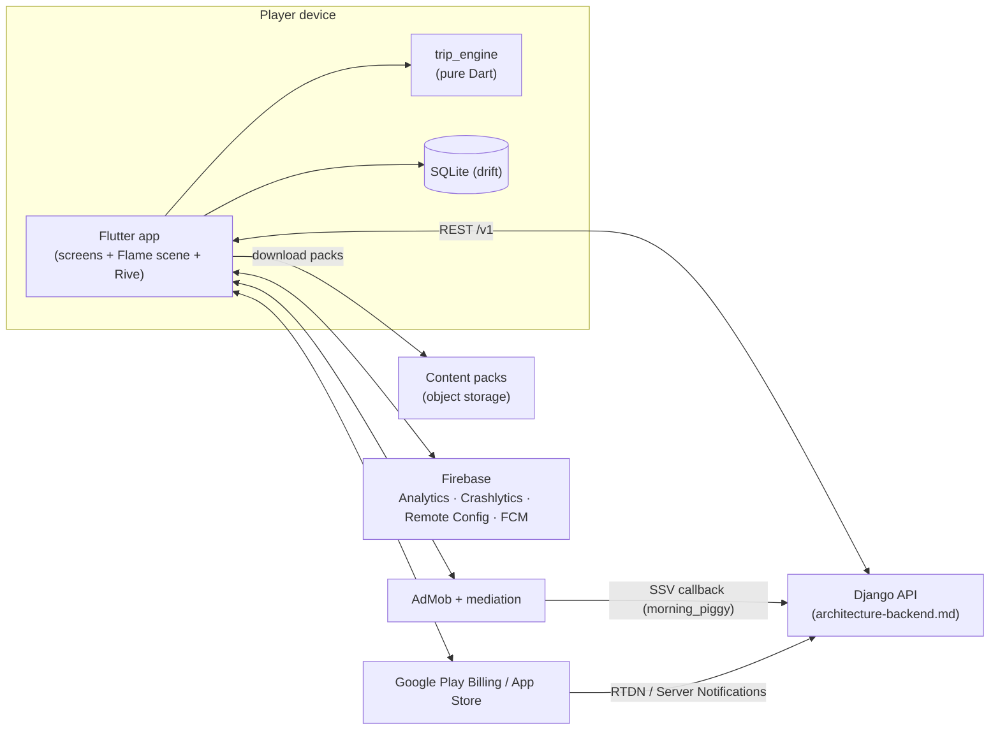
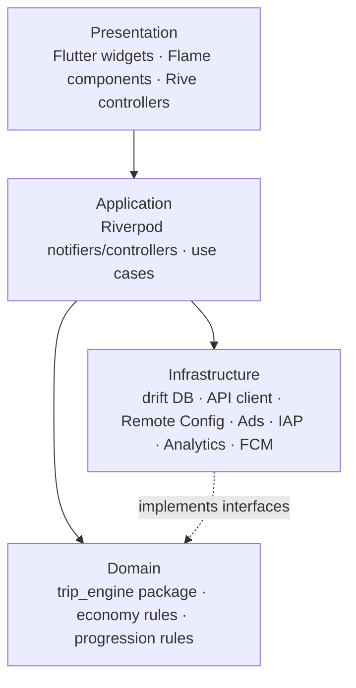
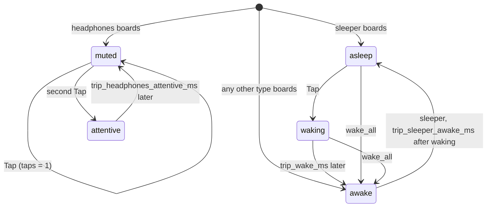
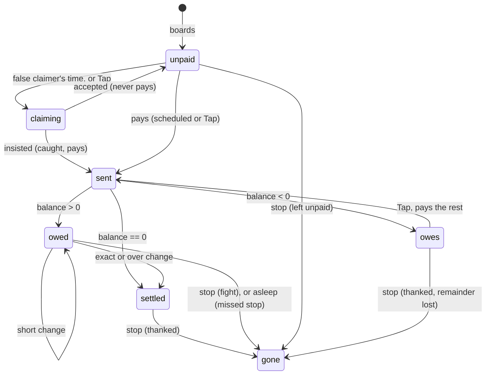

# Wassal El-Ogra — Mobile Architecture

| Field | Value |
| --- | --- |
| Product | وصّل الأجرة (code name: `wassal`) |
| Document | Mobile client architecture (Flutter) |
| Companion | [`architecture-backend.md`](./architecture-backend.md) — read both together |
| Product spec | `docs/product-spec.md` (export of the product & business doc) |
| UX spec | `docs/ux-spec.md` (export of the UI/UX doc) |
| Status | Draft v1 for `/speckit.plan` |
| Date | 2026-10-17 |

---

## 0. How to use this document with spec-kit

1. Export the product doc and the UX doc to Markdown and place them at `docs/product-spec.md` and `docs/ux-spec.md`. They are the **what/why** input for `/speckit.specify`.
2. Use §18 (*Engineering Principles*) of this document and §17 of the backend document as the seed for `/speckit.constitution`. The two lists are numbered identically on purpose.
3. Create one spec per feature listed in §23 (mobile) and backend §20. Each feature ID (`M01`…, `B01`…) is meant to become one `specs/NNN-*` folder.
4. When running `/speckit.plan` for a feature, give the agent both architecture documents as context. Technical Context (§2), Project Structure (§5), data model (§7, §11) and contracts (§3, backend §6) map directly to `plan.md`, `data-model.md` and `contracts/`.
5. Items marked **NEEDS CLARIFICATION** must be resolved in `research.md` before tasks are generated. They are collected in §24.

---

## 1. Summary

The mobile app is a portrait, one-handed, offline-first casual puzzle game for Android first and iOS second. The player is a microbus driver who collects fares, returns exact change before each passenger's stop, and saves money to furnish an apartment and get married.

The client is built as **Flutter** for all screens, **Flame** for the trip scene, and **Rive** for expressive characters. All gameplay rules live in a **pure-Dart trip engine package** with no Flutter dependency, so the same rules can be unit-tested, replayed deterministically, and checked for parity against the backend's Python solver.

The backend (see [`architecture-backend.md`](./architecture-backend.md)) is authoritative for identity, premium currency, purchases, content packs and the daily challenge. The client is authoritative for moment-to-moment gameplay and can play every regular trip offline.

---

## 2. Technical Context

| Field | Value |
| --- | --- |
| Language/Version | Dart 3.x, Flutter stable channel. Exact version pinned at kickoff with FVM (`.fvmrc`). |
| Primary dependencies | `flame` (trip scene), `rive` (character animation, 0.14 with `rive_native`) drawn in the scene by `flame_rive`, `flutter_riverpod` + `riverpod_generator` (state), `go_router` (navigation), `freezed` + `json_serializable` (models), `drift` (SQLite persistence), `flutter_secure_storage` (tokens), `dio` (HTTP), `google_mobile_ads` + AdMob mediation adapters, `in_app_purchase`, `firebase_core`, `firebase_analytics`, `firebase_crashlytics`, `firebase_remote_config`, `firebase_messaging`, `flutter_local_notifications`, `google_sign_in`, `sign_in_with_apple`, `share_plus`, `flutter_localizations` + `intl`, `flame_audio`. Tests add `flame_test` (M02). |
| Storage | Local SQLite via `drift` (game state, ledger, sync queue, content cache). Secure storage for auth tokens. Bundled assets for the initial content pack. |
| Testing | `test` for the pure-Dart engine, `flutter_test` + golden tests for widgets, `integration_test` for end-to-end trip flows, shared JSON fixtures for engine ↔ solver parity |
| Target platform | Android first (minSdk 24, targetSdk 36), iOS second (iOS 15.0). Portrait only. Decided in M03: `specs/001-m03-app-shell/research.md` R1. |
| Project type | Mobile app + reusable pure-Dart package inside a monorepo that also holds the backend |
| Performance goals | 60 fps in the trip scene on the reference low-end device, a Samsung Galaxy A06 (4 GB RAM, Helio G85); cold start to Home < 3 s on that device; first trip playable < 20 s after install-first-open (product requirement) |
| Constraints | Arabic RTL everywhere; Arabic-Indic digits by default with a Western-digits setting; offline play for regular trips; no ads during a trip; no LLM calls at runtime; minimum on-screen sizes from UX doc §"الأحجام الدنيا" |
| Scale/Scope | MVP: 2 lines (≈50 trips), 2 vehicles, story chapters 1–4, ~11 screens + overlays. Full scope: 5 lines (≈140 trips), 4 vehicles, 7 chapters, ≈20 screens. |

---

## 3. Shared Contract Glossary

> **This section is identical in `architecture-mobile.md` §3 and `architecture-backend.md` §3. Change both together.** Every identifier below is used in code, content files, analytics and API payloads.

### 3.1 Money and currencies

| Concept | Identifier | Rule |
| --- | --- | --- |
| Cash amounts inside a trip (fares, change, tray) | `piasters` (integer) | 1 EGP = 100 piasters. Smallest coin is 50 (نص جنيه). Floats are forbidden for money. |
| Soft currency «الجنيهات» | `JENEHAT` | Integer. Earned from trips. Spent on apartment items, vehicles, vehicle upgrades. Never sold for real money. |
| Premium currency «البونات» | `BONAT` | Integer. Earned in small amounts, bought with real money. Spent on fuel, boosters, revive, cosmetics. |
| Energy «البنزين» | `FUEL` | Integer liters, `0..fuel_max` (5; 7 with subscription). +1 every 20 minutes. 1 per trip start. |

### 3.2 Denominations (`denomination`, piasters)

`50, 100, 500, 1000, 2000, 5000, 10000, 20000` (نص، ١، ٥، ١٠، ٢٠، ٥٠، ١٠٠، ٢٠٠)

### 3.3 Boosters (`booster_id`)

| `booster_id` | Arabic name | Effect | Price |
| --- | --- | --- | --- |
| `change_bag` | كيس فكة | Adds 50×2, 100×3, 500×2 to the tray | 10 BONAT |
| `wake_all` | صحّي النايم | Wakes every sleeping passenger | 8 BONAT |
| `ledger_peek` | الدفتر | Shows paid/unpaid badges for 10 s | 12 BONAT |
| `traffic_jam` | زحمة | +10 s to the next station | 8 BONAT or rewarded ad |
| `revive` | صالح الراكب | Continue a failed trip at 40% reputation | 20 BONAT or rewarded ad |
| `refuel_full` | تفويلة كاملة | Fuel to max | 30 BONAT or rewarded ad |
| `fuel_unlimited_1h` | بنزين مفتوح | No fuel cost for 60 min | 80 BONAT |

### 3.4 Ad placements (`ad_placement`)

| `ad_placement` | Type | Reward | Cap |
| --- | --- | --- | --- |
| `result_double` | rewarded | ×2 trip JENEHAT | 1 per trip |
| `fuel_refill` | rewarded | `refuel_full` | 3 per day |
| `trip_revive` | rewarded | `revive` | 1 per trip |
| `traffic_jam` | rewarded | `traffic_jam` | 1 per trip |
| `morning_piggy` | rewarded | JENEHAT + BONAT (server-verified) | 1 per day |
| `interstitial_between_trips` | interstitial | none | every 3 trips, never in the first 10 trips, never right after a rewarded ad, never for `remove_ads` or subscribers |

### 3.5 Store products (`product_id`)

`bonat_pack_s`, `bonat_pack_m`, `bonat_pack_l` (consumable) · `starter_pack` (non-consumable, phase 2, offered once after chapter 1 and kept in the shop until day 7) · `remove_ads` (non-consumable) · `sub_ostaz_weekly`, `sub_ostaz_monthly` (auto-renewing) · `season_pass_<season_key>` (non-consumable per season)

### 3.6 Content identifiers

| Kind | Format / values |
| --- | --- |
| `line_id` | `line_hay`, `line_gamaa`, `line_souq`, `line_masyaf`, `line_safar` |
| `vehicle_id` | `tuktuk`, `micro_old`, `micro_new`, `micro_safar` |
| `trip_id` | `<line_id>.<nn>`, e.g. `line_gamaa.12` |
| `station_id` | lowercase slug unique within a line, e.g. `kobri`, `mostashfa`, `gamaa` |
| `archetype` (passenger behavior) | `regular`, `hajja`, `sleeper`, `hurry`, `big_note`, `student`, `headphones`, `false_claimer`, `group_payer`, `chatty`, `money_changer`, `bags_lady`, `dodger`, `mother_kids`, `big_family`, `traveler`, `regular_customer`, `honest` |
| `skin` (passenger look) | free slug referencing a Rive artboard, e.g. `effendi_suit`, `student_cap` |
| `chapter_id` | `ch1_first_job`, `ch2_her_father`, `ch3_shabka`, `ch4_salon`, `ch5_kitchen`, `ch6_bedroom`, `ch7_wedding` |
| `room_id` / `item_id` | `salon`, `kitchen`, `bedroom` / `<room_id>.<slug>`, e.g. `salon.nish` |
| `event_id` (in-trip) | `bump`, `traffic`, `open_road`, `fare_increase`, `drop_me_here`, `payment_dispute`, `change_request`, `roadside_pickup` |

### 3.7 API conventions

- Base URL `https://api.<domain>/v1`, JSON, UTF-8.
- Auth: `Authorization: Bearer <access_jwt>`; refresh via `/v1/auth/refresh`.
- Every request sends `X-Client-Version` and `X-Platform` (`android` | `ios`).
- Every state-changing operation carries a client-generated `client_txn_id` (UUIDv7) and is idempotent on the server.
- Server time is authoritative. The client stores `server_time_offset` from `/v1/bootstrap`.
- The full endpoint list and payloads live in backend §6.

---

## 4. System Context



| External | Used for | Owner of truth |
| --- | --- | --- |
| Django API | identity, sync, BONAT, purchases, entitlements, daily challenge, content manifest | backend |
| Content packs | trips, lines, items, chapters, speech pools | backend (published), client (cached) |
| Firebase Remote Config | tuning numbers (speeds, caps, prices shown in UI) | Firebase console |
| Firebase Analytics / Crashlytics | KPIs and crashes | Firebase |
| AdMob | ads and mediation | AdMob |
| Play / App Store | payments | stores, verified by backend |

---

## 5. Repository & Project Structure

Monorepo, so engine fixtures, content schemas and contracts stay in one place for both client and server.

```text
wassal/
├── apps/
│   └── mobile/                     # Flutter app (this document)
│       ├── lib/
│       │   ├── main.dart
│       │   ├── bootstrap/          # app start, flavors, DI overrides
│       │   ├── core/
│       │   │   ├── routing/        # go_router config (§9)
│       │   │   ├── theme/          # tokens from UX doc «النظام البصري»
│       │   │   ├── l10n/           # ARB files, digit formatting
│       │   │   ├── network/        # dio client, API base per flavor (M04); auth interceptor, API DTOs
│       │   │   ├── storage/        # drift database, DAOs
│       │   │   ├── sync/           # sync queue + reconciler (§12)
│       │   │   ├── economy/        # wallet, ledger, fuel (§13)
│       │   │   ├── content/        # pack decoder, store, updater, switch at Home (§14.1)
│       │   │   │   └── domain/     # ContentSource: how features read content (no Flutter imports)
│       │   │   ├── config/         # Remote Config wrapper + defaults
│       │   │   ├── ads/            # AdsGateway (§15)
│       │   │   ├── iap/            # PurchaseGateway (§15)
│       │   │   ├── analytics/      # event taxonomy (§17)
│       │   │   ├── notifications/  # FCM + local notifications
│       │   │   └── audio_haptics/
│       │   └── features/
│       │       ├── onboarding/     # loading, intro comic, name, tutorial overlays
│       │       ├── home/           # الموقف
│       │       ├── pre_trip/       # كارت ما قبل المشوار
│       │       ├── trip/           # trip screen: Flame scene + HUD + dashboard
│       │       ├── result/
│       │       ├── lines/          # lines map, line detail, vehicle purchase
│       │       ├── garage/         # upgrades + cosmetics (phase 2)
│       │       ├── apartment/      # rooms, item sheet, requests, chapters
│       │       ├── story/          # comic scene viewer, album
│       │       ├── shop/           # shop, fuel sheet, starter pack (phase 2)
│       │       ├── daily/          # daily reward, tasks, daily challenge
│       │       ├── leagues/        # ملك الخط (public launch)
│       │       ├── events/         # seasonal events + season pass (public launch)
│       │       └── settings/       # settings, account, referral, welcome back
│       ├── assets/
│       │   ├── content/            # bundled pack: dev/ (the sample), release/ (content/source)
│       │   ├── rive/               # *.riv characters, UI animations
│       │   ├── audio/
│       │   └── fonts/
│       ├── test/  integration_test/
│       └── pubspec.yaml
├── packages/
│   ├── trip_engine/                # pure Dart, no Flutter imports (§7)
│   │   ├── lib/  test/
│   └── content_models/             # freezed models GENERATED from content/schemas (never hand-edited)
├── backend/                        # Django project (architecture-backend.md)
├── contracts/
│   └── openapi.yaml                # API contract generated by the backend (backend §6)
├── tools/
│   ├── content_kit/                # Python `wassal-content`: codegen, validation, canonical packs
│   └── solver/                     # Python solver/simulator (backend §10)
├── content/
│   ├── schemas/                    # JSON Schemas, one per pack part (backend §9.2)
│   ├── examples/                   # valid/invalid documents, the sample pack and its golden
│   └── source/                     # exports of the packs promoted to production
├── fixtures/
│   └── parity/                     # shared engine ↔ solver fixtures (§7.10)
└── docs/
    ├── product-spec.md  ux-spec.md
    ├── architecture-mobile.md  architecture-backend.md
```

---

## 6. Layered Architecture



Rules:

- **Domain** never imports Flutter, Flame, Firebase or any plugin. It exposes interfaces (`Clock`, `Random`, `ContentSource`) that infrastructure implements.
- **Presentation** never mutates game state directly. It sends commands and renders state/events.
- **Infrastructure** wraps every plugin behind an interface (`AdsGateway`, `PurchaseGateway`, `AnalyticsSink`, `ApiClient`, `ConfigSource`) so features can be tested with fakes.

---

## 7. Trip Engine (`packages/trip_engine`)

### 7.1 Responsibilities

Everything that decides the outcome of a trip: fares, tray, hand, passing chain, passenger behavior, stations, events, reputation, stars and earnings. The engine is deterministic for a given `(TripDefinition, seed, difficulty params, command log)`.

### 7.2 Core types

The full field lists are in M01's [data-model.md](../specs/004-m01-trip-engine/data-model.md), and the Dart surface is in [engine-api.md](../specs/004-m01-trip-engine/contracts/engine-api.md). Every amount is integer piasters, every time is integer milliseconds, and every value is immutable.

| Type | Key fields |
| --- | --- |
| `TripDefinition` | `trip_id`, `rev`, `kind`, `line_id`, `vehicle_id`, `seed`, `stations[] {station_id, at_seconds, fare_piasters}`, `seats[]`, `passengers[]`, `events[]`, `initial_tray {denomination: count}`, `rules {student_discount_pct, bag_fare_piasters, child_free_age, max_break_requests, no_fights_required}`, `star_rules`, `max_earnings_jenehat`. Generated from `content/schemas/trip.schema.json` (owned by backend §9) into `packages/content_models`; the engine never redefines it. |
| `PassengerSpec` | `passenger_id`, `archetype`, `skin`, `seat_id`, `dest_station_id`, `board_station_id?`, `pays_at_seconds?`, `payment [denominations]`, `group_id?`, `group_size?`, `speech_keys? {slot: key}` |
| `Seat` | `seat_id`, `row` (`front`, `A`, `B`, `C`, `D`), `col` (`r`, `m`, `l`), `reachable_by_driver` (bool) |
| `TripParams` | One integer per rule number, keyed by tunable name (§14.3), with `trip_hop_ms_<line_id>` written as `trip_hop_ms`. Built with `TripParams.fromTunables(values, line)`. There are no defaults in code. |
| `TripState` | `t_ms`, `status` (`running`, `paused`, `failed`, `finished`, `abandoned`), `reputation 0..100`, `tray`, `hand`, `passengers[]`, `tokens[]`, `schedule[]` (stations with their shifted `at_ms`), the open choices (`claims`, `disputes`, `change_requests`, `pending_breaks`), `counters {fights, lost_fares, missed_stops, impatient, caught_liars, tips_piasters, overpaid_piasters}`, `mistakes[]`, `reputation_lost {cause: int}`, `boosters_used[]`, `revived`, `revivable`, `prng`, `result?` |
| `PassengerState` | `presence` (`waiting`, `aboard`, `gone`), `alertness` (`asleep`, `waking`, `awake`, `muted`, `attentive`), `fare_sent`, `fare_piasters`, `balance` (> 0 owed change, < 0 owes the driver), `paid_in`, `patience_ms`, `impatient`, `deadline_ms?`, `outcome?` |
| `MoneyToken` | `token_id`, `kind` (`fare`, `change`, `return`, `redirect`, `break_out`, `break_in`), `pieces`, `owner`, `target`, `holder` (`DRIVER` or a passenger id), `hop? {to, elapsed_ms, duration_ms}`, `hops_done`, `blocked_by?`, `dropped_until_ms?` |
| `TripResult` | `trip_id`, `rev`, `outcome` (`finished`, `failed`, `abandoned`), `stars 0..3`, `star_flags {reached, no_fights, no_mistakes}`, `fares_collected_piasters`, `overpaid_piasters`, `tips_piasters`, `earnings_jenehat`, `fights`, `lost_fares`, `missed_stops`, `impatient`, `caught_liars`, `mistakes[] {passenger_id, kind, amount_piasters}` (`kind`: `over`, `not_owed`, `unreturned`), `reputation`, `reputation_lost`, `duration_ms`, `boosters_used[]`, `revived` (bool), `command_log_hash` |
| `ReplayRecord` | `definition`, `seed`, `params`, `command_log`, `t_ms` (§7.10, §10) |

### 7.3 Simulation loop

- Fixed logic step of **33 ms** (≈30 Hz), independent of render frame rate. The scene interpolates between steps (`MoneyToken.progressPermille`).
- Each step, in this order: advance the clock → timers (waking, falling asleep, attentive ending, ledger peek ending, dropped money lost, breaks completing) → authored events → scheduled payments → tokens hop by hop → patience → station warning → `drop_me_here` deadlines and stations → failure check → end check. The exact order is [RULES.md](../packages/trip_engine/RULES.md) §3.
- `TripEngine` is the only stateful object: `start`, `rebuild`, `step`, `stepTo`, `apply`, `pause` and `resume`. It has no async API, and it never throws during `step` or `apply`: invalid commands are rejected.
- `pause()` freezes `t_ms`; the app calls it on lifecycle `paused` and on any overlay.

### 7.4 Commands (player intents)

13 commands. Each one applies at the current clock, between steps. A rejected command returns a `Rejection {code, message}` and changes nothing; the message is English and for developers, and player text comes from the ARB file keyed by the code. At most 1,200 commands are accepted per trip, except `Abandon`, which is always accepted so the player can leave.

| Command | Meaning |
| --- | --- |
| `PickFromTray(denomination)` | Move one piece from the tray to the hand |
| `ReturnHand()` | Move the hand back to the tray |
| `SendHand(passenger_id)` | Send the hand as a `change` token along the chain to that passenger |
| `UndoLastSend()` | Take the last send back while `trip_undo_window_ms` lasts and its first hop hasn't finished |
| `Tap(passenger_id)` | Context action: wake a sleeper, call headphones (2 taps), ask for the fare or the rest, or raise «أنا دافع!» on someone who has paid. A tap on a group member acts on the payer |
| `ResolveClaim(passenger_id, insist: bool)` | Answer to «أنا دافع!» |
| `ResolveDispute(dispute_id, paid_passenger_id)` | Answer to a `payment_dispute`: which of the two has paid |
| `ResolveChangeRequest(passenger_id, agree: bool)` | Answer to a `change_request` (break a passenger's note from the tray) |
| `RequestBreak(denomination)` | «حد معاه فكة؟»: a note of at least `trip_break_min_piasters` comes back broken after `trip_break_delay_ms`, at most `rules.max_break_requests` times per trip |
| `CollectDropped(token_id)` | Pick up money dropped by a `bump`, within `trip_bump_collect_ms` |
| `UseBooster(booster_id)` | `change_bag`, `wake_all`, `ledger_peek`, `traffic_jam` (at most `booster_traffic_jam_max_per_trip` times) |
| `Revive()` | After `failed`, once: reputation becomes `rep_revive_to` and the trip resumes. Not after a fight in a `no_fights_required` trip |
| `Abandon()` | Ends the trip as `abandoned` |

`ResolveClaim`, `ResolveDispute`, `ResolveChangeRequest` and `UseBooster` are also accepted while paused, because they are answered from an overlay.

### 7.5 Domain events (engine → UI/analytics)

Every `step` and accepted command returns the events it produced, in order. Payloads are in [engine-api.md](../specs/004-m01-trip-engine/contracts/engine-api.md).

- **Passengers:** `PassengerBoarded`, `PassengerSpeaks {passenger_id, slot, speech_key, variant, amount_piasters?, station_id?}`, `PassengerWaking`, `PassengerWoke`, `PassengerFellAsleep`, `PassengerCalled`, `PassengerAttentive`, `PassengerMuted`, `PatienceRanOut`, `StopChanged`, `PassengerAlighted {outcome: thanked|fight|missed_stop|left_unpaid}`.
- **Money:** `FareSent`, `ChangeSent`, `SendUndone`, `TokenHopStarted`, `TokenBlocked {by}`, `TokenUnblocked`, `MoneyArrivedAtDriver`, `ChangeDelivered {result: exact|short|over|not_owed}`, `ExcessReturned`, `MoneyDropped`, `DroppedCollected`, `DroppedLost`, `BreakRequested`, `BreakCompleted`.
- **Choices:** `ClaimRaised`, `ClaimAccepted`, `LiarCaught`, `FalseAccusation`, `DisputeRaised`, `DisputeResolved`, `ChangeRequestRaised`, `ChangeRequestResolved`, `ChangeRequestCompleted`.
- **Trip:** `EventStarted {event_id}`, `EventSkipped`, `FareIncreased`, `ScheduleShifted`, `StationWarning {alighting, owed}`, `StationReached`, `ReputationChanged {delta, cause, value}`, `MistakeMade`, `BoosterUsed`, `LedgerPeekStarted`, `LedgerPeekEnded`, `TripFailed`, `TripRevived`, `TripFinished {TripResult}`, `TripAbandoned {TripResult}`.

The engine never contains Arabic text. It emits `speech_key` values and a seeded `variant`; the app resolves them to localized lines from the content pack's speech pools (§14). Some events, such as `FareSent`, reveal who has paid. The engine reports them anyway, and M02 decides what to show (the ux-spec's «اللاعب يفتكر، والشاشة ما تفضحش» is presentation).

### 7.6 Passenger state machines

Alertness:



Fare and balance:



A passenger is *able* when aboard and `awake` or `attentive`. Only able passengers pay on schedule and pass money on.

### 7.7 Money flow & chain routing rules

A summary. The exact rules are [RULES.md](../packages/trip_engine/RULES.md) §5 and §6.

- Seats in rows `front` and `A` are one hop from the driver. Rows behind pass money seat by seat in the same column toward the driver, and back the same way. Empty seats are skipped.
- A hop starts only when both its holder and the next holder are the driver or able. Otherwise the token waits, blocked by whichever of them isn't able (`TokenBlocked`).
- Hop duration is `trip_hop_ms_<line_id>`, scaled by `trip_hop_pct_hajja` out of a `hajja`'s seat and by `trip_hop_pct_chatty_row` out of a row holding an able `chatty` passenger.
- A `change` token to a non-payer member of a group is redirected to the group's payer in one hop of `trip_group_redirect_hop_ms`.
- Delivery: `exact` settles and raises reputation; `short` lowers the balance and costs `rep_short_change`, but isn't a mistake; `over` is a mistake; change to a passenger who isn't owed is a `not_owed` mistake. `honest` passengers send any excess back as a `return` token; anyone else keeps it (`overpaid_piasters`).
- When a passenger gets off, every token they hold or that is heading to them is handed on: a fare goes to the driver, anything else into the tray. At the end of the trip, money still moving settles the same way, and dropped money is lost.

### 7.8 Scoring

The penalties and gains are tunables (defaults in §14.3). The exact rules are [RULES.md](../packages/trip_engine/RULES.md) §9 to §11.

| Rule | Effect |
| --- | --- |
| Fight at the stop (still owed change) | reputation −`rep_fight`, `fights++`, an `unreturned` mistake |
| False accusation | reputation −`rep_false_accusation`, `fights++` |
| Missed stop (asleep or waking at the stop) | reputation −`rep_missed_stop` |
| Short change, patience run out, change request declined | reputation −`rep_short_change`, −`rep_impatient`, −`rep_change_request_declined` |
| Liar caught, exact change | reputation +`rep_liar_caught`, +`rep_exact_change` (cap 100) |
| Fail | reputation ≤ 0, or any fight in a `no_fights_required` trip → `TripFailed` |
| Stars | 0 unless finished; 1 = finished; 2 = and `fights == 0`; 3 = and no mistakes |
| Earnings | `fares_collected − overpaid_piasters + tips`, floored at 0, converted to `JENEHAT` per whole pound and capped by `max_earnings_jenehat`; 0 unless finished |

### 7.9 Difficulty parameters

Per line, from Remote Config (§14.3): `trip_hop_ms_<line_id>` (1300 / 1100 / 900 ms), `trip_bubble_min_ms_<line_id>` (4500 / 4000 / 3500 ms) and `trip_hints_mode_<line_id>` (`always` for `line_hay`, `first_time` for `line_gamaa`, `off` for the rest). Values from the UX doc «الصعوبة والمساعدة حسب الخط». Only the hop length reaches the engine; bubbles and hints are presentation, read by M02, and are not part of the replay tuple.

### 7.10 Determinism, replay & parity with the solver

- All randomness comes from a seeded PRNG (`xorshift32`, seed in `TripDefinition` or from the daily challenge).
- The engine records the command log with logic-step timestamps. `(definition, seed, params, log)` replays to the same `TripResult`.
- **Parity contract with the backend solver:** `fixtures/parity/*.json` contains `{definition, seed, params, command_log, expected_result}`. Both `packages/trip_engine` (Dart test) and `tools/solver` (pytest) must reproduce `expected_result` exactly. CI fails on any mismatch, and both suites are required: the Dart `packages` job of `mobile.yml` and the `solver` job of `backend.yml` (`wassal-solver parity`). A rule change edits `packages/trip_engine/RULES.md`, both engines and the affected fixtures in the same PR. See backend §10. The solver's 3-star runs of the sample trips are fixtures too (`solver__*`), pinned by `test/fixtures/expectations/solver.dart`. The fixtures and the `tool/fixtures.dart` check, update and show commands are in M01's [replay-and-fixtures.md](../specs/004-m01-trip-engine/contracts/replay-and-fixtures.md).
- **The replay record** `{definition, seed, params, command_log, t_ms}` is the same tuple plus the clock it reached. It is the trip's checkpoint (§10).

---

## 8. Trip Scene Rendering

| Layer | Technology | Content |
| --- | --- | --- |
| Scene | Flame `GameWidget` filling the scene band. Scene coordinates are screen points: one world unit is one logical point, with no fixed resolution, so no letterboxing and every minimum size is measured in points. One pure function, `SceneLayout`, gives every seat's rectangle, face, token and bubble anchors to the Flame components and the Flutter overlays alike (M02 [research R3](../specs/008-m02-trip-screen/research.md#r3-the-scene-its-coordinates-and-flames-role)). | cabin, windows with their street, benches, passengers, driver's hand, effects (shake, glints). Flame draws only; it handles no touch and draws no text. |
| Characters | One Rive file (`assets/rive/passenger.riv`), one artboard instance per passenger, drawn by `flame_rive` with `Factory.flutter` (the only factory that works inside Flame and in Linux `flutter test`). States through data binding: view-model properties `mood` (0 calm → 3 angry), `talking`, `asleep`, `headphones`, `alight`, `shirt`, `accessory` ([contracts/rive-character.md](../specs/008-m02-trip-screen/contracts/rive-character.md)) | driven from the trip view each step; a stand-in drawing until the file exists |
| Touch and text overlays | Flutter widgets in a `Stack` over the `GameWidget`, positioned from `SceneLayout` | passenger hit areas, money tokens with their amounts (moved by a `Flow`), dropped notes, choice answers, bubbles, ledger badges, hints, banners (Arabic shaping, semantics and test finders) |
| HUD & dashboard | Flutter widgets | top bar, station strip, hand, tray, «حد معاه فكة؟», boosters, «آخر كلام» log |

Rules from the UX doc that the renderer must enforce:

- Back-row face ≥ 50 pt wide, near-row face ≥ 80 pt, bubble text ≥ 15 pt after scaling, money token ≥ 40×24 pt, touch targets ≥ 44×44 pt. Every minimum holds from 744 pt of screen height; below that only the faces shrink, until M07's short-screen layout (M02 [research R15](../specs/008-m02-trip-screen/research.md#r15-layout-screen-sizes-and-text-scale)).
- At most 2 bubbles visible; others queue. Bubble duration ≥ `trip_bubble_min_ms_<line_id>`.
- Bubbles are clamped inside the scene bounds; the tail points to the speaker.
- Reduced-motion setting disables shake and bubble pop.

---

## 9. App Screens & Navigation

`go_router` with a shell route for the bottom navigation (Home, Lines, Apartment, Shop). Trip and overlays are full-screen routes outside the shell.

| Route | Screen (UX doc section) | Phase |
| --- | --- | --- |
| `/boot` | Loading | MVP |
| `/onboarding/intro`, `/onboarding/name` | Intro comic, driver name | MVP |
| `/home` | الموقف | MVP |
| `/home/pre-trip/:tripId` (sheet) | كارت ما قبل المشوار | MVP |
| `/trip/:tripId` | شاشة المشوار (+ pause, fail overlays) | MVP |
| `/trip/:tripId/result` | النتيجة | MVP |
| `/lines`, `/lines/:lineId` (sheet) | الخطوط, تفاصيل الخط | MVP |
| `/lines/vehicle/:vehicleId` (sheet) | شراء العربية | MVP |
| `/garage` | الجراج | Phase 2 |
| `/apartment`, `/apartment/item/:itemId` (sheet), `/apartment/requests` (sheet), `/apartment/chapters` | الشقة, لوح القطعة, الطلبات, خط الفصول | MVP (ch1–4) |
| `/story/:chapterId` | عارض المشاهد | MVP |
| `/shop`, `/shop/fuel` (sheet) | المحل, نافذة البنزين | MVP |
| `/daily/reward`, `/daily/tasks`, `/daily/challenge` | الرجوع اليومي | MVP |
| `/leagues` | ملك الخط | Public launch |
| `/events/:seasonKey` | المناسبات + تذكرة الموسم | Public launch |
| `/settings`, `/settings/account`, `/settings/referral` | الإعدادات, الحساب, ادعي صاحبك | MVP (referral: public launch) |

Global rules: back button top-right; Android system back on the trip route opens the pause overlay; sheets dismiss by swipe-down.

---

## 10. State Management

- Riverpod providers per feature; `AsyncNotifier` for anything backed by DB/API.
- `TripController` (M02, `lib/features/trip/application/`) owns one `TripEngine` instance, steps it at 33 ms from the frame clock, exposes a `TripModel` (its phase plus `TripView`, a render-friendly projection) and a stream of cues (sound, vibration, shake, words), and forwards commands. It saves the trip's replay record on every accepted command and every pause, and the replay record is the checkpoint: a killed app rebuilds the trip exactly where it was left with `TripEngine.rebuild`, paused, and fuel is untouched ([M01 research R10](../specs/004-m01-trip-engine/research.md#r10-the-replay-record-and-resuming-resolves-mobile-244)).
- The record lives in three drift tables of the app database, written only by `DriftTripRecords`: `trip_record` (one per start, keyed by the economy's start id), `trip_record_command` (append-only) and `trip_intent`, the outbox of economy calls that must survive a kill (a booster use is applied to the engine and written with its intent in one transaction, then charged, then the intent is deleted). See [M02 research R6, R7](../specs/008-m02-trip-screen/research.md#r6-the-trips-record-on-disk) and [contracts/trip-controller.md](../specs/008-m02-trip-screen/contracts/trip-controller.md).
- Cross-feature state (wallet, fuel, entitlements, progression) lives in `core/economy` and `core/sync` providers, backed by drift streams.

---

## 11. Local Persistence & Offline

`drift` schema in one SQLite file, `<app support>/db/wassal.sqlite`, opened during startup on its own isolate with WAL and `synchronous = FULL`. Device backup leaves the file out (Android `dataExtractionRules` and `fullBackupContent`), so a restore never brings back a ledger the server has moved past. The app refuses a file from a newer schema and never deletes or recreates it. Every column is INTEGER or TEXT: money is never REAL (constitution II).

M05 created the economy's eight tables (`specs/007-m05-local-economy/data-model.md`); the others arrive with their features.

| Table | Purpose |
| --- | --- |
| `profile` | `player_id?`, `local_id`, `display_name`, `driver_level`, settings JSON |
| `wallet` | one row: `jenehat`, `bonat`, `fuel`, `fuel_counted_from_ms`, `fuel_unlimited_until_ms`, `last_seq` (M05) |
| `ledger_ops` | append-only, one row per applied operation (M05): `seq`, `txn_id` (UUIDv7, unique), `op_type`, the wire `payload` as canonical JSON, `jenehat_delta`, `bonat_delta`, `fuel_delta`, `reason`, `ref`, the trusted `occurred_at_ms`, `content_version`, the fuel tunables it applied with (`fuel_max`, `fuel_regen_minutes`), a start's `max_earnings_jenehat`, and `sync_status` / `sync_reason`, the only columns that ever change |
| `inventory` | `booster_id`, `count` (M05) |
| `trip_progress` | `trip_id`, `best_stars`, `best_time_ms`, `plays`, `first_completed_at_ms` (M05) |
| `ownership` | `kind` (`item`, `vehicle`, `chapter`), `sku_id`, the chosen style as `variant_id`, `acquired_at_ms`, `acquired_by` (M05); upgrades and cosmetics later |
| `trip_session` | one row: the unfinished trip and the last result, which a ×2 or a revive needs (M05) |
| `projection_base` | one row: the state the projection folds from, the new player or (M06) the server's snapshot, with the last `seq` it includes (M05) |
| `clock_anchor` | one row: the trusted-time anchor (§13) and the latest trusted time handed out (M05) |
| `story_state` | `chapter_id`, `status`, scenes unlocked, family requests status |
| `daily_state` | login streak, tasks, challenge attempts |
| `entitlements_cache` | `remove_ads`, `subscription_until`, `season_pass` keys |
| `content_cache` | installed pack versions and paths. Not a drift table: `state.json` in `<app support>/content/`, next to the stored packs (M04, `specs/006-m04-content-loader/data-model.md`), which M05 keeps as it is |
| `sync_queue` | pending API operations. The economy's pending operations are `ledger_ops` rows with `sync_status = pending` |

Offline policy:

| Feature | Offline |
| --- | --- |
| Regular trips, apartment purchases with JENEHAT, story scenes already downloaded | Works; synced later |
| Spending BONAT | Optimistic up to local balance; server may reject on sync (§12) |
| Buying with real money, daily challenge, leagues, rewarded ads, content updates | Requires network; UI shows «محتاج نت» |

---

## 12. Sync with Backend

Protocol owned by backend §7; the client side:

1. On launch (and on network regain): `GET /v1/bootstrap` → profile, wallet snapshot, entitlements, `server_time`, `content_version`, `state_version`.
2. Local changes are recorded as `ledger_ops` and progress deltas, each with a `client_txn_id`.
3. `POST /v1/sync` sends `{base_state_version, ops[]}` in batches of ≤ 100.
4. The response returns per-op `accepted | rejected(reason)` and the authoritative `wallet` and `state_version`.
5. Rejected ops are rolled back locally; the UI shows a neutral message only if a visible balance changed.
6. If `base_state_version` is stale (another device), the client pulls `GET /v1/state`, replaces local state, and re-applies still-pending ops.

A trip is sent as two ops: `trip_start` (fuel spend) and `trip_result` carrying the `TripResult` (§7.2). The server validates earnings against the trip's `max_earnings_jenehat`. The full op list (`ad_reward`, `spend_jenehat`, `spend_bonat`, `use_booster`, `claim_daily_reward`, `claim_task`, `story_progress`, `settings_update`) and validation rules are in backend §7.4.

---

## 13. Economy on the Client

The rules, the API and the storage contract are in `specs/007-m05-local-economy/contracts/`.

- **One service, one writer.** Every change goes through `EconomyService`, which validates a request against the current state, then stores the `ledger_ops` row and every row it changes in one transaction, and only then updates what screens read. Requests run one after the other. A request id seen before returns the stored outcome, so a double tap or a retry charges once. A full disk fails the request and changes nothing.
- **The projection is a fold.** The materialized tables equal the fold of `projection_base` and the stored operations after it. A rejection from the server rebuilds them by folding again: each operation still in play is checked again (balances, ownership, inventory, its trip) and left out when it no longer applies; fuel is lenient. Debug builds check the projection against the fold each time the database opens. Startup reads only the materialized tables, never the log.
- **Fuel.** `fuel_max` liters, one back every `fuel_regen_minutes`, counted from the start of the current countdown; at or above the maximum nothing counts. Every trip start costs a liter, replays included, unless an unlimited-fuel window runs. Each operation records the fuel tunables it applied with, so a fold gives the same fuel after Remote Config changes them. Exact rules: `contracts/fuel-and-time.md`, which B03 must agree with.
- **Trusted time** (constitution VI, as amended in 1.3.0). Time is an anchor advanced by the phone's monotonic uptime (`SystemClock.elapsedRealtime`, through the `wassal/clock` channel). The anchor is the last server time, or the device clock until there is one. The device clock is read only to take a new anchor, at the first open or after a restart while offline, and a new anchor never moves time back. Clock changes while the phone stays on have no effect. The server recomputes fuel, rewards and daily resets from its own clock, and its state replaces the client's on sync (M06).
- **Prices** (JENEHAT for items, vehicles and chapters; BONAT for boosters, fuel, revives and cosmetics) come from the active pack's catalog when the purchase applies, never from code or the caller. The kind decides the currency.
- **Rule from product doc:** BONAT can never be converted into JENEHAT in v1. No code path may do it: no device operation adds BONAT, and none spends BONAT and adds JENEHAT (`direction_test.dart` builds every one).

---

## 14. Content Delivery & Remote Config

### 14.1 Content packs

- A pack is a versioned, gzipped JSON bundle (trips, lines, vehicles, items, chapters, speech pools, catalog prices) defined by the schemas in `content/schemas/`. Format and publishing: backend §9.
- **What each build bundles.** Staging and prod ship the latest pack **production has promoted**, built from `content/source/` into `assets/content/release/` (never a staging-only pack, whose version production may never serve); Gradle's `checkBundledPack` stops their build until one is committed. Dev ships the sample (`content/examples/sample`, version 1) in `assets/content/dev/`.
- **When the app checks.** Until M06's sync takes it over, the app asks `GET /v1/content/manifest` itself: at launch, on resume and when the connection returns, at most once every 15 minutes. A newer pack downloads in the background and is stored as ready.
- **When it switches.** Only at launch or on arrival at Home, never during a trip. At launch it uses the newest pack that passes its checks, bundled or stored.
- **Caps.** The manifest is read up to 64 KiB, a download up to 16 MiB, and a pack decompresses up to 32 MiB.
- The loader, the store and the update rules: `specs/006-m04-content-loader/contracts/` (`loading.md`, `updates.md`, `bundling.md`, `content-source.md`).
- **Which pack the manifest offers.** The app sends `X-Client-Version` (`MAJOR.MINOR.PATCH`, any `+BUILD` ignored). An app at or above the current pack's `min_client_version` gets the current pack. An older app gets the newest published or retired pack whose minimum it meets, or `{"version": 0, "packs": []}` when there is none: it then keeps the pack it has, and B10's force update takes over. Pack URLs come only from the manifest, which builds them per response (backend §9, B04 contracts/api.md).
- **Verify before reading.** The manifest's `sha256` is the SHA-256 of the gzip file as served. The app checks the downloaded bytes against it (and against `size`) before it decompresses or parses anything, and decompresses with a size cap. A mismatch discards the file and keeps the current pack.
- `packages/content_models` holds the freezed models that `wassal-content codegen` generates from the JSON Schemas, so client and server never drift. Its `canonicalJson` gives the same canonical form as the backend (keys in UTF-16 code-unit order, no whitespace, integers only).

### 14.2 Speech pools

Speech pools map `speech_key` → list of Egyptian Arabic lines with placeholders (`{amount}`, `{station}`). The client picks lines deterministically with the trip seed. All lines are written and reviewed offline; there is no runtime text generation.

### 14.3 Remote Config keys (defaults bundled)

| Key | Default |
| --- | --- |
| `trip_hop_ms_<line_id>` | 1300 / 1100 / 900 |
| `trip_bubble_min_ms_<line_id>` | 4500 / 4000 / 3500 |
| `trip_hints_mode_<line_id>` (`off`, `first_time`, `always`) | `always` for `line_hay`, `first_time` for `line_gamaa`, `off` for the rest |
| `trip_undo_window_ms` | 1000 |
| `rep_fight`, `rep_false_accusation`, `rep_missed_stop`, `rep_liar_caught`, `rep_exact_change`, `rep_revive_to` | 30, 20, 15, 10, 3, 40 |
| `rep_short_change`, `rep_impatient`, `rep_change_request_declined` | 5, 5, 5 |
| `trip_station_warning_ms` | 8000 |
| `trip_hop_pct_hajja`, `trip_hop_pct_chatty_row`, `trip_group_redirect_hop_ms` | 200, 150, 600 |
| `trip_wake_ms`, `trip_sleeper_awake_ms`, `trip_headphones_attentive_ms` | 1000, 15000, 15000 |
| `trip_patience_ms`, `trip_patience_pct_hurry`, `trip_patience_drain_pct_traffic` | 20000, 50, 150 |
| `trip_bump_collect_ms` | 3000 |
| `trip_break_min_piasters`, `trip_break_delay_ms` | 1000, 1500 |
| `trip_tip_piasters_regular_customer` | 200 |
| `booster_ledger_peek_ms`, `booster_traffic_jam_ms`, `booster_traffic_jam_max_per_trip` | 10000, 10000, 3 (the last two at most 60000 and 5) |
| `fuel_max`, `fuel_max_subscriber`, `fuel_regen_minutes` | 5, 7, 20 |
| `ads_interstitial_every_n_trips`, `ads_interstitial_grace_trips`, `ads_fuel_refill_daily_cap` | 3, 10, 3 |
| `pre_trip_card_mode` | `always` |
| `notif_daily_max` | 2 |

---

## 15. Monetization: Ads & IAP

### 15.1 AdsGateway

- Wraps `google_mobile_ads`, mediation configured in the AdMob console (networks: **NEEDS CLARIFICATION**, candidates AppLovin, Meta Audience Network, Unity Ads, Liftoff).
- API: `preload(placement)`, `isReady(placement)`, `showRewarded(placement, {customData})`, `maybeShowInterstitial()`.
- Enforces §3.4 caps locally and via Remote Config; the trip route forbids any ad call while `TripState.status == running`.
- `morning_piggy` sets SSV options `userId = player_id` and `customData = {placement, nonce}` so the backend's SSV endpoint grants BONAT (backend §8.4). The app then polls `GET /v1/ads/rewards/{nonce}` (1 s, 2 s, 4 s); a late grant arrives with the next bootstrap. Other rewards are applied locally and sent as `ad_reward` sync ops (backend §7.4).
- Consent: Google UMP before the first ad request; iOS ATT prompt before personalized ads on iOS.

### 15.2 PurchaseGateway

1. Query products for §3.5 IDs from the store.
2. Start purchase → receive token/transaction.
3. `POST /v1/purchases/verify` → server verifies with Google/Apple and grants (backend §8).
4. Client completes/acknowledges the store transaction **only after** server success; refreshes wallet and entitlements.
5. Pending purchases are retried at launch; «استرجاع المشتريات» calls the store restore flow, then `/v1/purchases/verify` for each.
6. Subscriptions: status comes from `entitlements` in `/v1/bootstrap`, never from local state alone.

---

## 16. Identity, Notifications, Sharing

- **Identity:** first online launch calls `POST /v1/auth/anonymous` with a random install ID; tokens go to secure storage. Linking Google/Apple from Settings calls `POST /v1/auth/link`; on `409 provider_in_use` the app shows both progress summaries and lets the player choose which one to keep (backend §6.4). Accounts are never merged. Account deletion calls `DELETE /v1/account` (store requirement).
- **Notifications:** «البنزين اتملى» is a local scheduled notification. Daily challenge, Salma, league and comeback pushes come from the backend via FCM (backend §11). The device registers its token with `POST /v1/push-tokens`. The in-game pre-prompt runs before the OS prompt (UX doc).
- **Sharing:** MVP shares a rendered result image (`share_plus`). The 15-second auto clip is public-launch scope; it will reuse the command log replay (§7.10) to re-render the moment.

---

## 17. Analytics & Crash Reporting

Firebase Analytics event taxonomy (snake_case, ≤ 25 params). Every event carries `line_id` and `trip_id` when relevant.

| Event | Key params | KPI (product doc) |
| --- | --- | --- |
| `tutorial_step` | `step` 1..8 | First-session completion |
| `trip_start` | `line_id`, `trip_id`, `fuel_after`, `boosters_loaded` | Trips per player per day |
| `trip_end` | `stars`, `fights`, `mistakes`, `lost_fares`, `duration_ms`, `revived`, `earnings` | Line completion, difficulty tuning |
| `change_given` | `result` exact/short/over, `amount` | Difficulty tuning |
| `ad_offer_shown` / `ad_reward_granted` | `ad_placement` | Rewarded-ad rate |
| `ad_interstitial_shown` | — | Ad load |
| `iap_view` / `iap_purchase` | `product_id`, `price_tier` | Payer rate |
| `fuel_empty` | `choice` ad/bonat/wait | Fuel economy |
| `item_purchased` | `item_id`, `jenehat` | Meta engagement |
| `chapter_complete` | `chapter_id` | Story pacing |
| `daily_reward_claimed`, `daily_task_done`, `daily_challenge_end` | — | D1/D7/D30 retention |
| `share` | `kind` | Virality |

Crashlytics for crashes and non-fatal errors (sync rejections, purchase failures). Retention cohorts and funnels are computed in Firebase/BigQuery, not on our backend.

---

## 18. Engineering Principles (constitution candidates)

> Identical numbering in backend §17.

1. **Engine purity.** Gameplay rules live only in `packages/trip_engine` (and its Python mirror). UI and server never re-implement them.
2. **Integer money.** All cash amounts are integer piasters; currencies are integers.
3. **Parity or it didn't happen.** Any engine rule change ships with updated parity fixtures that pass in Dart and Python.
4. **Server authority for value.** BONAT, purchases, entitlements and subscriptions are decided by the backend. The client is optimistic only for JENEHAT and progress, within server-validated bounds.
5. **Offline-first play.** A regular trip must be playable with no network.
6. **Idempotent everything.** Every state-changing request carries `client_txn_id`.
7. **Content, not code.** Trips, prices, lines, items and lines of dialogue are data in versioned packs.
8. **Tunable numbers.** Every balancing number has a Remote Config key with a bundled default.
9. **No ads in a trip.** Ad calls are rejected while a trip is running.
10. **RTL and Arabic first.** Every screen is designed and tested in Arabic RTL with Arabic-Indic digits.
11. **Accessible minimums.** UX doc minimum sizes and contrast are acceptance criteria, not suggestions.
12. **No runtime LLM.** Dialogue is authored and reviewed before shipping.
13. **Small, testable features.** Each spec-kit feature ships behind its own tests; the engine targets ≥ 90% line coverage.

---

## 19. Non-functional Requirements & Budgets

| Area | Budget |
| --- | --- |
| Trip scene | 60 fps target, never below 45 fps on the reference device, a Samsung Galaxy A06 (`specs/001-m03-app-shell/research.md` R14) |
| Cold start | < 3 s to Home on reference device |
| Install size | Android download < 80 MB (initial content + Rive + audio) |
| Memory | < 300 MB during a trip |
| Battery | No background work except FCM and scheduled local notifications |
| Network | Bootstrap < 20 KB; content pack delta < 2 MB typical |
| Crash-free sessions | ≥ 99.5% |

---

## 20. Testing Strategy

| Level | Scope | Tooling |
| --- | --- | --- |
| Engine unit | every rule in §7, every archetype, every event | `test` (pure Dart) |
| Parity | shared fixtures vs Python solver | Dart test + pytest in CI |
| Widget/golden | each screen in RTL, both digit settings, min sizes | `flutter_test` goldens |
| Integration | onboarding → first 5 trips; fuel empty → ad/bonat; purchase → verify (fake backend) | `integration_test` |
| Playtest builds | internal track with debug overlay (seed, state) | flavor `staging` |
| Performance | trip scene profiling on reference device per release | DevTools, Firebase Performance (optional) |

---

## 21. Build, Flavors, CI/CD, Release

- Flavors: `dev` (local backend), `staging` (staging API, test ads), `prod`.
- Android builds and all tests on GitHub Actions; iOS builds on Codemagic (developer machine is Linux, no Mac).
- Code obfuscation and split debug info on release builds; symbols uploaded to Crashlytics.
- Release tracks: Play internal testing → closed testing (Egypt) → production; TestFlight for iOS.
- Versioning: `MAJOR.MINOR.PATCH+BUILD`; `X-Client-Version` lets the backend force-update (backend §6).

---

## 22. Phasing

| Phase (product roadmap) | Mobile scope |
| --- | --- |
| 1 — MVP, Egypt, Android | onboarding, home, pre-trip, trip (lines `line_hay`, `line_gamaa`), result, lines, vehicle purchase (`tuktuk`, `micro_old`), apartment ch1–4, story viewer, shop (BONAT packs, remove ads), fuel sheet, ads, daily reward/tasks/challenge, settings, account, sync, analytics |
| 2 — Content & revenue, + KSA/UAE | `line_souq`, `micro_new`, ch5, garage (upgrades + cosmetics), subscription, starter pack |
| 3 — Public launch, iOS | `line_masyaf`, `line_safar`, `micro_safar`, ch6–7, leagues, seasonal events + season pass, share clips, referral |
| 4 — Season 2 | new goals, Arab line packs |

---

## 23. Feature Breakdown for spec-kit (mobile)

| ID | Feature | Depends on | Backend counterpart |
| --- | --- | --- | --- |
| M01 | `trip_engine` package: rules, commands, events, determinism | — | B05 solver parity |
| M02 | Trip screen: Flame scene, Rive characters, HUD, dashboard, overlays | M01, M04 | — |
| M03 | App shell: routing, theme tokens, l10n/RTL, digit setting | — | — |
| M04 | Content pack loader + bundled pack + models from schemas | M03 | B04 |
| M05 | Local persistence (drift) + economy service + fuel | M03 | B03 |
| M06 | Identity + bootstrap + sync queue | M05 | B02, B03 |
| M07 | Onboarding + tutorial overlays (5 tutorial trips) | M02 | — |
| M08 | Home + pre-trip card + result screen | M02, M05 | — |
| M09 | Lines map, line detail, vehicle purchase | M05 | — |
| M10 | Apartment ch1–4, item sheet, family requests, chapters, story viewer | M05 | — |
| M11 | Ads integration (rewarded, interstitial, consent) | M05 | B07 |
| M12 | Shop + IAP + fuel sheet | M05, M06 | B06, B10 |
| M13 | Daily reward, tasks, daily challenge | M06 | B08 |
| M14 | Settings, account linking, deletion, notifications | M06 | B02, B09, B11 |
| M15 | Analytics taxonomy + Crashlytics + Remote Config wiring | M03 | — |
| M16 | Garage (phase 2) | M09 | — |
| M17 | Subscription + starter pack (phase 2) | M12 | B12 |
| M18 | Leagues (phase 3) | M06 | B13 |
| M19 | Seasonal events + season pass (phase 3) | M12 | B14 |
| M20 | Referral + share clips (phase 3) | M06, M01 | B15 |

Suggested order for MVP: M03 → M01 → M04 → M05 → M02 → M07 → M08 → M06 → M09 → M10 → M15 → M11 → M12 → M13 → M14.

---

## 24. Open Questions (NEEDS CLARIFICATION)

1. **Resolved in M03:** Android `minSdk` 24 and `targetSdk` 36; iOS 15.0. See [research R1](../specs/001-m03-app-shell/research.md#r1-minimum-platform-versions-resolves-mobile-241).
2. **Resolved in M03:** the reference low-end Android device is a Samsung Galaxy A06 (4 GB RAM, Helio G85). See [research R14](../specs/001-m03-app-shell/research.md#r14-reference-device-and-cold-start-method-resolves-mobile-242-owner-decision-2026-10-18).
3. AdMob mediation networks for Egypt and the Gulf.
4. **Resolved in M01:** a trip killed mid-way resumes exactly where it was left, rebuilt from its replay record, and fuel is untouched. See [research R10](../specs/004-m01-trip-engine/research.md#r10-the-replay-record-and-resuming-resolves-mobile-244). **UI side, M02:** at launch the boot screen opens the unfinished trip instead of Home, and the trip comes back paused with the pause card (or the failure card, or its result). See [M02 research R8](../specs/008-m02-trip-screen/research.md#r8-resuming-at-launch-the-ui-side-of-mobile-244).
5. **Resolved in M05:** every trip start costs a liter, replays of completed trips included. See [research R20](../specs/007-m05-local-economy/research.md#r20-fuel-for-replays-resolves-mobile-245).
6. **Resolved in M02:** `rive 0.14` with `rive_native`, drawn in Flame by `flame_rive` with `Factory.flutter`; the runtimes are MIT with no runtime fee, and exporting without a splash needs a paid editor seat. See [M02 research R1](../specs/008-m02-trip-screen/research.md#r1-the-character-runtime-and-its-license-resolves-mobile-246).

---

## 25. Decision Log (seeds for `research.md`)

| Decision | Rationale | Alternatives rejected |
| --- | --- | --- |
| Flutter + Flame + Rive | Game is ~80% screens; official Google ads/IAP plugins; native Arabic RTL; visual quality comes from Rive art, not the engine | Godot 4 (community ads/IAP plugins), Unity 6 (heavier; RTL only in UI Toolkit with the new text generator) |
| Pure-Dart engine package | Deterministic, testable, shareable with replay and parity | Logic inside Flame components |
| Python solver mirror | Validates solvability, generates daily challenges, owner is a Python expert | Solver in Dart only |
| Integer piasters | Avoids float errors with 0.5 EGP coins | `double` amounts |
| drift (SQLite) | Relational queries for ledger/sync, mature, typed | Hive, Isar, shared_preferences |
| Riverpod | Testable DI + state without BuildContext | Bloc, Provider |
| Server-verified purchases and BONAT | Prevents fake purchases and currency edits | Client-side verification |
| Authored speech pools, no runtime LLM | Cost, offline, content safety, store AI-content obligations | Live LLM dialogue |
