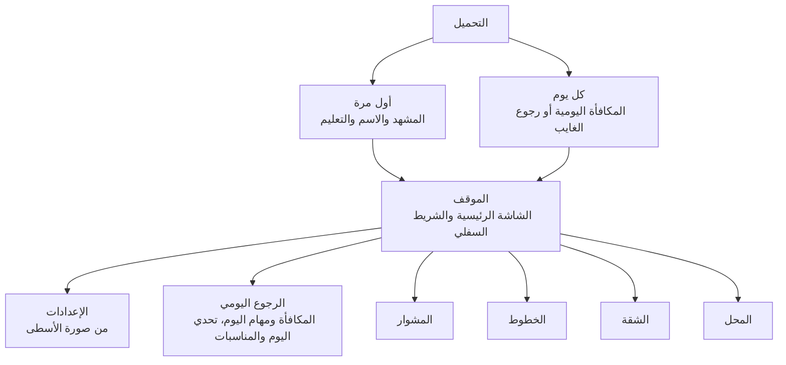

# وصّل الأجرة — وثيقة الواجهة وتجربة المستخدم

Oct 17, 2026 · @Ahmed Saied

## مقدمة

الوثيقة دي بتحدد كل شاشة في "وصّل الأجرة": إيه اللي فيها، ومكانه فين، وبيتصرف إزاي، وبتوصل لها منين. هي الترجمة البصرية لـ[وثيقة المنتج والبيزنس](https://claude.ai/code/artifact/9bc4fe51-ec70-4ce5-8dbe-8080b26991d3)، وكل بند هناك له شاشة هنا (القسم قبل الأخير بيربطهم بند ببند).

### المصادر

| المصدر | دوره |
| --- | --- |
| [وثيقة المنتج والبيزنس](https://claude.ai/code/artifact/9bc4fe51-ec70-4ce5-8dbe-8080b26991d3) | المرجع لكل الميكانيكيات والاقتصاد والدخل |
| [لوحة شاشات وصّل الأجرة](https://claude.ai/artifact/Gsw8pFhvZZNmzivVfTxCou) | التصميم المرئي المبدئي لست شاشات |
| [نموذج المشوار التفاعلي](https://claude.ai/artifact/FC1UXY4QzS73fwpsriptR6) | مشوار واحد بيتلعب، اتجرّب ونتايجه في القسم الجاي |

### القواعد العامة للوثيقة

- **الإطار المرجعي:** موبايل رأسي بعرض ٣٩٠ وارتفاع ٨٤٤ نقطة. أي مقاس مذكور هنا بالنسبة للإطار ده.
- **الاتجاه:** من اليمين للشمال في كل الشاشات، والترتيب في الجداول "من فوق لتحت" ثم "من اليمين للشمال".
- **النطاق:** الوثيقة بتغطي الشكل والسلوك وتجربة المستخدم، ومش بتغطي التنفيذ التقني.
- **المراحل:** كل شاشة عليها المرحلة اللي هتطلع فيها حسب خارطة الطريق في وثيقة المنتج (النسخة الأولى، مرحلة ٢، الإطلاق العام).

## ما تعلمناه من تجربة النموذج

المشوار التجريبي اتلعب حوالي ١٠ مرات لحد ما خلص بتلات نجوم من غير خناقة ولا غلطة، والإعادة كانت رغبة في الفوز مش زهق. ده معناه إن حلقة "مرة كمان" شغالة، وإن المشوار ده مكانه مرحلة متوسطة أو بداية الصعب، مش أول اللعبة.

| الملاحظة | النوع | القرار في التصميم |
| --- | --- | --- |
| الأشخاص والكلام كانوا صغيرين | مشكلة وتم حلها جزئيًا | حد أدنى لحجم الوشوش والخط في المشهد (قسم النظام البصري)، وتصغير الشريط العلوي والتابلوه لصالح المشهد |
| سرعة حركة الفلوس والكلام صعّبت المتابعة | مشكلة | الفقاعة تفضل ٣٫٥ ثانية على الأقل، وسرعة التمرير تبدأ بطيئة وتزيد مع الصعوبة، وشريط "آخر كلام" في التابلوه |
| لخبطة أحيانًا وقت ترجيع الباقي | مشكلة | إجمالي الإيد ظاهر بخط كبير، والراكب المستهدف يتنوّر قبل ما الفلوس تتحرك، وزرار "رجّع" لمدة ثانية بعد الرمي |
| خلصان الفكة بيعمل توتر | ميزة مقصودة | يفضل جزء أساسي من اللغز، و"حد معاه فكة؟" يكون واضح وقريب من الدرج |
| الإعادة ١٠ مرات عشان التلات نجوم | ميزة مقصودة | النجمة الواحدة سهلة، والتلات نجوم للي عايز يتقن، وشاشة النتيجة تقول الغلط كان فين بالظبط |

كل القرارات دي متطبّقة في مواصفات الشاشات تحت، ومحتاجة اختبار تاني على لاعبين مش من فريق التصميم.

## مبادئ تجربة المستخدم

سبع قواعد بيتحكم بيها أي قرار تصميم، ولو حصل تعارض بينها الترتيب ده هو الأولوية:

1. **المشهد هو اللعبة.** شاشة المشوار بتدّي المشهد أكبر مساحة ممكنة، وأي عنصر مش محتاجه اللاعب في اللحظة دي يتشال منها.
2. **إيد واحدة وموبايل رأسي.** كل حاجة بتتلمس في المشوار في التلت السفلي من الشاشة، ما عدا الركاب نفسهم.
3. **اللاعب يفتكر، والشاشة ما تفضحش.** مين دفع ومين ليه باقي ما يظهرش على الشاشة، إلا لحظة ما الراكب بيتكلم، أو بمساعدة "الدفتر". ده قلب لغز الذاكرة في وثيقة المنتج.
4. **كل حدث له صوت وشكل وكلمة.** الدفع، والباقي الغلط، والمحطة اللي بتقرب، كل واحد بيوصل بأكتر من حاسة، عشان اللاعب ما يفوّتهوش.
5. **الإعلان اختيار، مش عقاب.** الإعلانات المكافئة بتظهر كفرصة جنب القرار، والإجبارية بس بين المشاوير وبالقواعد اللي في وثيقة المنتج.
6. **الحلم ظاهر دايمًا.** تقدّم الشقة يظهر في الموقف وفي النتيجة، عشان كل مشوار يبان إنه خطوة نحو الجواز.
7. **النبرة مصرية في كل كلمة.** الأزرار والرسايل والأخطاء بالعامية وبصوت الشخصيات، من غير ما تبقى غير مفهومة لعربي من بلد تاني.

## النظام البصري

الطابع اسمه "ستيكر الميكروباص": أرضية صفرا زي التاكسي، حدود سودا عريضة، وظلال صلبة تحت كل حاجة بتتلمس. نفس الشكل في الوضع الفاتح والغامق، لأن اللعبة عالم بصري واحد.

### الألوان

| الاسم | القيمة | الاستخدام |
| --- | --- | --- |
| شمس | #FFD23F | أرضية الشاشات، وزر "حد معاه فكة؟" |
| حبر | #1D1A2B | الحدود، والنصوص، والظلال الصلبة |
| ورق | #FFFFFF | الكروت والفقاعات |
| تابلوه | #2A2633 | خلفية التابلوه والشريط السفلي |
| أزرق | #1F5FA8 | الأزرار الأساسية، والفلوس المظبوطة، والتقدم |
| برتقالي | #C2410C | الخطر: محطة قريبة، خناقة، نقص |
| محطة الكوبري / المستشفى / الجامعة | #C2410C / #0F766E / #5B4B8A | رقعة المحطة على الراكب ونقطتها في الشريط، ومعاها حرف دايمًا |
| ذهبي | #F5B301 | العملات والنجوم |

كل محطة ليها لون وحرف مع بعض، عشان اللي عنده عمى ألوان يميّز بالحرف. والألوان اللي لازم تتفرق عن بعض مختلفة في الفتاحة مش في اللون بس.

### الخطوط

- **العناوين والأزرار الكبيرة:** خط بروح يافطات الشارع (Lalezar في النموذج).
- **النصوص والأرقام:** خط عربي مدوّر وواضح (Baloo Bhaijaan 2 في النموذج).
- **الأرقام:** عربية (١٢٣) افتراضيًا، وفيه إعداد للأرقام الغربية.

### الأحجام الدنيا

دي أهم نتيجة من تجربة النموذج:

| العنصر | الحد الأدنى على الشاشة |
| --- | --- |
| وش راكب في الصف الأخير | عرض ٥٠ نقطة |
| وش راكب في الصف القريب | عرض ٨٠ نقطة |
| خط فقاعة الكلام | ١٥ نقطة بعد التصغير |
| ورقة الفلوس وهي بتتعدّى | ٤٠ × ٢٤ نقطة، ورقمها ١٥ نقطة |
| أي حاجة بتتلمس | ٤٤ × ٤٤ نقطة |
| أي نص على الشاشة | ١٢ نقطة |

### المكونات المشتركة

| المكوّن | الشكل | بيظهر في |
| --- | --- | --- |
| الزرار الأساسي | أزرق، حدود سودا، ظل صلب ٥ نقط، خط العناوين | "يلا نطلع!"، "اقبض ×٢" |
| الزرار الثانوي | أبيض بنفس الحدود | "مشوار تاني"، "عيد" |
| زرار الإعلان | أي زرار عليه أيقونة شاشة صغيرة | كل الإعلانات المكافئة |
| شارة العملة | دايرة ذهبية للجنيهات، وكوبون أزرق للبونات، ومضخة للبنزين | الشريط العلوي، والأسعار |
| رقعة المحطة | دايرة بلون المحطة وحرفها | كتف الراكب، وشريط المشوار |
| فقاعة الكلام | بيضا بحدود سودا وديل ناحية الراكب؛ برتقالي فاتح للتحذير، برتقالي غامق للخناقة، أزرق فاتح للشكر | المشوار والمشاهد |
| الكارت | أبيض، حدود ٢٫٥ نقطة، زوايا ١٨، ظل صلب ٤ | كل الشاشات |
| الشريط السفلي | داكن بأربع خانات: الموقف، الخطوط، الشقة، المحل | كل الشاشات خارج المشوار |

### الحركة والصوت والاهتزاز

- **الحركة:** قصيرة وواضحة (أقل من ثلث ثانية) في الواجهة، وأبطأ في المشهد عشان العين تلحقها. لو الجهاز مفعّل "تقليل الحركة"، الفقاعات بتظهر من غير قفزة.
- **الصوت:** رنة الفكة في الدرج، وورقة بتتطوي وهي بتتعدّى، و"على جنب يا أسطى" بصوت الراكب، وكلاكس عند المحطة.
- **الاهتزاز:** خفيف عند وصول فلوس، وأقوى عند خناقة. وفيه إعداد يقفله.

## خريطة الشاشات والتنقل

الموقف هو المحور: منه بيتفتح المشوار بزرار، وباقي الأقسام بالشريط السفلي، والإعدادات والرجوع اليومي من الضغطات اللي فيه.

| المجموعة | الشاشات |
| --- | --- |
| المشوار | كارت ما قبل المشوار، المشوار، الإيقاف والفشل، النتيجة، مشهد القصة |
| الخطوط | خريطة الخطوط، تفاصيل الخط، شراء العربية، الجراج، ملك الخط |
| الشقة | الغرف وهدف الفصل، لوح القطعة، طلبات أهل العروسة، عارض المشاهد، خط الفصول |
| المحل | المحل، نافذة البنزين، لوح الدفع، باقة البداية، تذكرة الموسم |

النتيجة بترجّع اللاعب للموقف أو لمشوار تاني، ومشهد القصة بيظهر بعد مشاوير القصة وبعد إكمال أي غرفة.

### قواعد التنقل

- **الشريط السفلي** بيظهر في الموقف والخطوط والشقة والمحل بس، ومش بيظهر في المشوار ولا النوافذ.
- **زرار الرجوع** دايمًا فوق على اليمين، وزرار الرجوع بتاع الموبايل بيعمل نفس الحاجة.
- **النوافذ** (البنزين، شراء العربية، لوح القطعة، كارت ما قبل المشوار) بتطلع من تحت، وبتتقفل بالسحب لتحت أو بزرار إغلاق.
- **زرار الرجوع في المشوار** بيفتح نافذة الإيقاف، وما بيخرجش من المشوار مباشرة.

## البداية وأول جلسة

من فتح اللعبة لأول مشوار أقل من ٢٠ ثانية: لا تسجيل، ولا إعدادات، ولا إعلانات. التعليم بيحصل جوه المشاوير الأولى نفسها، مش في شاشات شرح. (النسخة الأولى)

### ١. شاشة التحميل

| المنطقة | العناصر |
| --- | --- |
| النص | شعار "وصّل الأجرة" على أرضية صفرا، والميكروباص داخل من اليمين |
| تحت | شريط تحميل على شكل طريق والعربية ماشية عليه، وجملة عشوائية زي "بنعدّ الفكة.." |

لو التحميل خلص في أقل من ثانيتين، الشاشة تعدّي على طول.

### ٢. المشهد الافتتاحي

ثلاث لوحات كوميك ورا بعض (حوالي ١٠ ثواني): المعلم بيسلّم الأسطى مفتاح التوكتوك ويقوله "لمّ الأجرة صح، والباقي يرجع لصاحبه". زرار "تخطّى" صغير فوق على الشمال، وزرار "يلا" كبير تحت.

### ٣. اسم الأسطى

كارت واحد بعد المشهد: "اسمك إيه يا أسطى؟" وخانة اسم فيها اسم مقترح جاهز، وزرار "تمام". الاسم بيظهر في الموقف وفي ملك الخط، وممكن يتغير من الإعدادات.

### ٤. التعليم داخل المشاوير

بلية (صاحب الأسطى) بيظهر كرأس صغير في ركن المشهد السفلي مع فقاعة فيها جملة واحدة، وإيد بتشاور على العنصر المقصود. باقي الشاشة بتغمق شوية وما تتلمسش غير الحاجة المطلوبة.

| المشوار | اللي بيتعلّمه | جملة بلية |
| --- | --- | --- |
| ١ (توكتوك، راكبين) | الفلوس توصل للدرج لوحدها | "شايف؟ الأجرة وصلت الدرج" |
| ٢ | ترجيع باقي: دوس على الفكة وبعدين على الراكب | "ليه باقي ٣، دوس على الجنيهات وبعدين عليه" |
| ٣ | المحطة والعداد | "نازل الكوبري، لازم ياخد باقيه قبلها" |
| ٤ | الراكب النايم | "ده نايم، دوس عليه صحّيه" |
| ٥ | البنزين | المعلم يدّي تفويلة هدية ويشرح عداد البنزين |

بعد المشوار التالت، المشهد القصير: الأسطى بيشوف سلمى في الموقف، وتظهر الشقة الفاضية مقفولة كهدف.

### ٥. طلب الإشعارات

كارت بنبرة اللعبة بعد مشهد سلمى، قبل طلب النظام الرسمي: "تحب نقولك لما البنزين يتملى؟" بزرارين "أيوه" و"بعدين". لو اختار "بعدين" ما نسألش تاني قبل ٣ أيام.

## الموقف (الشاشة الرئيسية)

نقطة البداية لكل جلسة، ووظيفتها إن اللاعب يطلع مشوار بضغطة واحدة ويشوف حلمه بيقرب. (النسخة الأولى)

| المنطقة (من فوق لتحت) | العناصر | التفاعل |
| --- | --- | --- |
| الشريط العلوي | يمين: صورة الأسطى واسمه و"درجة ٣". شمال: ثلاث شارات: الجنيهات، والبونات، والبنزين (٤/٥ ومعاه عداد "اللتر الجاي بعد ١٢:٣٠") | الصورة تفتح الإعدادات، والبونات والبنزين يفتحوا المحل |
| صف الرجوع اليومي | دواير صغيرة على اليمين: المكافأة اليومية، مهام اليوم (٢/٣)، تحدي اليوم، والمناسبة لو فيه مناسبة شغالة. أي دايرة فيها حاجة جديدة عليها نقطة حمرا | كل دايرة تفتح شاشتها |
| المشهد | الميكروباص بزينته في الشارع، شارة الخط الحالي، وفقاعة التبّاع "جامعة.. جامعة!" | الضغط على العربية يفتح الجراج |
| كارت الخط | "المشوار ١٢ من ٣٠" وشريط تقدم الخط، وجنبه نجوم الخط (٢٧ من ٩٠ مثلًا) | يفتح الخطوط |
| زرار "يلا نطلع!" | أزرق كبير بعرض الشاشة، وجواه شارة "−١ بنزين" | يفتح كارت ما قبل المشوار |
| كارت تحويش الجواز | أيقونة الدبلة، الفصل الحالي، القطعة الجاية وسعرها، شريط تقدم بالجنيهات | يفتح الشقة |
| حصّالة الصبح | شريط داكن: "اتفرج على إعلان وخد جنيهات وبونات" وشارة "ببلاش"، مرة في اليوم | يشغّل إعلان مكافئ |
| الشريط السفلي | الموقف، الخطوط، الشقة، المحل | تنقل؛ النقطة الحمرا على أي خانة فيها جديد |

### الحالات

- **البنزين خلص:** زرار "يلا نطلع!" يتحول لـ"البنزين خلص" برتقالي ومعاه العداد، والضغط يفتح نافذة البنزين (قسم المحل).
- **تقدر تشتري القطعة الجاية:** كارت التحويش يتنوّر وعليه "جاهزة للشرا!".
- **مشهد قصة مستني:** كارت التحويش يبقى "مشهد جديد مستنيك" بدل شريط التقدم.
- **قبل ما الشقة تتفتح (فصل ١ و٢):** الكارت يوري الشقة مقفولة والهدف الحالي ("خلّص خط الحي" ثم "اشتري الميكروباص").
- **مناسبة شغالة:** المشهد بياخد زينة المناسبة (زينة رمضان مثلًا)، ودايرة المناسبة تظهر في صف الرجوع اليومي.

### الإعلان البيني

لو اللاعب رجع للموقف أو داس "مشوار تاني" بعد ٣ مشاوير من آخر إعلان بيني، يظهر إعلان قبل كارت ما قبل المشوار. ما يظهرش في أول ١٠ مشاوير خالص، ولا بعد إعلان مكافئ مباشرة، ولا للي شال الإعلانات أو مشترك.

## كارت ما قبل المشوار

لوح بيطلع من تحت فوق الموقف قبل كل مشوار، عشان اللاعب يعرف الأسعار والجديد قبل ما الوقت يبدأ. ده بيقلل اللخبطة اللي ظهرت في النموذج. (النسخة الأولى)

| المنطقة | العناصر |
| --- | --- |
| الرأس | اسم الخط ورقم المشوار، ولو مشوار قصة: شارة "مشوار قصة" وصورة الشخصية |
| أسعار المحطات | صف بالمحطات بالترتيب من اليمين، كل محطة بلونها وحرفها وسعرها، وتحتها سطر القواعد الخاصة زي "الطلبة بنص أجرة" أو "الشنطة عليها أجرة" |
| الجديد في المشوار ده | لو فيه نوع راكب أو حدث أول مرة يظهر: صورته وجملة واحدة عنه |
| أهداف النجوم | ثلاث سطور: وصّل، من غير خناقات، وكل باقي صح من أول مرة |
| المساعدات | الأربع مساعدات وعدد اللي معاك من كل واحدة، وزرار "+" يشتري بالبونات |
| الشرط الخاص (مشاوير القصة) | شريط برتقالي: "أبو العروسة راكب: أي خناقة والمشوار يتعاد" |
| تحت | زرار "اطلع" أزرق ومعاه "−١ بنزين"، وزرار إغلاق |

اللوح ده يقدر اللاعب يقفله نهائيًا للمشاوير العادية من الإعدادات، فيدوس "يلا نطلع!" ويدخل المشوار على طول. مشاوير القصة والمشاوير اللي فيها حاجة جديدة بيظهر فيها دايمًا.

## شاشة المشوار

دي أهم شاشة في اللعبة، ومقسومة لتلات مناطق ثابتة: شريط علوي رفيع، ومشهد العربية بأكبر مساحة ممكنة، وتابلوه تحت الإيد. الكاميرا من قدّام العربية على وشوش الركاب، كأن الأسطى بيبص في المراية. (النسخة الأولى)

| المنطقة | الارتفاع التقريبي | المحتوى |
| --- | --- | --- |
| الشريط العلوي | ١١٠ نقطة | الإيقاف، الخط، السمعة، شريط المحطات وأسعارها |
| المشهد | الباقي كله، ومش أقل من ٤٢٠ نقطة | الركاب، الشبابيك، الفلوس وهي بتتعدّى، إيد الأسطى |
| التابلوه | ٢٣٠ نقطة، وراكب على آخر المشهد ١٦ نقطة | إيدك، الدرج، المساعدات، آخر كلام |

المشهد بياخد أغلب الشاشة، واللي بيتلمس تحت الإيد. العناصر من فوق لتحت:

1. **الشريط العلوي:** الإيقاف، الخط، السمعة، المحطات وأسعارها.
2. **الصفوف البعيدة:** الفلوس بتتعدّى لهم من إيد لإيد.
3. **الصف القريب والكرسي اللي قدّام:** إيدك توصلهم على طول.
4. **إيد الأسطى:** ماسكة اللي في إيدك وبترمي للراكب.
5. **إيدك وزرار «حد معاه فكة؟»**
6. **درج الفكة:** ٨ فئات.
7. **المساعدات الأربعة.**
8. **آخر كلام:** آخر سطرين اتقالوا.

النسب بالنسبة لإطار ٣٩٠ × ٨٤٤ نقطة، والتابلوه راكب على آخر المشهد عشان يبان إنه تابلوه العربية نفسها.

### الشريط العلوي

- **يمين:** زرار الإيقاف (دايرة بيضا ٤٤ نقطة).
- **النص:** اسم الخط ورقم المشوار.
- **شمال:** عداد السمعة؛ أزرق، ويتحول برتقالي تحت ٤٠٪.
- **شريط المحطات:** نقطة الموقف، ثم كل محطة بلونها وحرفها، والعربية ماشية عليه. تحت كل محطة اسمها وسعرها. المحطة الجاية عليها عدّاد ثواني برتقالي، يكبر وينبض لما يقل عن ٨ ثواني.
- **قاعدة خاصة بالخط:** أيقونة صغيرة جنب السعر لو فيه قاعدة، زي كارنيه الطالب.

### المشهد

**الترتيب:** الصف اللي ورا الأسطى على طول تحت وكبير، وإيدك توصله مباشرة. الصفوف اللي وراه أصغر لفوق، والفلوس بتتعدّى لهم من إيد لإيد. الكرسي اللي جنب الأسطى تحت على اليمين، وإيده هو كمان توصله.

| العربية | الترتيب في المشهد | أقصى عدد ركاب |
| --- | --- | --- |
| توكتوك | صف واحد قريب | ٣ |
| ميكروباص قديم | ٣ صفوف × ٣ + كرسي قدام | ١٠ |
| ميكروباص جديد | ٣ صفوف × ٣ + صف رابع + كرسي قدام | ١٢ |
| ميكروباص سفر | زي الجديد + شنط فوق السقف ظاهرة من الشباك الخلفي | ١٢ |

**الشبابيك:** الجانبية بتبيّن الطريق وهو بيتحرك، ويافطة المحطة الجاية بتقرّب فيها. في الزحمة تظهر عربيات واقفة، وفي المطب المشهد كله يتهز.

**الراكب:** وش وكتاف، ولون الهدوم والإكسسوار بيعرّفوا نوعه (كاب الطالب، نضارة الحاجة، سمّاعات، كرافتة الأفندي). على كتفه رقعة محطته.

| حالة الراكب | شكلها |
| --- | --- |
| عادي | وش مبتسم |
| بيتكلم | بُقّه مفتوح وفوقه فقاعة |
| صبره بيخلص | حواجب مكشّرة ونقطة عرق، وتزيد كل ما يستنى |
| نايم | راسه مايلة وفوقه "z z"، وبيوقف أي فلوس عايزة تعدّي من عنده |
| لابس سمّاعات | علامات موسيقى جنب ودانه، وبيوقف الفلوس لحد ما تنده عليه مرتين |
| ليه باقي ومحطته قربت | رقعة المحطة بتنبض بإطار برتقالي، وفقاعة تحذير "الباقي يا أسطى!" |
| خناقة | فقاعة برتقالي غامق، والمشهد يتهز، واهتزاز في الموبايل |
| نازل | بيقوم ويختفي لفوق، وكرسيه يفضل فاضي |
| راكب جديد | بيدخل من الباب على اليمين ويقعد في كرسي فاضي |

**فقاعات الكلام:** بتظهر فوق راس الراكب، ومش أكتر من فقاعتين في نفس اللحظة؛ الباقي بيستنى دوره. كل فقاعة تفضل ٣٫٥ ثانية على الأقل، وتتحط جوه حدود الشاشة حتى لو الراكب على الطرف.

**الفلوس وهي بتتعدّى:** ورقة بالمبلغ بخط كبير، خضرا لو أجرة رايحة لقدّام، وزرقا لو باقي راجع لورا. لو وقفت عند نايم أو لابس سمّاعات، تبقى برتقالي وفوقها "؟".

**إيد الأسطى:** طالعة من تحت الشاشة، وماسكة المبلغ اللي في إيدك، ولما ترمي بتتحرك ناحية الراكب.

### التابلوه

| الصف | العناصر | التفاصيل |
| --- | --- | --- |
| ١ | خانة "في إيدك" + زرار "حد معاه فكة؟" | الخانة فيها الفئات اللي في إيدك والإجمالي بخط ٢٠ نقطة. الزرار أصفر ومعاه عدد المرات الباقية |
| ٢ و٣ | درج الفكة: ٨ خانات في صفين | نص، ١، ٥، ١٠ ثم ٢٠، ٥٠، ١٠٠، ٢٠٠. كل خانة فيها شكل العملة أو الورقة والعدد. الخانة الفاضية متقطعة وباهتة |
| ٤ | المساعدات | كيس فكة، الدفتر، صحّي النايم، زحمة. على كل واحدة عددها، ولو خلصت يظهر سعرها بالبونات أو أيقونة الإعلان |
| ٥ | آخر كلام | آخر سطرين حصلوا، زي "الشلة: خد ٥٠ عن تلاتة" و"وصلك ٥٠ من الشلة". السطر بيختفي لما ييجي غيره، فالذاكرة لسه مهمة |

### التفاعلات

| الحركة | النتيجة |
| --- | --- |
| ضغطة على فئة في الدرج | تتحط في إيدك، مع رنة فكة |
| ضغطة على خانة "في إيدك" | كل اللي في إيدك يرجع الدرج |
| ضغطة على راكب وإيدك فيها فلوس | الراكب يتنوّر نص ثانية، والإيد ترمي، والفلوس تمشي في السلسلة. زرار "رجّع" يظهر ثانية واحدة لو اللاعب غلط |
| سحب من إيدك لراكب | نفس النتيجة، كبديل للي بيحب السحب |
| ضغطة على راكب وإيدك فاضية | يطلب منه الأجرة، أو يصحّيه لو نايم، أو ينده عليه لو لابس سمّاعات (مرتين) |
| ضغطة على راكب دفع قبل كده (أو الأفندي) | يقول "أنا دافع!" ويظهر تحته اختياران: "ماشي" و"لأ، ما دفعتش!" |
| "حد معاه فكة؟" | الأوراق من ١٠ لفوق في الدرج تتنوّر؛ تختار ورقة، وراكب يفكها بعد ثانية ونص |
| الدفتر | تحت كل راكب شارة "دافع" أو "لسه" لمدة ٥ ثواني |
| صحّي النايم | كل النايمين يصحوا مرة واحدة |
| زحمة | إعلان مكافئ أو بونات، وبعدها ١٠ ثواني زيادة للمحطة الجاية |
| الإيقاف | الوقت يقف ونافذة الإيقاف تظهر |

### الصعوبة والمساعدة حسب الخط

السرعة والمساعدة بتتغير مع التقدم، عشان المشوار اللي اتجرّب في النموذج يبقى صعب في وقته، مش في أول اللعبة:

| الخط | وقت انتقال الفلوس بين كرسيين | مدة الفقاعة | تلميحات بلية |
| --- | --- | --- | --- |
| خط الحي | ١٫٣ ثانية | ٤٫٥ ثانية | شغالة: بيشاور على اللي ليه باقي لما محطته تقرب |
| خط الجامعة | ١٫١ ثانية | ٤ ثواني | أول مرة لكل نوع راكب جديد بس |
| خط السوق وبعده | ٠٫٩ ثانية | ٣٫٥ ثانية | مقفولة |

القيم دي مبدئية وتتضبط بعد اختبار لاعبين جداد.

## أثناء المشوار: الأحداث والنوافذ

كل حدث في وثيقة المنتج له شكل على الشاشة، وكل نافذة بتوقف الوقت لحد ما اللاعب يقرر.

### أحداث داخل المشوار

| الحدث | اللي بيظهر | اللي اللاعب بيعمله |
| --- | --- | --- |
| مطب | المشهد يتهز، والفلوس اللي بتتعدّى تقع على الأرضية وتلمع | يضغط على كل ورقة واقعة عشان يلمها قبل ٣ ثواني |
| زحمة | عربيات واقفة في الشبابيك، وعدّاد المحطة يبطّأ، ووشوش الركاب تكشّر أسرع | يستغل الوقت الزيادة |
| طريق مفتوح | الشبابيك تجري أسرع، والعدّاد ينزل أسرع | يستعجل |
| الأجرة زادت! | شريط برتقالي ينزل من فوق "الأجرة بقت ٨ بدل ٧"، والأسعار في الشريط العلوي تتغير بحركة | يصحح للي دفع بالسعر القديم |
| "نزّلني هنا" | الراكب يقول الجملة، ورقعة محطته تتحول لنجمة "هنا" بتنبض | يرجّعله باقيه فورًا |
| خناقة على الدفع | راكبين بفقاعتين متقابلتين، واختيار "مين اللي دفع؟" بصورهم | يختار من ذاكرته |
| "حد معاه فكة؟" من راكب | راكب يمد إيده بورقة كبيرة وفقاعة، واختياران "فكّله" و"معلش" | يقرر يصرف من درجه ولا يوفّر |
| راكب في الطريق | واحد بيشاور في الشباك، وبعدها بيدخل من الباب | راكب جديد في اللغز |

### مشاوير القصة

نفس شاشة المشوار، مع ثلاث فروق: الشخصية بتقعد في الكرسي اللي جنب الأسطى وبتعلّق على كل غلطة؛ والشرط الخاص ظاهر تحت شريط المحطات طول المشوار؛ والعربية متزوّقة في مشوار الفرح ومعاها مزيكا مختلفة.

### نافذة الإيقاف

كارت في النص فوق المشهد الغامق: "واقفين على جنب"، وثلاث أزرار: "كمّل المشوار"، "عيد المشوار" (بيقول إنه هيصرف لتر بنزين)، و"ارجع الموقف". وتحتهم مفاتيح سريعة للصوت والاهتزاز. اللعبة بتقف لوحدها لو اللاعب خرج منها أو جاله اتصال.

### فشل المشوار

لما السمعة تخلص، الوقت يقف والركاب كلهم يكشّروا. كارت "المشوار باظ" وفيه:

- **زرار أساسي:** "صالح الركاب" بإعلان مكافئ، والسمعة ترجع ٤٠٪ والمشوار يكمل من نفس النقطة. مرة واحدة لكل مشوار.
- **زرار تاني:** "صالح بـ٢٠ بون" لو ما عايزش إعلان.
- **زرار ثالث:** "عيد المشوار" (بلتر بنزين)، و"ارجع الموقف".
- **سطر صغير:** إيه اللي ضيّع السمعة، زي "خناقتين وراكب فاتته محطته".

## شاشة النتيجة

بتظهر بعد آخر محطة، ووظيفتها تلات حاجات: تفرّح اللاعب بالقبض، تقوله غلط فين بالظبط، وتعرض عليه "×٢" في أنسب لحظة. (النسخة الأولى)

| المنطقة (من فوق لتحت) | العناصر |
| --- | --- |
| الرأس | زرار رجوع للموقف يمين، و"المشوار ١٢ · خط الجامعة" في النص |
| العنوان | "وصلنا الجامعة!" بخط العناوين الكبير |
| النجوم | تلات نجوم بتظهر واحدة واحدة، وتحت كل نجمة شرطها بعلامة صح أو غلط: وصلت، من غير خناقات، كل باقي صح من أول مرة |
| جملة راكب | أطرف أو أحلى جملة اتقالت في المشوار، زي "ربنا يكرمك يا ابني.. الباقي وصل" — الحاجة |
| الحساب | الأجرة اللي اتلمّت، البقشيش، الباقي الزيادة اللي ضاع، عدد الخناقات |
| الغلطات | قائمة تتفتح لو فيه غلطات: كل غلطة بصورة الراكب وجملة، زي "اديت الطالب زيادة نص جنيه" أو "الأفندي نزل من غير ما يدفع" |
| القبض | الجنيهات اللي قبضتها برقم كبير، وأي بونات من المهام |
| زرار الإعلان | "اقبض ×٢" أزرق كبير بأيقونة الإعلان، وتحته "+١٧٠ بدل ٨٥". مرة لكل مشوار |
| رابط ثانوي | "لأ، خد ٨٥ بس" |
| تقدم الشقة | كارت القطعة الجاية وشريطها بيتحرك بالمبلغ الجديد. لو المبلغ كفّى: "تقدر تشتري الأنتريه!" ويفتح الشقة |
| تحت | زرار "مشوار تاني" ومعاه "−١ بنزين"، وزرار مشاركة |

### الحالات

- **تلات نجوم أول مرة:** احتفال قصير بالزينة والكلاكس، و"رقم قياسي جديد" على الخط.
- **مهمة يومية اتحققت:** شريط صغير فوق "مهمة خلصت: رجّع ٢٠ باقي صح" ومكافأتها.
- **البنزين خلص:** زرار "مشوار تاني" يفتح نافذة البنزين.
- **مشوار قصة:** بعد النتيجة، المشهد الكوميك بتاع الفصل يظهر على طول.

### المشاركة

في النسخة الأولى زرار المشاركة بيعمل صورة جاهزة فيها النجوم وجملة الراكب وشعار اللعبة. بعد الإطلاق العام بيتحول لمقطع ١٥ ثانية لأطرف لحظة في المشوار، زي ما في وثيقة المنتج.

## الخطوط والعربية والجراج

تلات شاشات بيتابع منها اللاعب تقدمه الطويل: خريطة الخطوط، وشراء العربية، والجراج للترقيات والزينة.

### الخطوط (النسخة الأولى)

| المنطقة (من فوق لتحت) | العناصر | التفاعل |
| --- | --- | --- |
| الرأس | عنوان "الخطوط" وشارات الجنيهات والبونات | — |
| شريط العربيات | أربع خانات: توكتوك، ميكروباص قديم، جديد، سفر. اللي خلّصته عليه صح، والحالية متنوّرة، والمقفولة متقطعة وعليها سعرها بالجنيهات | الضغط يفتح نافذة شراء العربية |
| خريطة الخطوط | طريق رأسي متقطع عليه الخطوط من تحت لفوق. كل خط كارت فيه اسمه، وأجرته، والجديد فيه، ونجومه | الخط المفتوح يفتح تفاصيله، والحالي عليه زرار "كمّل" |
| الخط المقفول | كارت باهت عليه قفل وسبب القفل: "محتاج ميكروباص جديد" أو "بعد خط السوق" | يفتح نافذة العربية المطلوبة |
| ملك الخط | شريط داكن "ترتيبك ١٤ على خط الجامعة الأسبوع ده" (من الإطلاق العام) | يفتح ملك الخط |
| الشريط السفلي | خانة الخطوط متنوّرة | تنقل |

**تفاصيل الخط:** لوح من تحت فيه شبكة بكل مشاوير الخط مرقمة، وعلى كل مشوار نجومه. المشاوير اللي خلصت تتعاد عشان النجوم، والجاية مقفولة لحد ما اللي قبلها يخلص.

### نافذة شراء العربية (النسخة الأولى)

| العنصر | التفاصيل |
| --- | --- |
| الصورة | العربية الجديدة بزينة اللاعب الحالية |
| الجديد | عدد الكراسي، والخط اللي بتفتحه، وإنها بتجيب أجرة أكتر في المشوار |
| السعر | بالجنيهات، وجنبه رصيد اللاعب |
| الأثر على الشقة | سطر واضح: "بعد الشرا، فاضل للأنتريه ١٬٨٠٠"، عشان القرار يبقى عن وعي |
| الأزرار | "اشتريها" و"لسه". لو الرصيد مش كفاية: "ناقصك ٢٬٤٠٠" بدل زرار الشرا |

### الجراج (مرحلة ٢)

بيتفتح من الضغط على العربية في الموقف، أو من شريط العربيات. فوق صورة كبيرة للعربية بتتغير وانت بتجرب، وتحتها تبويبين:

- **الترقيات (بالجنيهات):** أربع كروت: درج أوسع، كاسيت، مراية كبيرة، كرسي قلّاب. كل كارت فيه المستوى، وأثره بجملة ("المشوار يبدأ بنص جنيه زيادة")، والسعر.
- **الزينة (بالبونات أو من المناسبات):** أقسام: ستاير، ستيكرات، فرش كراسي، أنوار، كلاكسات. الضغط على أي قطعة يجربها على العربية فورًا، والكلاكس بيشتغل صوته. القطع اللي من مناسبة عليها اسم المناسبة بدل السعر.

## الشقة والقصة

خانة "الشقة" في الشريط السفلي هي بيت القصة كلها: هدف الفصل الحالي، والغرف، والمشاهد، وطلبات أهل العروسة. (النسخة الأولى للفصول من ١ لـ ٤، والباقي حسب خارطة الطريق)

### الشقة: الفصول من ١ لـ ٣ (قبل العفش)

قبل ما الشقة تتفتح، الشاشة بتوري كارت كبير لهدف الفصل بدل الغرفة: صورة الهدف (مفتاح التوكتوك، الميكروباص، الشبكة)، وشريط تقدم، وجملة من الشخصية ("أبوها هيسألك بتشتغل إيه")، وتحته الشقة الفاضية مقفولة كإغراء.

### الشقة: من الفصل ٤

| المنطقة (من فوق لتحت) | العناصر | التفاعل |
| --- | --- | --- |
| الرأس | "شقة العُمر" وشارة الجنيهات | — |
| شريط الفصل | أزرق: "الفصل ٤ · أهل العروسة جايين الخميس"، وشريط "جهّزت ٢ من ٤" | يفتح خط الفصول |
| تبويبات الغرف | الصالة، المطبخ، أوضة النوم. اللي لسه ما اتفتحتش عليها قفل | تبديل الغرفة |
| رسمة الغرفة | الغرفة بالقطع اللي اتشرت، ومكان كل قطعة ناقصة مرسوم متقطع وعليه سعرها وزرار "+" | الضغط على مكان قطعة يفتح لوح القطعة |
| قطع الغرفة | شبكة كروت من عمودين: اسم القطعة، وحالتها (اتركّبت / سعرها / ناقصك كام) | نفس لوح القطعة |
| طلبات أهل العروسة | زرار بعدد الطلبات المفتوحة | يفتح لوح الطلبات |
| المشهد الجاي | شريط داكن: "خلّص الصالة وافتح مشهد زيارة أهل العروسة" | — |
| الشريط السفلي | خانة الشقة متنوّرة | تنقل |

### لوح القطعة

- فوق: القطعة كبيرة، وتحتها ٣ أشكال يختار منها اللاعب بنفس السعر (كلاسيك، مودرن، شعبي مثلًا).
- السعر بالجنيهات وزرار "اشتري". لو الرصيد مش كفاية: "ناقصك ٩٠٠" وزرار "اطلع مشوار" بيرجّعه للموقف.
- بعد الشرا: اللوح يقفل، والقطعة تنزل مكانها في الغرفة بحركة قصيرة، وسلمى تعلّق بفقاعة ("حلو أوي، بس النجفة كانت أحلى بالكريستال").

### إكمال الغرفة

احتفال قصير، ومكافأة البونات، وبعدها زرار "شوف المشهد" بيفتح عارض المشاهد.

### عارض المشاهد

شاشة كاملة بخلفية داكنة، فيها لوحة كوميك واحدة كل مرة بحوار عامي. الضغط في أي مكان يعدّي للوحة الجاية، وفيه زرار "تخطّى" فوق. آخر لوحة فيها زرارين: "شارك" و"كمّل". كل المشاهد اللي اتفتحت محفوظة في "ألبوم المشاهد" جوه خط الفصول.

### خط الفصول

خط رأسي بالفصول السبعة: الخلصانة عليها صورة مشهدها وتتعاد، والحالي متنوّر وعليه هدفه، والجاية بأسمائها بس ومقفولة.

### لوح طلبات أهل العروسة

قائمة بالطلبات المفتوحة، كل طلب بصورة أم العروسة أو أبوها، والطلب ("النجفة لازم تبقى كريستال")، والمكافأة بالبونات، وحالته. الطلبات اختيارية وما بتوقفش تقدم القصة.

## المحل والبنزين والدفع

المحل هو المكان الوحيد اللي فيه فلوس حقيقية، والترتيب فيه من الأرخص والمجاني لفوق للأغلى تحت. الجنيهات ما بتتشريش خالص، زي ما في قاعدة الاقتصاد. (النسخة الأولى، والاشتراك من مرحلة ٢)

### المحل

| المنطقة (من فوق لتحت) | العناصر |
| --- | --- |
| الرأس | "المحل" وشارات الجنيهات والبونات |
| العرض | باقة البداية (أول ٧ أيام بس) بعدّاد تنازلي: بونات + زينة حصرية + بنزين مفتوح ساعتين، وسعرها |
| بنزين ببلاش | كارت أزرق: "اتفرج على إعلان وخد تفويلة كاملة" و"باقيلك مرتين النهارده" |
| البنزين | تفويلة كاملة (٣٠ بون)، وبنزين مفتوح ساعة (٨٠ بون) |
| المساعدات | كيس فكة (١٠)، صحّي النايم (٨)، الدفتر (١٢)، زحمة (٨)، كل واحدة بالبونات وجنبها عدد اللي معاك |
| البونات | تلات أكياس: صغير ومتوسط وكبير، والكبير عليه "زيادة مجانية". السعر بعملة البلد من المتجر نفسه |
| اشتراك الأسطى | كارت فيه المميزات: بونات يومية، خزان بنزين أكبر، بلا إعلانات إجبارية. أسبوعي وشهري |
| شيل الإعلانات | كارت واحد بسعره، وتحته "إعلانات المكافآت تفضل باختيارك" |
| الزينة | رابط "شوف الزينة" يفتح الجراج |
| تحت | "ادفع برصيد موبايلك أو بالكارت"، و"استرجاع المشتريات"، والشروط |

### الشرا

- **بالبونات:** أي حاجة بـ٥٠ بون أو أكتر تاخد تأكيد صغير ("هتصرف ٨٠ بون؟"). الأقل منها بيتشرى على طول مع إمكانية "رجّع" لمدة ٣ ثواني.
- **بفلوس حقيقية:** لوح الدفع بتاع المتجر نفسه، وبعده نافذة "وصلك ٥٠٠ بون" والرقم بيطير لشارة البونات.
- **لو الدفع فشل:** "الدفع ما تمّش، وما اتخصمش منك حاجة. جرّب تاني أو اختار طريقة دفع تانية."

### نافذة البنزين

بتظهر لما اللاعب يدوس "يلا نطلع!" والبنزين صفر.

| العنصر | التفاصيل |
| --- | --- |
| الرسمة | عدّاد بنزين فاضي والمعلم بيقول "الخزان نشف يا أسطى" |
| العداد | "اللتر الجاي بعد ١٢:٣٠"، و"الخزان يتملى بعد ١:٤٠:٠٠" |
| الاختيار ١ | "اتفرج على إعلان وفوّل" (لحد ٣ مرات في اليوم، والعدد الباقي ظاهر) |
| الاختيار ٢ | "فوّل بـ٣٠ بون" |
| الاختيار ٣ | "بنزين مفتوح ساعة بـ٨٠ بون" |
| تحت | "استنى"، ومفتاح "فكّرني لما يتملى" (إشعار) |

### عرض باقة البداية

بيظهر كنافذة مرة واحدة بس، بعد إكمال الفصل الأول، لأنها لحظة فرحة مش لحظة إحباط. بعدها يفضل في أول المحل لحد ما الأيام السبعة تخلص.

## الرجوع اليومي

كل الأدوات دي بتتفتح من صف الدواير الصغيرة في الموقف، وكل دايرة عليها نقطة حمرا لما يكون فيها حاجة مستنية.

### المكافأة اليومية (النسخة الأولى)

بتظهر لوحدها أول ما اللاعب يفتح اللعبة كل يوم، قبل الموقف. فيها سبع خانات أيام بالترتيب من اليمين: اللي اتاخدت عليها صح، والنهارده متنوّرة وبتنبض، واليوم السابع أكبر وفيه زينة أو بونات كتير. زرار واحد "خد" والمكافأة تطير لشارتها. لو اللاعب فوّت يوم، الخانة بترجع خطوة واحدة بس، وفيه جملة توضح كده.

### مهام اليوم (النسخة الأولى)

لوح بتلات كروت، كل كارت فيه المهمة ("رجّع ٢٠ باقي صح")، وشريط تقدم (١٢/٢٠)، والمكافأة. المهمة اللي خلصت عليها زرار "خد". فوق اللوح عدّاد "مهام جديدة بعد ٦ ساعات".

### تحدي اليوم (النسخة الأولى)

| المنطقة | العناصر |
| --- | --- |
| الرأس | "تحدي النهارده" وعدّاد لحد التحدي الجاي |
| الوصف | جملة عن المشوار ("فيه أفندي معاه ٢٠٠ ونايمين اتنين")، وإنه نفس المشوار لكل اللاعبين |
| أحسن نتيجة | نجومك ووقتك لو لعبته قبل كده |
| زرار | "العبه" (ما بيصرفش بنزين في أول محاولة) |
| كارت المشاركة | بعد اللعب: كارت مربع فيه النجوم والوقت وعدد الخناقات بأيقونات بس من غير تفاصيل المشوار، وزرار "شارك" |

### ملك الخط (الإطلاق العام)

| المنطقة | العناصر |
| --- | --- |
| الرأس | اسم الدوري ("دوري الموقف" ثم أعلى)، والخط، وعدّاد نهاية الأسبوع |
| مناطق الصعود والهبوط | خلفية خضرا خفيفة لأول ٥ وبرتقالي لآخر ٥، ومكتوب عليها |
| الترتيب | ٣٠ صف: المركز، صورة واسم ودرجة الأسطى، والنقط. صف اللاعب متثبّت وظاهر دايمًا حتى لو نزل تحت |
| المكافآت | أول ٣ عليهم كاس صغير ومكافأتهم بالبونات والزينة |

### المناسبات الموسمية (الإطلاق العام)

- **صفحة المناسبة:** صورة كبيرة بطابع المناسبة (فوانيس رمضان، بلالين العيد)، وعدّاد للنهاية، وزرار "العب خط المناسبة".
- **تذكرة الموسم:** مسارين أفقيين فوق بعض: المجاني تحت والمدفوع فوق، وكل خطوة عليها مكافأة. شريط النقط ماشي عليهم، وزرار "افتح المسار المدفوع" بسعره.
- **الموقف وقت المناسبة:** المشهد والميكروباص بياخدوا زينة المناسبة، ودايرة المناسبة تظهر في صف الرجوع اليومي.

## الإعدادات والحساب والتواصل

### الإعدادات (النسخة الأولى)

بتتفتح من صورة الأسطى في الموقف. فوق كارت الأسطى: صورته، واسمه مع زرار تعديل، ودرجته، وأرقام بسيطة (مشاوير، نجوم، أطول سلسلة أيام). وتحته مجموعات:

| المجموعة | الإعدادات |
| --- | --- |
| الصوت | المزيكا، والمؤثرات، وأصوات الركاب، كل واحد بمفتاح |
| اللعب | الاهتزاز، وكارت ما قبل المشوار (يظهر دايمًا / في الجديد بس)، وشكل الأرقام (عربية ١٢٣ / غربية 123) |
| الإشعارات | البنزين اتملى، تحدي اليوم، رسايل سلمى، ملك الخط؛ كل واحد بمفتاح |
| الحساب | ربط الحساب بجوجل أو أبل لحفظ التقدم، واسترجاع المشتريات، وحذف الحساب |
| عن اللعبة | سياسة الخصوصية، والشروط، و"كلّمنا" |

**حذف الحساب:** خطوتين: صفحة بتوضح إيه اللي هيتمسح (التقدم والمشتريات)، وبعدها تأكيد بكتابة كلمة "امسح". ما فيش حذف بضغطة واحدة.

### ادعي صاحبك (الإطلاق العام)

كارت في الإعدادات وفي المحل: "ابعت لصاحبك، ولما يخلّص خط الحي تاخدوا بونات انتو الاتنين". فيه كود اللاعب مع زرار نسخ، وزرار مشاركة، وقائمة بالأصحاب اللي دخلوا وحالة كل واحد.

### رجوع الغايب (النسخة الأولى)

لو اللاعب غاب ٧ أيام أو أكتر، أول ما يفتح يظهر كارت: المعلم بيقول "إنت فين يا أسطى؟ الموقف كان واحشك"، وهدية الرجوع (خزان مليان وكيس فكة) وزرار "خدها". لو كان في نص فصل، سطر يفكّره هو كان واقف فين.

### الإشعارات

بحد أقصى إشعارين في اليوم، وبصوت الشخصيات:

| الإشعار | النص | إمتى |
| --- | --- | --- |
| البنزين اتملى | "البنزين اتملى يا أسطى، الموقف مستنيك." | لما الخزان يتملى |
| تحدي اليوم | "تحدي النهارده نزل، فيه أفندي معاه ٢٠٠!" | الصبح |
| سلمى | "سلمى بعتتلك: شفت النجفة اللي قلتلك عليها؟" | لو اللاعب قرّب على قطعة وما رجعش يوم |
| ملك الخط | "فيه حد عدّاك في ترتيب خط الجامعة." | مرة في اليوم بالكتير |
| رجوع الغايب | "المعلم بيسأل عليك." | بعد ٣ و٧ أيام غياب |

## الحالات العامة

كل رسالة هنا بتقول اللي حصل وإيه اللي اللاعب يعمله، بالعامية ومن غير اعتذارات طويلة.

| الحالة | اللي بيظهر | اللي متاح |
| --- | --- | --- |
| بلا إنترنت | شريط صغير فوق الموقف: "انت أوفلاين، المشاوير شغالة والتقدم هيتحفظ لما النت يرجع" | المشاوير والشقة شغالين. المحل وتحدي اليوم وملك الخط والإعلانات بيظهروا باهتين وعليهم "محتاج نت" |
| الإعلان مش جاهز | "الإعلان مش جاهز دلوقتي، جرّب كمان شوية" | البديل بالبونات بيظهر جنبه على طول لو موجود |
| حد الإعلانات اليومي خلص | الزرار يبقى باهت وعليه "خلصت النهارده" | البديل بالبونات |
| تحميل جوه اللعبة | الميكروباص الصغير ماشي على طريق، ومن غير شاشة بيضا | — |
| فشل الدفع | (قسم المحل) | تجربة تانية أو طريقة دفع تانية |
| تحديث مطلوب | كارت: "فيه نسخة جديدة فيها خطوط جديدة" وزرار يفتح المتجر | لو التحديث إجباري ما فيش زرار إغلاق |
| صيانة | المعلم ماسك مفتاح: "الموقف بيتصلّح، راجعين الساعة ٤" | المشاوير أوفلاين لو متاحة |
| مقاطعة (مكالمة أو خروج) | المشوار بيقف لوحده | نافذة الإيقاف لما يرجع |
| قوائم فاضية | جملة وصورة بدل القائمة، زي "لسه ما دعيتش حد، ابعت كودك لصاحبك" | الزرار اللي يملاها |

## تغطية وثيقة المنتج

كل بند في وثيقة المنتج له مكان هنا. الجدول ده بيُراجع مع أي تعديل في أي وثيقة من الاتنين.

| البند في وثيقة المنتج | فين في الوثيقة دي |
| --- | --- |
| حلقة اللعب: المشوار والجلسة والميتا | شاشة المشوار، النتيجة، الموقف، الشقة |
| التحكم بالحركات الخمسة | شاشة المشوار: التفاعلات |
| الأجرة لكل خط وحسب المسافة | شريط المحطات، كارت ما قبل المشوار |
| نص الأجرة، الشنط، العيل على الرجل، الدفع الجماعي | كارت ما قبل المشوار (القواعد الخاصة)، فقاعات الكلام، آخر كلام |
| الأجرة زادت! | أثناء المشوار: الأحداث |
| الفكة والدرج وفئاته | التابلوه |
| الاختيارات التلاتة لما الفكة ما تكفيش | الإيد (استنى)، "حد معاه فكة؟"، كيس فكة |
| الباقي الناقص والزيادة والراكب الأمين | فقاعات الكلام، النتيجة (الغلطات) |
| سلسلة التمرير وقاطعينها | المشهد: الفلوس وهي بتتعدّى، وحالات الراكب |
| المحطات والوقت والراكب الجديد | الشريط العلوي، الشبابيك، حالات الراكب |
| السمعة | الشريط العلوي، فشل المشوار |
| النجوم والقبض | النتيجة |
| صالح الراكب | فشل المشوار |
| أنواع الركاب الـ١٨ | المشهد (الشكل والإكسسوار وحالات الراكب)، كارت ما قبل المشوار (الجديد) |
| أحداث داخل المشوار الثمانية | أثناء المشوار: الأحداث |
| المناسبات الموسمية السبعة | الرجوع اليومي: المناسبات، الموقف |
| مشاوير القصة الأربعة | أثناء المشوار: مشاوير القصة، كارت ما قبل المشوار |
| الخطوط الخمسة | الخطوط، تفاصيل الخط |
| العربيات الأربعة | شريط العربيات، نافذة شراء العربية، المشهد (عدد الركاب) |
| ترقيات العربية | الجراج |
| الزينة | الجراج، المحل |
| درجة الأسطى | الموقف، الإعدادات، ملك الخط |
| الشخصيات | التعليم، المشاهد، مشاوير القصة، الشقة |
| الفصول السبعة | الشقة، خط الفصول |
| قطع الشقة وأشكالها | الشقة، لوح القطعة |
| طلبات أهل العروسة | لوح الطلبات |
| المشاهد | عارض المشاهد، ألبوم المشاهد |
| العملتين والبنزين | الشريط العلوي للموقف، المحل، نافذة البنزين |
| المساعدات وأسعارها | التابلوه، المحل، كارت ما قبل المشوار، فشل المشوار |
| أماكن الإعلانات الستة | النتيجة (×٢)، نافذة البنزين، فشل المشوار، التابلوه (زحمة)، الموقف (حصّالة الصبح والإعلان البيني) |
| المشتريات الستة | المحل، عرض باقة البداية، تذكرة الموسم |
| طرق الدفع | المحل |
| المكافأة اليومية، الحصّالة، مهام اليوم، تحدي اليوم | الرجوع اليومي، الموقف |
| ملك الخط | ملك الخط، الخطوط |
| الإشعارات | الإشعارات، طلب الإشعارات، الإعدادات |
| مقطع المشوار، مشاركة المشاهد، ادعي صاحبك | النتيجة، عارض المشاهد، تحدي اليوم، ادعي صاحبك |
| رجوع الغايب | رجوع الغايب |
| الشاشات العشرة | كل أقسام الشاشات، ومعاهم كارت ما قبل المشوار ونافذة البنزين والجراج كشاشات إضافية |
| أول جلسة بخطواتها الثمانية | البداية وأول جلسة |
| الهوية والصوت واللغة والأرقام | النظام البصري، الإعدادات |
| حدود المحتوى | قواعد على كل الرسومات والنصوص؛ ومنها "لا صناديق عشوائية" في المحل |
| خارطة الطريق | المرحلة مكتوبة جنب كل شاشة |
| مؤشرات النجاح | الشاشات بتتصمم عشانها، والقياس نفسه خارج نطاق الوثيقة دي |

## أسئلة مفتوحة وتعديلات مقترحة

### تعديلات مقترحة على وثيقة المنتج

- [x] **عدد الركاب:** وثيقة المنتج بتقول ١١ للميكروباص القديم و١٤ للجديد والسفر، والشاشة بتتحمل ١٠ و١٢ و١٢ بوضوح. يتعدّل جدول العربيات.
- [x] **شاشات جديدة:** كارت ما قبل المشوار، ونافذة البنزين، والجراج، وخط الفصول، ولوح الطلبات. تتضاف لجدول الشاشات في وثيقة المنتج.
- [x] **مرحلة الجراج:** الترقيات والزينة مش في خارطة الطريق؛ الوثيقة دي حطتهم في مرحلة ٢.
- [x] **تحدي اليوم:** أول محاولة فيه ما بتصرفش بنزين. يتأكد في قسم الاقتصاد.
- [x] **صحّي النايم:** بقت رابع مساعدة في التابلوه جنب كيس الفكة والدفتر والزحمة.

### أسئلة للاختبار الجاي

- [ ] شريط "آخر كلام" بيسهّل لغز الذاكرة أكتر من اللازم؟ ولا بيحل مشكلة سرعة الكلام وبس؟
- [ ] زرار "رجّع" لمدة ثانية بعد الرمي بيقلل اللخبطة، ولا بيبطّأ اللاعبين الشاطرين؟
- [ ] اللاعبين بيفضلوا الضغط ولا السحب لرمي الفلوس؟
- [ ] سرعة انتقال الفلوس المقترحة لكل خط مناسبة للاعب جديد؟
- [ ] كلمة "بونات" مفهومة في الخليج؟ (مفتوح من وثيقة المنتج)

### خطوات بعد الوثيقة دي

- [ ] تحديث لوحة الشاشات بنظام العملتين وكل الشاشات الجديدة.
- [ ] نسخة من النموذج التفاعلي فيها مشوار أول سهل وشاشة نتيجة بتفاصيل الغلطات.
- [ ] اختبار مع ٥ لاعبين على الأقل مش من فريق التصميم.
