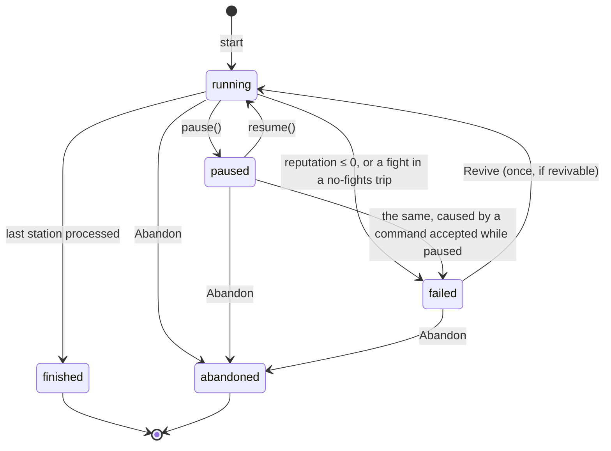
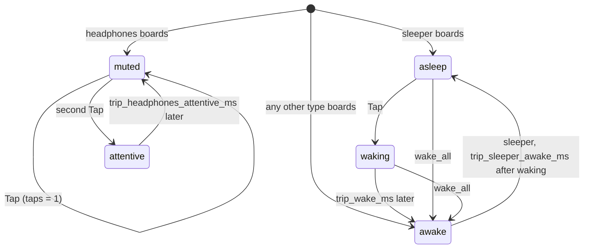
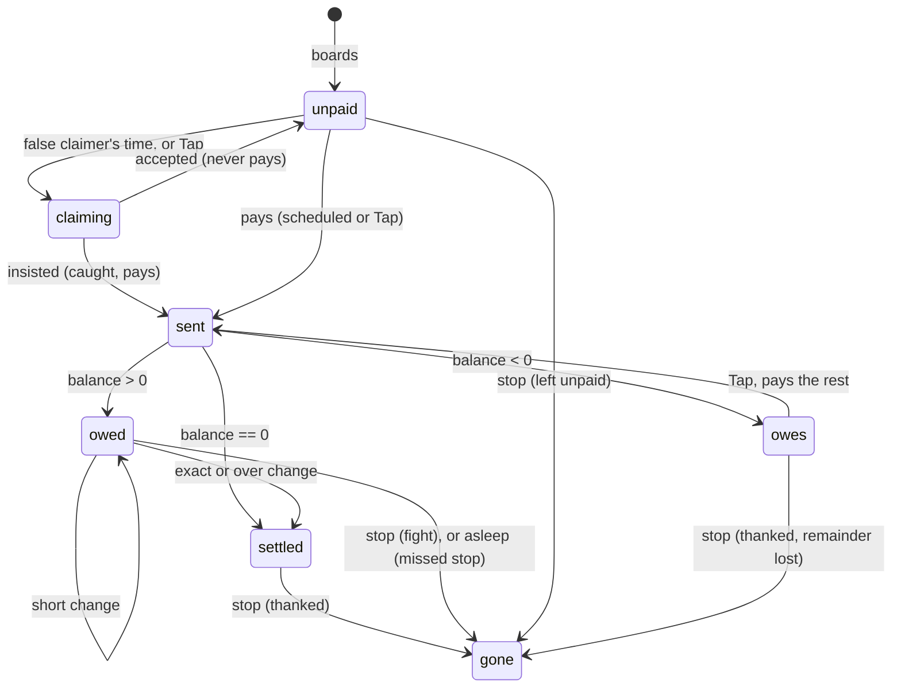
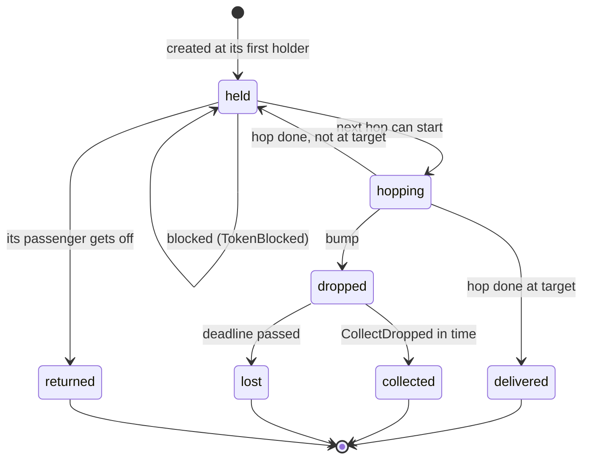

# Data Model: Trip Engine (M01)

Phase 1 of [plan.md](./plan.md). These are the engine's types: what each one holds, how it changes,
and what makes it valid. The exact behavior is in [contracts/rules.md](./contracts/rules.md), and the
Dart surface is in [contracts/engine-api.md](./contracts/engine-api.md). Every amount is integer
piasters, every time is integer milliseconds, and every collection is unmodifiable (research R2).
Wire names are snake_case and Dart names are camelCase.

## Inputs

### TripDefinition (generated, from `content_models`)

This is B04's generated model of `trip.schema.json`, and the engine never redefines it. This feature
adds one field to it (content-contract.md §1):

| Field | Type | Note |
| --- | --- | --- |
| `rules.no_fights_required` | bool | New. When true, the first fight fails the trip, and it can't be revived (FR-057). |

### TripParams

The rule numbers a trip runs with (FR-067). It has no defaults in code. Its wire form is a flat
object keyed by tunable name, with the per-line key written without its `_<line_id>` suffix
(contracts/tunables.md).

| Field (wire) | Rule |
| --- | --- |
| `trip_hop_ms` | base hop length, from `trip_hop_ms_<line_id>` |
| `trip_undo_window_ms` | undo window |
| `rep_fight`, `rep_false_accusation`, `rep_missed_stop`, `rep_liar_caught`, `rep_exact_change`, `rep_revive_to` | reputation |
| `trip_station_warning_ms` | warning lead, and the open-road clamp |
| `trip_hop_pct_hajja`, `trip_hop_pct_chatty_row`, `trip_group_redirect_hop_ms` | hop lengths |
| `trip_wake_ms`, `trip_sleeper_awake_ms`, `trip_headphones_attentive_ms` | alertness |
| `trip_patience_ms`, `trip_patience_pct_hurry`, `trip_patience_drain_pct_traffic` | patience |
| `trip_bump_collect_ms` | bump pick-up window |
| `trip_break_min_piasters`, `trip_break_delay_ms` | «حد معاه فكة؟» |
| `trip_tip_piasters_regular_customer` | tip |
| `booster_ledger_peek_ms`, `booster_traffic_jam_ms`, `booster_traffic_jam_max_per_trip` | boosters |
| `rep_short_change`, `rep_impatient`, `rep_change_request_declined` | reputation |

**Validation** (refusal `bad_params`):

- every field is present and is an integer;
- `trip_hop_ms`, `trip_group_redirect_hop_ms` and `trip_patience_ms` are ≥ 33;
- no percent scales them below 33 either: `scale(trip_hop_ms, trip_hop_pct_hajja)`,
  `scale(trip_hop_ms, trip_hop_pct_chatty_row)`, a hajja's hop in a chatty row (both percents), and
  `scale(trip_patience_ms, trip_patience_pct_hurry)` are all ≥ 33, so no hop lasts 0 ms and no
  hurried passenger starts with no patience (added during implementation);
- every percent is between 1 and 1000;
- every other field is ≥ 0;
- `rep_revive_to` is between 1 and 100;
- `booster_traffic_jam_ms` is at most 60,000, and `booster_traffic_jam_max_per_trip` at most 5.

The last two bounds fix the longest trip at 1,500 s of logic time: stations up to 600 s, plus 10
`traffic` events of at most 60 s, plus 5 traffic jams of at most 60 s (spec SC-004).

## State

### TripState

The whole trip at one moment. It is immutable, and each `step` or `apply` returns a new one.

| Field | Type | Meaning |
| --- | --- | --- |
| `t_ms` | int | Clock, a multiple of 33. |
| `status` | `TripStatus` | `running`, `paused`, `failed`, `finished` or `abandoned`. |
| `reputation` | int | 0..100 as reported. It may go below 0 internally, only to fail. |
| `tray` | `Pieces` | Pieces in the drawer. |
| `hand` | `Pieces` | Pieces the driver holds. |
| `passengers` | `List<PassengerState>` | In definition order, including those not yet aboard and those gone. |
| `tokens` | `List<MoneyToken>` | Live tokens in id order. Delivered and lost tokens are removed. |
| `next_token_id` | int | Starts at 1. |
| `schedule` | `List<StationState>` | One per trip station, in order. |
| `next_station` | int | Index of the next unprocessed station. It equals the station count when all are done. |
| `events_fired` | `List<bool>` | Per authored event. |
| `fare_increase_piasters` | int | Sum of `fare_increase` amounts so far. |
| `old_fare_payers` | `Set<String>` | Passengers listed by any `fare_increase`. |
| `traffic_active` | bool | True from a `traffic` event until the next station is reached. |
| `claims` | `Map<String, Claim>` | Open claims by passenger. |
| `disputes` | `Map<int, Dispute>` | Open disputes by event index. |
| `change_requests` | `Map<String, ChangeRequest>` | Open change requests by passenger. |
| `pending_breaks` | `List<PendingBreak>` | «حد معاه فكة؟» requests that haven't completed. |
| `breaks_used` | int | Against `rules.max_break_requests`. |
| `ledger_peek_until_ms` | int? | While `t_ms` is below this, who has paid is readable. |
| `last_send` | `LastSend?` | `{token_id, until_ms}` for undo. |
| `counters` | `Counters` | See below. |
| `mistakes` | `List<Mistake>` | In the order they happened. |
| `reputation_lost` | `Map<RepCause, int>` | Penalties applied, by cause. |
| `boosters_used` | `List<BoosterId>` | In order. |
| `revived` | bool | |
| `revivable` | bool | False after a story-trip fight (FR-057), or once revived. |
| `commands_accepted` | int | Against the cap of 1,200, which `Abandon` is exempt from (at most 1,201). |
| `prng` | int | xorshift32 state (uint32). |
| `result` | `TripResult?` | Set when the trip finishes, fails or is abandoned. |

### Pieces

A multiset of denominations: a map from the glossary §3.2 denomination to a count of at least 1,
held in ascending denomination order. Its `total` is the sum. Money is never anything else.

### StationState

| Field | Type | Meaning |
| --- | --- | --- |
| `station_id` | String | From the definition. |
| `at_ms` | int | Current arrival time: the authored time plus every shift so far. |
| `fare_piasters` | int | Authored fare. The current fare adds `fare_increase_piasters`. |
| `warned` | bool | Whether `StationWarning` has fired. |

### PassengerState

| Field | Type | Meaning |
| --- | --- | --- |
| `passenger_id` | String | |
| `presence` | `Presence` | `waiting` (not boarded yet), `aboard` or `gone`. |
| `seat_id` | String | Their seat. They sit in it only while `aboard`. |
| `alertness` | `Alertness` | See the state machine below. |
| `alert_until_ms` | int? | When `waking` ends, `awake` ends (sleeper), or `attentive` ends. |
| `taps` | int | Taps while muted. Reset when attentive. |
| `fare_sent` | bool | Their fare (or claim-free payment) has been handed over. |
| `fare_piasters` | int? | Fixed when the fare is sent, including the group sum for a payer. |
| `balance` | int | Payment minus fare. Above 0, change is owed; below 0, the passenger owes. |
| `paid_in` | int | Fare money from this passenger that reached the driver. |
| `patience_ms` | int? | Remaining. Null until first owed. |
| `half_patience_spoken` | bool | |
| `impatient` | bool | Patience ran out (charged once). |
| `claim_resolved` | bool | One resolved claim per passenger (research R7). |
| `never_pays` | bool | A believed false claimer. |
| `deadline_ms` | int? | Set by `drop_me_here`. |
| `pickup_due` | bool | A `waiting` passenger whose boarding station or pickup has come, and who boards as soon as their seat is free. |
| `outcome` | `AlightOutcome?` | `thanked`, `fight`, `left_unpaid` or `missed_stop`, once `gone`. |

Derived, not stored:

- **able**: aboard, and `awake` or `attentive`;
- **owed**: `fare_sent` and `balance > 0`;
- **group payer**: the passenger in the group with archetype `group_payer`;
- **member**: any other passenger with that `group_id`.

### MoneyToken

| Field | Type | Meaning |
| --- | --- | --- |
| `token_id` | int | Creation order, from 1. |
| `kind` | `TokenKind` | `fare`, `change`, `return`, `redirect`, `break_out` or `break_in`. |
| `pieces` | `Pieces` | What it carries. |
| `owner` | String | The passenger it concerns: the payer for a fare or a return, the recipient for change. |
| `target` | `Holder` | `DRIVER`, or a passenger id. |
| `holder` | `Holder` | Who holds it now. |
| `hop` | `Hop?` | `{to, elapsed_ms, duration_ms}` while moving. |
| `hops_done` | int | 0 while on its first hop (for undo). |
| `blocked_by` | String? | The passenger stopping it, if any. |
| `dropped_until_ms` | int? | Set by a bump. The deadline for `CollectDropped`. |

`Holder` is either `DRIVER` or a passenger id. Seats are reached through their passengers.

### Open choices

| Type | Key | Fields |
| --- | --- | --- |
| `Claim` | passenger | `truthful` (bool): true when they really sent their fare. |
| `Dispute` | event index | `a`, `b` (passenger ids). |
| `ChangeRequest` | passenger | `note_piasters`. |
| `PendingBreak` | (list) | `denomination`, `completes_at_ms`. |

### Counters

`fights`, `lost_fares`, `missed_stops`, `impatient`, `caught_liars`, `tips_piasters` and
`overpaid_piasters`. All are integers starting at 0.

### Mistake

`{passenger_id, kind, amount_piasters}`, where `kind` is one of:

- `over`: gave more than was owed; the amount is the excess;
- `not_owed`: gave change to a passenger who hadn't paid or was owed nothing; the amount is the whole
  token;
- `unreturned`: a passenger got off still owed change; the amount is what they were owed.

### RepCause

- Losses, recorded in `reputation_lost`: `fight`, `false_accusation`, `missed_stop`,
  `short_change`, `impatient` and `change_request_declined`.
- Gains, not recorded there: `exact_change`, `liar_caught` and `revive`.

## Commands

13 commands (FR-050). The wire forms are in contracts/replay-and-fixtures.md.

| Command | Arguments | Allowed when |
| --- | --- | --- |
| `PickFromTray` | `denomination` | running |
| `ReturnHand` | none | running |
| `SendHand` | `passenger_id` | running |
| `UndoLastSend` | none | running |
| `Tap` | `passenger_id` | running |
| `ResolveClaim` | `passenger_id`, `insist` | running, paused |
| `ResolveDispute` | `dispute_id`, `paid_passenger_id` | running, paused |
| `ResolveChangeRequest` | `passenger_id`, `agree` | running, paused |
| `RequestBreak` | `denomination` | running |
| `CollectDropped` | `token_id` | running |
| `UseBooster` | `booster_id` (`change_bag`, `wake_all`, `ledger_peek`, `traffic_jam`) | running, paused |
| `Revive` | none | failed |
| `Abandon` | none | running, paused, failed |

A rejected command returns a `Rejection {code, message}` and changes nothing. The codes are listed
in contracts/engine-api.md.

## Domain events

The engine reports what happened, in order, from every `step` and accepted command. The payloads are
in contracts/engine-api.md. Grouped:

- **Passengers:** `PassengerBoarded`, `PassengerSpeaks`, `PassengerWaking`, `PassengerWoke`,
  `PassengerFellAsleep`, `PassengerCalled`, `PassengerAttentive`, `PassengerMuted`,
  `PatienceRanOut`, `StopChanged`, `PassengerAlighted`.
- **Money:** `FareSent`, `ChangeSent`, `SendUndone`, `TokenHopStarted`, `TokenBlocked`,
  `TokenUnblocked`, `MoneyArrivedAtDriver`, `ChangeDelivered`, `ExcessReturned`, `MoneyDropped`,
  `DroppedCollected`, `DroppedLost`, `BreakRequested`, `BreakCompleted`.
- **Choices:** `ClaimRaised`, `ClaimAccepted`, `LiarCaught`, `FalseAccusation`, `DisputeRaised`,
  `DisputeResolved`, `ChangeRequestRaised`, `ChangeRequestResolved`, `ChangeRequestCompleted`.
- **Trip:** `EventStarted`, `EventSkipped`, `FareIncreased`, `ScheduleShifted`, `StationWarning`,
  `StationReached`, `ReputationChanged`, `MistakeMade`, `BoosterUsed`, `LedgerPeekStarted`,
  `LedgerPeekEnded`, `TripFailed`, `TripRevived`, `TripFinished`, `TripAbandoned`.

These keep mobile §7.5's names (`ChangeDelivered`, `StationWarning` and so on) and add the rest.

## TripResult

Wire form, snake_case. It extends mobile §7.2 (FR-058). B03 reads it in `trip_result`.

| Field | Type | Note |
| --- | --- | --- |
| `trip_id`, `rev` | String, int | From the definition. |
| `outcome` | `finished` · `failed` · `abandoned` | New. |
| `stars` | 0..3 | 0 unless finished. |
| `star_flags` | `{reached, no_fights, no_mistakes}` | bools |
| `fares_collected_piasters` | int | Σ `min(fare, paid_in)`. |
| `overpaid_piasters`, `tips_piasters` | int | |
| `earnings_jenehat` | int | 0 unless finished. Otherwise ⌊max(0, fares − overpaid + tips) / 100⌋, capped. |
| `fights`, `lost_fares`, `missed_stops`, `impatient`, `caught_liars` | int | `missed_stops` and `impatient` are new. |
| `mistakes` | `List<Mistake>` | |
| `reputation` | 0..100 | Final. New. |
| `reputation_lost` | `{cause: int}` | Only causes with a loss. New. |
| `duration_ms` | int | Clock when it ended. |
| `boosters_used` | `List<booster_id>` | |
| `revived` | bool | |
| `command_log_hash` | String | Lowercase hex SHA-256 (research R9). |

## Replay record and parity fixture

| Type | Fields |
| --- | --- |
| `ReplayRecord` | `definition`, `seed`, `params`, `command_log`, `t_ms` |
| `ParityFixture` | `definition`, `seed`, `params`, `command_log`, `expected_result` |

Both are JSON. See contracts/replay-and-fixtures.md.

## Capabilities

`content/engine/capabilities.json`: the supported archetypes, the events with their parameter rules,
the speech slots with their placeholders, and the allowed change-request notes. See
contracts/content-contract.md §2.

## State machines

### Trip status

A rebuilt trip comes back `paused` if it was running, and otherwise in the status it had.

### Passenger alertness

### Passenger fare and balance

### Money token

## Validation (refusals at start, FR-003)

`TripEngine.start` throws `TripRefused` with every problem found, not just the first. Each problem
is `{code, path, message}`, and B05 uses the same codes.

| Code | When |
| --- | --- |
| `bad_seed` | Seed outside 1..2^32−1. |
| `bad_params` | See TripParams. |
| `duplicate_id` | Two seats, stations or passengers share an id. |
| `unknown_seat` | A passenger's seat isn't in `seats`. |
| `unknown_station` | A destination, boarding or event station isn't a station of the trip. |
| `stations_out_of_order` | `at_seconds` doesn't strictly increase. |
| `board_after_dest` | A boarding station doesn't come before the destination. |
| `seat_taken_at_start` | Two passengers aboard at the start share a seat. |
| `unknown_passenger` | An event names a passenger the trip doesn't have. |
| `group_mismatch` | Group sizes disagree, more members than the size, or not exactly one `group_payer`. |
| `unsupported_archetype` | The archetype isn't in capabilities. |
| `unsupported_event` | The event isn't in capabilities. |
| `event_param` | A parameter is missing, forbidden or out of range (capabilities table). |
| `pickup_conflict` | A passenger is picked up by more than one `roadside_pickup`, or also has a `board_station_id`. |
