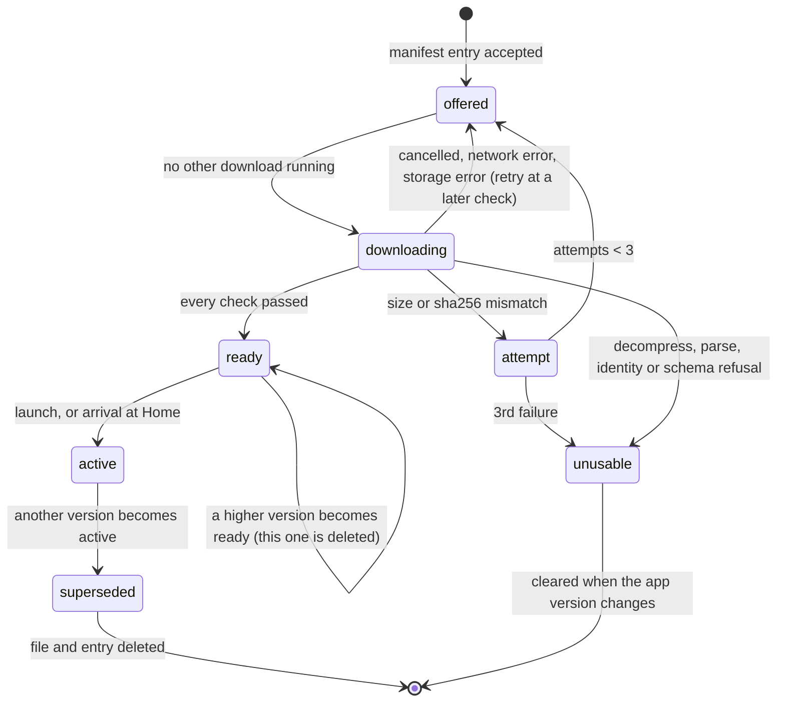

# Data Model: Content Pack Loader (M04)

Everything here is local to the app or committed to the repository. There is no server-side change.
The pack itself is defined by `content/schemas` (B04), and the manifest by `manifest.schema.json`.

## Bundled pack record (`assets/content/<dir>/bundled.json`)

Written by `wassal-content bundle` (contracts/bundling.md) from the file it describes, and committed
in canonical JSON.

| Field | Type | Rule |
| --- | --- | --- |
| `pack_id` | string | `"core"` |
| `version` | int | ≥ 1. Dev: `1`. Release: `content/source/pack.json`'s `version`. |
| `file` | string | `core-<version>.json.gz`, in the same directory |
| `size` | int | ≥ 1, the file's byte length |
| `sha256` | string | 64 lowercase hex, over the file's bytes |
| `min_client_version` | string | `MAJOR.MINOR.PATCH`. Dev: the schema set's floor for the pack's major. Release: the release record's. |
| `source` | string | `sample` (dev) or `content_source` (release) |
| `release_record_sha256` | string | Release only: the sha256 of the committed `core-<v>.release.json` copy, which is the hash in production's promotion code |

**Directories.**

- `assets/content/dev/` is bundled in the dev flavor.
- `assets/content/release/` is bundled in staging and prod. Until production's first promotion it
  holds only `README.md`, and the Gradle check refuses staging and prod builds.

## Content state (`<app support>/content/state.json`)

The app's record of what it stores. It is written atomically (research R5) by `PackStore` only.

| Field | Type | Rule |
| --- | --- | --- |
| `format` | int | `1`. Any other value, or a file that doesn't parse, counts as an empty state. |
| `app_version` | string | `<version>+<build>` of the app that last wrote it |
| `stored` | list of Stored pack | At most 2: at most one `active` and one `ready` |
| `unusable` | list of `{version: int, reason: string}` | Versions this app version won't download again (R14) |
| `attempts` | list of `{version: int, count: int}` | Failed size or sha256 checks per version, 1 or 2. The 3rd moves the version to `unusable`. |
| `last_check_at` | string | UTC ISO-8601 of the last manifest check, failed or not. A check cancelled because the app left the foreground puts back the previous value. Absent before the first check. |
| `events` | list of Event | The last 20, oldest first. A repeat of the newest event (the same reason, version and detail) replaces it with the new time, so an entry ignored on every check can't push the others out. |

### Stored pack

| Field | Type | Rule |
| --- | --- | --- |
| `version` | int | ≥ 1 |
| `file` | string | `core-<version>.json.gz` in `<app support>/content/` |
| `size`, `sha256`, `min_client_version` | as in the manifest entry it came from | The values every later check uses |
| `state` | `ready` or `active` | `ready`: verified, waiting for a switch. It is what the spec calls the "verified next pack". `active`: the pack in use. |

**Event**: `{at: UTC ISO-8601, reason: string, version?: int, detail?: string}`. The reason and
detail codes are in contracts/loading.md "Reason codes". No URL, header or content.

**Invariants** (checked after every write in tests):

1. If both a `ready` entry and an `active` entry exist, the `ready` version is higher.
2. Every listed `file` exists, and no other `core-*.json.gz` or `tmp/` file survives a launch.
3. A version in `unusable` is never in `stored` or `attempts`.
4. `app_version` equals the running app's after the first write of a launch.

## Expected pack

What a check compares against, from the bundled record, a stored entry or a manifest entry:
`{version, size, sha256, min_client_version}`.

## Manifest entry (generated `ManifestPack`)

The app acts on an entry only when all of these hold (FR-018); otherwise it is ignored, with an
`entry_ignored` event for the last three:

1. `pack_id == "core"`;
2. `version` is above the active version and above any `ready` version;
3. `size` ≤ 16 MiB, or the reason is `too_large`;
4. `min_client_version` ≤ the app's version, or the detail is `min_client_version`;
5. `version` isn't in `unusable`, or the detail is `unusable`;
6. the URL is `https`, or (dev only) `http` to `localhost`, `127.0.0.1` or `10.0.2.2`, or the
   detail is `insecure_url`.

A manifest with `version: 0`, an empty `packs` or no acceptable `core` entry means "nothing new".

## Active content (in memory)

| Field | Type | Meaning |
| --- | --- | --- |
| `version` | int | The active pack's version (FR-010) |
| `origin` | `bundled` or `stored` | Where it was loaded from |
| `source` | `ContentSource` | The read-only view of the pack (contracts/content-source.md) |

The ready pack, if any, is held as a second decoded pack next to it until the switch (research R7).

## Lifecycle of one version on a device

## Choosing the active pack at launch

Order of work in research R6: reconcile, clear on app update, sort the candidates highest first, and
decode until one passes. Outcomes:

| Situation | Active | Deleted |
| --- | --- | --- |
| Fresh install | bundled | — |
| A stored `ready` (or `active`) passes, and it is above bundled | that entry | every other stored entry |
| The top stored entry fails its check | the next candidate | the failed entry (`stored_check_failed`) |
| An app update ships a bundled version above every stored one | bundled | all stored |
| An app update ships a lower bundled version | the stored entry, if its minimum ≤ the app version | — |
| Nothing passes | none: startup fails with the boot screen's retry (FR-008) | — |
