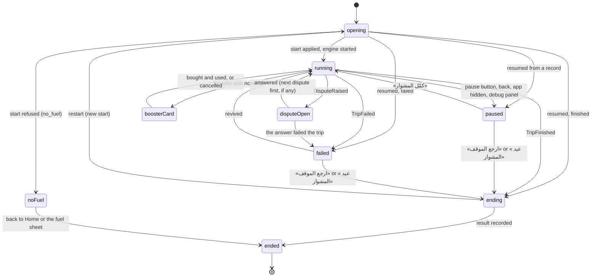

# Data Model: Trip Screen (M02)

What M02 stores, what it keeps in memory while a trip runs, and what the screen draws. The engine's
own types (`TripState`, `PassengerState`, `MoneyToken`, `TripResult`, `ReplayRecord`, commands and
events) are M01's ([data-model.md](../004-m01-trip-engine/data-model.md)) and are not repeated. Every
amount is integer piasters, every time integer milliseconds on the trip's clock unless it says
otherwise (constitution II).

## Stored

### Tables (app database, schema v2)

Written only by `DriftTripRecords` ([contracts/trip-records.md](./contracts/trip-records.md)). Every
column is `INTEGER` or `TEXT`.

**`trip_record`**: one row per trip start that hasn't recorded its result yet.

| Column | Type | Meaning |
| --- | --- | --- |
| `start_txn` | TEXT, PK | The economy's request id for the start, which becomes the start operation's id (UUIDv7). |
| `trip_id` | TEXT | `line_hay.01`. |
| `content_version` | INTEGER | The pack version the trip started with (M04 hand-over). |
| `definition_json` | TEXT | The `TripDefinition` in canonical JSON, so a pack switch can't change it. |
| `seed` | INTEGER | The engine's seed (uint32). |
| `params_json` | TEXT | `TripParams.toJson()` as the trip started. |
| `t_ms` | INTEGER | The last saved clock: updated with every command row and every pause. |
| `created_at_ms` | INTEGER | Trusted time when the row was written (M05's clock), for cleanup and debugging. |

**`trip_record_command`**: the accepted commands of a record, append-only.

| Column | Type | Meaning |
| --- | --- | --- |
| `start_txn` | TEXT | The record. PK with `seq`. |
| `seq` | INTEGER | 0, 1, 2, … in acceptance order. |
| `command_json` | TEXT | The command's wire form, `[t_ms, "Name", …args]` (M01 replay-and-fixtures.md). |

**`trip_intent`**: economy calls that follow an engine command and must survive a kill.

| Column | Type | Meaning |
| --- | --- | --- |
| `request_txn` | TEXT, PK | The request id the economy call uses, and reuses on every retry. |
| `start_txn` | TEXT | The record it belongs to. |
| `kind` | TEXT | `use_booster` (the only kind in M02). |
| `booster` | TEXT | The `booster_id` wire name. |

Rules:

- A record and its commands and intents are deleted together, in one transaction.
- At most one record matches the economy's unfinished start. Any other record is stale and is deleted
  at launch (research R8).
- A command row and the record's new `t_ms` are written in one transaction; so are a `UseBooster`
  command row and its intent row (research R7).

### Preferences (settings store)

Device preferences, kept by M03's `SettingsStore`. Each key joins
`SharedPrefsSettingsStore.keys`.

| Key | Values | Default | Meaning |
| --- | --- | --- | --- |
| `pref.trip_sound` | `on`, `off` | `on` | Sound effects in a trip. |
| `pref.trip_haptics` | `on`, `off` | `on` | Vibration in a trip. |
| `pref.trip_hints_seen` | comma-separated archetype wire names | empty | Passenger types بلية has already explained (`first_time` mode). |

### Assets

| Path | What |
| --- | --- |
| `assets/rive/passenger.riv` | The owner's character file ([contracts/rive-character.md](./contracts/rive-character.md)). |
| `assets/audio/sfx/*.wav` | The stand-in effects, made by `tool/sfx/generate.py` (research R18). |

## In memory

### TripSession

The trip on screen. Created when the trip opens, gone when it ends.

| Field | Meaning |
| --- | --- |
| `startTxn` | The economy's start id, also the record's key. |
| `tripId`, `lineId`, `vehicleId`, `kind` | From the definition. |
| `definition`, `seed`, `params` | What the engine started or rebuilt with. |
| `contentVersion` | The pack version it started with. |
| `line` | The trip's line from the active pack, for names (nullable: a resumed trip may outlive its line). |
| `bubbleMinMs`, `hintsMode` | Read from the tunables when the trip started (`trip_bubble_min_ms_<line_id>`, `trip_hints_mode_<line_id>`). |
| `engine` | The one `TripEngine`. |

### TripPhase

The controller's phase. The engine runs only in `running`.

- `ending` records the result and deletes the record; on `OpWriteFailed` it stays in `ending` with a
  retry.
- `ended` carries where to go: the result route (with the `TripResult`), or Home.
- Leaving the app in `running` goes to `paused`. In any other phase the engine is already stopped, and
  the phase stays as it was.

### TripIntents

The request ids the controller holds, one per intent (FR-008).

| Intent | Id lives | On a kill |
| --- | --- | --- |
| Start | the record's `start_txn` | resumed from the record, or the record is stale |
| Result | memory | the rebuilt trip records its result again (the old id never applied) |
| Booster purchase | memory | the bought booster stays in the inventory |
| Booster use | `trip_intent` | sent again with the same id at the rebuild |
| Revive | memory | the economy's `unfinished.revived` says it was paid; the rebuild applies `Revive` |

### Presentation memory

Kept by the controller next to the engine and folded by pure functions on each step. It isn't saved:
a rebuild starts it empty, which loses only bubbles and log lines from before the kill.

| Part | Content |
| --- | --- |
| `BubbleQueue` | Visible bubbles (≤ 2), each with its line and the trip time it appeared; waiting lines with their emit time. |
| `TalkLog` | The last two «آخر كلام» lines. |
| `WarningMemory` | The last `StationWarning`'s `owed` ids and its station, until `StationReached`. |
| `HintState` | The hint showing (if any), the queue, and the types explained this trip. |
| `DisputeQueue` | Disputes waiting to be asked, in event order. |
| `BannerState` | The fare-increase banner and its end time. |
| `RoadState` | Whether an `open_road` event rushes the street (until `StationReached`), and when a `roadside_pickup` started its wave. |

## The view

Built by `projectTripView(state, memory, facts, screen)`, a pure function in `features/trip/domain/`.
`facts` is what the trip started with (`TripFacts`: the definition, the line, the params, and the line's
bubble and hint tunables). `screen` is what the controller adds (`TripScreenState`: the phase, break
mode, the command lock, the booster stock and prices, the revive offer, a rejection line). The view
contains only what the screen may show ([contracts/trip-view.md](./contracts/trip-view.md)).

| Type | Fields |
| --- | --- |
| `TripView` | `tMs`, `phase`, `topBar`, `strip`, `passengers`, `tokens`, `dropped`, `windows`, `hand`, `tray`, `breakButton`, `boosters`, `undoUntilMs?`, `choices`, `bubbles`, `log`, `hint?`, `banner?`, `storyCondition?` (null without the condition, false once broken), `failSummary?`, `rejection?` (a rejection line), `breakMode` («حد معاه فكة؟» waiting for a note), `controlsLocked` (the command limit) |
| `TopBarView` | `lineName?`, `tripNumber`, `reputation` (0–100), `reputationLow` (below 40) |
| `StationStripView` | `chips` (≤ 4), `vehiclePermille` (position along the strip), `countdownMs?`, `warning` (bool) |
| `StationChip` | `stationId`, `slot` (0–3: color and letter), `name?`, `farePiasters`, `studentIcon`, `reached`, `next` |
| `PassengerView` | `passengerId`, `seatId`, `presence` (`boarding`, `aboard`, `leaving`, `gone`), `look` (`SkinLook`), `slot?`, `mood` (0–3), `talking`, `asleep`, `waking`, `headphones`, `attentive`, `nearStopPulse`, `dropMeHere` (the «هنا» star), `ledgerBadge?` (`paid` or `unpaid`, only during a peek), `outcome?` (while leaving) |
| `TokenView` | `tokenId`, `kind` (`fare` forward or `change` back, from the token's kind), `amountPiasters`, `from?` (a seat; null for the driver), `to?`, `progressPermille`, `hopMs` (the hop's length, for interpolation), `blocked`, `dropped`, `atHolder` |
| `DroppedMoneyView` | `tokenId`, `amountPiasters`, `from?`, `to?`, `progressPermille` (where it fell), `untilMs` |
| `WindowsView` | `road` (`normal`, `traffic` while `state.trafficActive`, `open` from an `open_road` event until the next `StationReached`), `waveAtMs?` (a `roadside_pickup`'s wave, for `waveMs`) |
| `HandView` | `pieces` (denomination → count), `totalPiasters` |
| `TraySlotView` | `denomination`, `count`, `breakable` (glows in break mode) |
| `BreakButtonView` | `left`, `enabled` |
| `BoosterSlotView` | `booster`, `count`, `priceBonat?` (when 0 left), `enabled`, `adOffered` (always false until M11) |
| `ClaimChoice` | `passengerId` |
| `ChangeRequestChoice` | `passengerId`, `notePiasters` |
| `DisputeChoice` | `disputeId`, `a`, `b` |
| `BubbleView` | `passengerId`, `text`, `style` (`plain`, `warning`, `fight`, `thanks`), `shownAtMs` |
| `SpeakerLabel` | `labelKey` (the look's label, or «الشلة»), `slot?` (the station letter when two aboard share the label) |
| `LogLine` | `kind` (`speech`, `fareArrived`, `breakDone`, `dropped`, `lost`, `fareUp`), `speaker?`, `text?` (a passenger's line, resolved), `amountPiasters?` (a money line; the screen words it) |
| `HintView` | `key` (the ARB key of بلية's line), `targetPassengerId?` |
| `BannerView` | `oldPiasters`, `newPiasters`, `shownAtMs` |
| `FailSummary` | `causes` (the top two by reputation lost), `revive?` |
| `FailCause` | `cause`, `count?` (when the engine counts it) |
| `ReviveOffer` | `priceBonat`, `affordable` |
| `RejectionLine` | `code`, `untilMs` |

`ClaimChoice`, `ChangeRequestChoice` and `DisputeChoice` are the three `ChoiceView`s. Every view type is
immutable and compared by its fields, so a widget that selects a slice rebuilds only when it changes.
Text the app owns (labels, log money lines, hints, rejections) stays as keys and amounts in the view
and is worded by the screen; a passenger's line comes from the content pack and is resolved in the
domain, with amounts formatted in the player's digit style.

The view has no field for a passenger's fare, payment, balance or debt (research R10).

### SkinLook

App data (art ships in the app).

| Field | Meaning |
| --- | --- |
| `skin` | The content's slug, such as `effendi_suit`. |
| `shirt` | A theme token for the shirt. |
| `accessory` | One of the Rive file's accessory values: `none`, `cap`, `glasses`, `headphones`, `tie`, `scarf`, `headscarf`. |
| `labelKey` | The ARB key of the speaker label (`tripLookEffendi`, `tripLookStudent`, …). |

Unknown skins resolve through a fallback by archetype, with the neutral label `tripLookPassenger`
(«راكب»).

## Cues

`mapCues(events, before, after, session)` turns one step's or one command's engine events into one-shot
cues, in event order.

| Cue | Payload |
| --- | --- |
| `SoundCue` | `Sfx` (`coin`, `notePass`, `call`, `horn`, `fight`, `thanks`, `wrong`, `bump`, `alert`) |
| `HapticCue` | `light` or `heavy` |
| `ShakeCue` | duration (skipped under reduced motion) |
| `HighlightCue` | passenger id (the half-second glow before a throw) |
| `LineCue` | a resolved speech line for the bubble queue and the log |
| `LogCue` | a money line for the log |
| `BannerCue` | the fare increase |
| `FeedbackCue` | a rejection line or a control shake (research R22) |

## Validation

- A record whose `definition_json` doesn't parse, or whose commands are out of order, is refused by
  `TripEngine.rebuild` (`RebuildRefused`), and the trip is recorded abandoned (research R8).
- A `trip_intent` whose record is gone is deleted at launch.
- `SkinLook` covers every skin in the sample pack and in `content/source/` (a test reads both).
