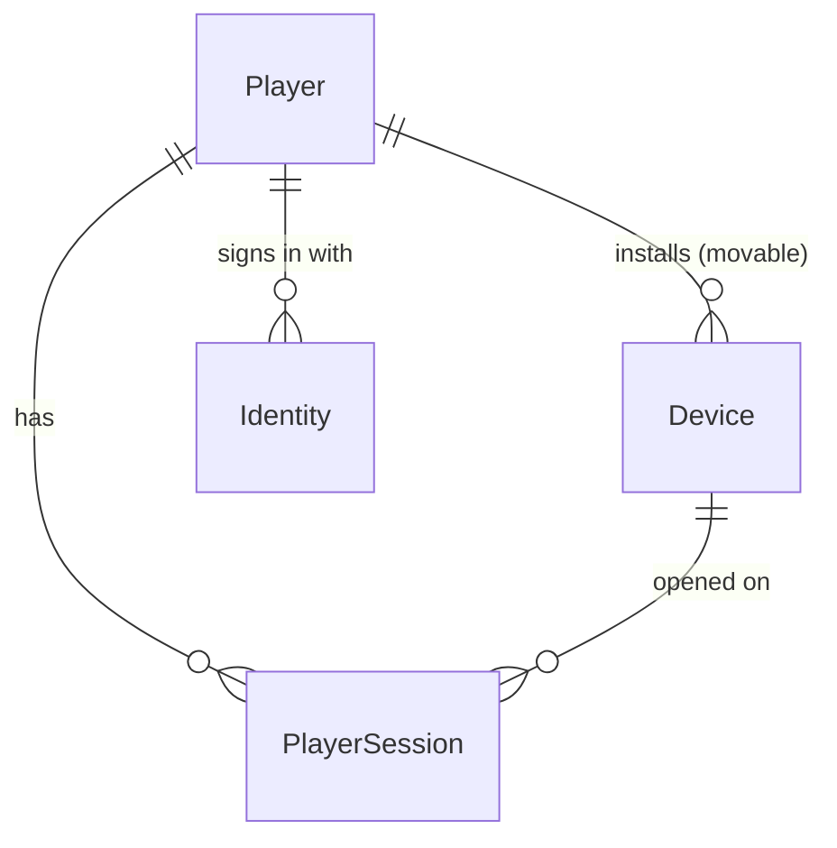

# Data Model: Accounts and Auth (B02)

Every table is in `apps.accounts` and has a UUIDv7 primary key (`common.UUIDv7Model`, B01 check
`common.E001`), plus `created_at`. Mutable tables also have `updated_at`. B01's staff `User` is
unchanged and separate (research R1).



## Player

One game account. B03 attaches the wallet and progress to it, B09 changes its status, and
B11 attaches its push tokens.

| Field | Type | Rule |
| --- | --- | --- |
| `id` | UUIDv7 | The `player_id` in every API payload and token (`sub`) |
| `status` | text: `active` \| `pending_deletion` \| `deleted` | Default `active`. B02 only reads it (research R11). Indexed. |
| `display_name` | text ≤ 32, blank | Empty until B03's `settings_update` stores one (spec FR-006) |
| `country` | text ≤ 2, blank | Upper-case region of `locale` when it has one (`ar-EG` → `EG`), else empty. No address lookup. |
| `locale` | text ≤ 16 | `^[a-z]{2,3}(-[A-Z]{2})?$`, from the creation request |
| `platform` | text: `android` \| `ios` | From `X-Platform` at the last token issue |
| `client_version` | text ≤ 32 | From `X-Client-Version` at the last token issue |
| `driver_level` | small integer ≥ 1 | Default 1. B03 raises it. |
| `is_tester` | boolean | Default false. The only field staff can change (contracts/admin.md). |
| `last_seen_at` | timestamp | Set when tokens are issued or renewed (FR-018), never on other requests |
| `created_at`, `updated_at` | timestamp | `created_at` stands for §12's `install_first_at` |

- `is_authenticated` is a property that is always `True`, for DRF. It is not a column.
- **Changes in B02:** only the token issue paths change it. They write `last_seen_at`,
  `client_version` and `platform` with `update_fields`.

### Status transitions

```text
active ──(B09: deletion requested)──▶ pending_deletion ──(B09: 7 days)──▶ deleted
```

What B02 does with each status:

| Status | Tokens | Install id | Its Google identity |
| --- | --- | --- | --- |
| `active` | accepted | returns the player | belongs to it |
| `pending_deletion` | refused, `403 account_deleted`, from the next request on (FR-014) | gets a new player, and the device moves to it (FR-004) | free: a link from another player moves it (FR-030) |
| `deleted` | refused, `403 account_deleted` | gets a new player, and the device moves to it | free |

## Device

One installation of the app, keyed by its install id. It is the anonymous identity (research R4).

| Field | Type | Rule |
| --- | --- | --- |
| `id` | UUIDv7 | Opaque. Appears in logs and in the admin. |
| `install_id_hash` | char(64) | `sha256` hex of the canonical v4 UUID. **Unique.** Never shown or logged. |
| `player` | FK `Player`, `PROTECT` | Moves on `switch_to_existing` (FR-026), and to a new player when the old one isn't active (FR-004) |
| `platform` | text: `android` \| `ios` | Updated at each token issue |
| `app_version` | text ≤ 32 | Updated at each token issue |
| `last_seen_at` | timestamp | Updated at each token issue |
| `created_at`, `updated_at` | timestamp | — |

- Index on `player`.
- One install id that is carried to two phones (research R5) is one device row with two sessions.

## Identity

A provider account that signs in to a player. MVP providers: `google`. Phase 3 adds `apple`.

| Field | Type | Rule |
| --- | --- | --- |
| `id` | UUIDv7 | — |
| `player` | FK `Player`, `PROTECT` | Moves on `keep_current` (FR-027), or when its holder is no longer active (FR-030) |
| `provider` | text: `google` | Choices grow with phase 3 (an expand-only migration) |
| `subject` | text ≤ 255 | The provider's account number (`sub`). Never shown or logged. |
| `linked_at` | timestamp | Set when the row is created or moved |
| `created_at`, `updated_at` | timestamp | — |

**Constraints:**

- `UNIQUE(provider, subject)`: a provider account belongs to at most one player row. Its holder
  being active is checked in the link service (research R7).
- `UNIQUE(player, provider)`: one account per provider per player (FR-024).

"Linked" means at least one identity row, and `providers` in API answers lists their `provider`
values in a fixed order.

## PlayerSession

The chain of refresh tokens from one sign-in on one device (FR-010, research R3). It never stores
a token, only claims.

| Field | Type | Rule |
| --- | --- | --- |
| `id` | UUIDv7 | The `sid` claim of every token in the chain |
| `player` | FK `Player`, `CASCADE` | — |
| `device` | FK `Device`, `CASCADE` | The device it was opened on. It doesn't move when the device moves: a switch ends this session and opens one for the other player. |
| `status` | text: `active` \| `ended` | — |
| `end_reason` | text, blank: `reuse` \| `switch` \| `limit` | Set when it ends |
| `ended_at` | timestamp, null | — |
| `current_jti` | UUID | The live refresh token |
| `current_issued_at` | timestamp | Its `iat` |
| `current_expires_at` | timestamp | Its `exp` (`iat` + 30 days). After it the session is lapsed (not a stored status). |
| `current_kid` | text ≤ 32 | The key that signed it, for a byte-identical re-sign during the retry window |
| `previous_jti` | UUID, null | The token spent last |
| `previous_spent_at` | timestamp, null | When it was spent: the retry window counts from here |
| `last_renewed_at` | timestamp | Creation or last rotation. Orders the cap's eviction. |
| `created_at`, `updated_at` | timestamp | — |

**Indexes:**

- `(player, status, current_expires_at)`, for counting live sessions;
- `(status, ended_at)` and `current_expires_at`, for pruning.

**Live** means `status = active AND current_expires_at > now`.

### Session transitions

```text
                ┌────────── rotate (current token): new current, old → previous ──────────┐
                │                                                                         │
 sign-in ──▶ active ◀─────── replay (previous token, within the retry window): no change ─┘
                │
                ├── stale token (older, or previous after the window) ──▶ ended (reuse)
                ├── switch_to_existing on this session ─────────────────▶ ended (switch)
                ├── player's live sessions reach the cap at a new sign-in ─▶ ended (limit), least recently renewed
                └── current_expires_at passes ──────────────────────────▶ lapsed (derived; not written)

 ended or lapsed for 30 days ──(daily prune)──▶ row deleted
```

## Settings-backed values (not tables)

| Name | Where | Value |
| --- | --- | --- |
| Signing key ring | `AUTH_SIGNING_KEYS` | `kid:key` entries, first signs (contracts/environment.md) |
| Access lifetime | constant | 15 min (constitution) |
| Refresh lifetime | constant | 30 days (constitution) |
| Retry window | `AUTH_REFRESH_RETRY_SECONDS` | 60 s (0–300) |
| Session cap | `AUTH_MAX_SESSIONS_PER_PLAYER` | 10 (1–50) |
| Throttle rates | `THROTTLE_*_RATE` | contracts/environment.md |
| Google audiences, key cache, timeout | `GOOGLE_*`, `AUTH_HTTP_TIMEOUT_SECONDS` | contracts/environment.md |

## Validation rules (from the spec)

| Rule | Where it is enforced |
| --- | --- |
| Install id is a v4 UUID (FR-002) | Serializer |
| One player per install id, also under a race (FR-003) | `UNIQUE(install_id_hash)` + savepoint retry (research R4) |
| A non-active player is never returned (FR-004) | Creation service |
| One account per provider per player; one player row per provider account (FR-024) | The two unique constraints on `Identity` |
| Only an active holder blocks a link (FR-030) | Link service, under row locks |
| A retry acts only on the conflict shown (FR-029) | `existing_player_id` compared under lock |
| Link and resolve move only links, devices and sessions (FR-028) | Link service writes only `Identity`, `Device.player`, `PlayerSession` (and FR-018's fields on a token issue). The property test checks it. |
| At most the cap of live sessions (FR-010) | Session service, under the player row lock |
| Status checked on every request (FR-014) | `PlayerAuthentication` |

## Migrations (expand-only)

1. `accounts/0002_players`: `Player`, `Device`, `Identity` and `PlayerSession`, with their
   constraints and indexes.
2. `accounts/0003_player_support_group`: the `player_support` group with `view_player`,
   `change_player`, `view_device` and `view_identity` (contracts/admin.md).
3. `accounts/0004_prune_sessions_schedule`: the daily beat row for `accounts.tasks.prune_sessions`
   at 04:30 Cairo time, after the 03:00 backup. Same pattern as B01's heartbeat migration.

Nothing existing changes, so the previous release keeps working during the deploy.

## Restore-drill invariants

None are registered. The drill restores constraints along with the data, so `UNIQUE(install_id_hash)`
and the two `Identity` uniques hold in any restored copy. "At most one *active* holder" is the
link service's guard, not a stored fact that could break. B03 registers
`economy.wallet_equals_ledger` (B01 hand-over).
