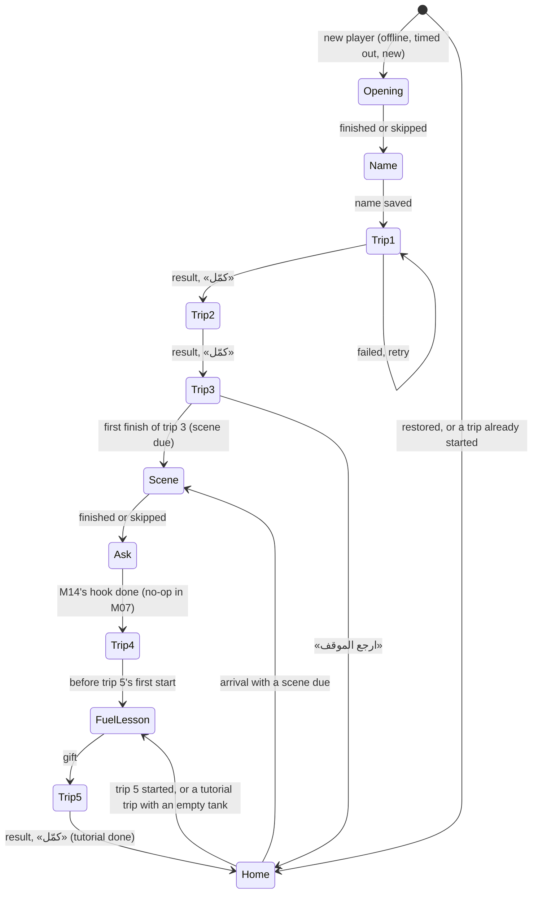
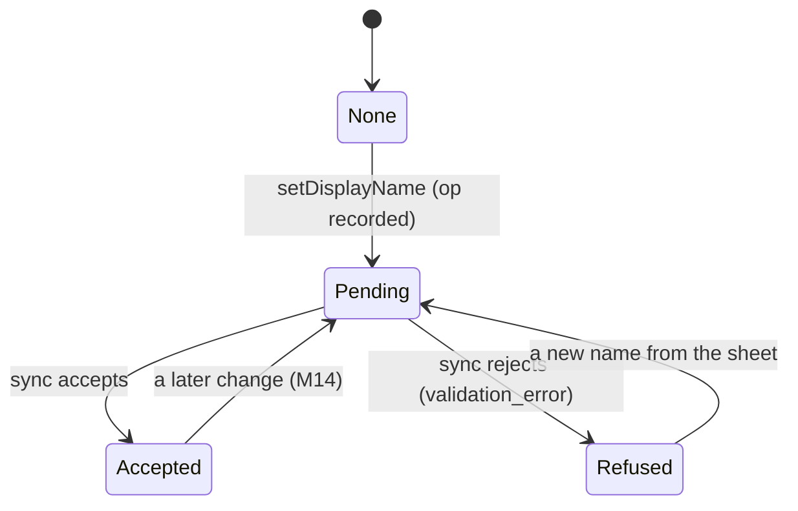

# Data Model: Onboarding and the Tutorial Trips (M07)

What M07 keeps, where, and how it changes. Decisions are in [research.md](./research.md). M05's
economy tables (`specs/007-m05-local-economy/data-model.md`) and M06's account tables
(`specs/011-m06-identity-sync/data-model.md`) stay as they are, except where this file says.

## Where each value lives

| Value | Store | Written by |
| --- | --- | --- |
| The opening done, scenes due and seen, fuel lesson done, step reached, tutorial done | app database, `first_session` (new) | `DriftFirstSessionStore` |
| The driver's name (projected), the tutorial grant | app database, `player_state` (new), and the base state's JSON | `DriftEconomyStore` |
| The server's last answer about the name (M06) | app database, `account.display_name`, unchanged | `DriftAccountStore` |
| The name and gift operations | app database, `ledger_ops` (two new types) | `DriftEconomyStore` |
| Whether the name sheet opened this launch; the coach's per-run memory; the debug "coach everywhere" switch | memory | `NameReaskHost`, `TripController`, the dev card |
| Trip progress, fuel, unfinished trip | M05's tables, unchanged | `DriftEconomyStore` |
| Scenes and their `plays`, the tutorial trips | the active content pack | read only |

**Two copies of the name, two jobs.**

- M06's `account.display_name` is what the server last said. Typing a name never changes it, and M07
  adds no reader of it.
- `player_state.display_name` is the name the game shows: the server's base plus any pending
  `settings_update`, rolled back on a refusal (FR-017) and kept over a restore (FR-005).
- Everything that shows the name reads `driverNameProvider`, which reads only the projection.

## App database v4 (`lib/core/storage/`)

`schemaVersion` 3 → 4, with one step in `AppDatabase.upgradeSteps` (`_toV4`) and `make-migrations`'
`drift_schemas/app/drift_schema_v4.json` and tests.

### `ledger_ops` (changed)

The `op_type` CHECK lists nine wire names: the seven of v3, plus `settings_update` and
`tutorial_gift`. The table is rebuilt with `TableMigration(schema.ledgerOps)`, as `_toV3` did. Rows are
unchanged.

### `player_state` (new)

| Column | Type | Rule |
| --- | --- | --- |
| `id` | INTEGER | `= 1` (one row) |
| `display_name` | TEXT | nullable; no length CHECK, since the server allows up to 20 and its name wins on a restore |
| `tutorial_granted` | BOOLEAN | not null, default false |

Written in the same transaction as the wallet by `commit`, `rebuild`, `applyAnswer` and
`takeServerState`. The v4 step inserts nothing: an absent row reads as `(null, false)`.

### `first_session` (new)

| Column | Type | Rule |
| --- | --- | --- |
| `id` | INTEGER | `= 1` |
| `opening_done_at_ms` | INTEGER | nullable |
| `scenes_due` | TEXT | JSON array of scene ids, default `[]` |
| `scenes_seen` | TEXT | JSON array of scene ids, default `[]` |
| `fuel_lesson_done_at_ms` | INTEGER | nullable |
| `step_reached` | INTEGER | 0–8, default 0, never lowered (the store refuses a lower value) |
| `done_at_ms` | INTEGER | nullable |

No REAL column (the guard). Times are trusted-clock milliseconds.

## Economy domain (`lib/core/economy/domain/`)

| Change | Detail |
| --- | --- |
| `OpType` | `+ settingsUpdate('settings_update')`, `+ tutorialGift('tutorial_gift')` |
| `OpRequest` | `+ SettingsUpdateRequest(String name)`, `+ TutorialGiftRequest()` |
| `EconomyRefusal` | `+ invalidName`, `+ alreadyGranted` |
| `EconomyState` | `+ String? displayName`, `+ bool tutorialGranted`; `toJson`/`fromJson` read absent keys as `null`/`false` |
| Rules | `profile_rules.dart` (`settings_update`); `gift_rules.dart` gains `tutorial_gift`; `rules.dart`'s four switches gain both |
| `EconomyView` | `+ displayName`, `+ nameRefused` (newest `settings_update` row rejected), `+ tutorialGranted` |
| `Economy` | `+ setDisplayName(TxnId, String)`, `+ grantTutorialGift(TxnId)` |

The two operations carry no JENEHAT or BONAT delta. `tutorial_gift` records its `fuelDelta`, like
`comeback_gift`.

## Sync domain (`lib/core/sync/`)

| Change | Detail |
| --- | --- |
| `StateSnapshot` | `+ grants` (`tutorial: bool`, required in the answer, absent tolerated as `false`) |
| `stateFromSnapshot` | maps `player.display_name` → `displayName` and `grants.tutorial` → `tutorialGranted` |
| `SyncEngine._isVisible` | `false` for `settings_update` |
| `opWire` | unchanged (payload as stored). Neither type is in `contentVersionTypes`. |

## Onboarding domain (`lib/features/onboarding/domain/`)

Pure Dart, under the domain-imports guard.

- **`FirstSessionFlags`**: the `first_session` row.
- **`FirstSessionFacts`**: flags + `tutorialTrips` + the view's `progress`, `unfinished`, fuel,
  `tutorialGranted`, `displayName`, `nameRefused` + `openingScene` + `afterTripScenes` +
  `hasStartedATrip`.
- **`FirstSession`**: the answers in contracts/first-session.md.
- **`BeforeStart`**: sealed; `DueScene(sceneId)` or `FuelLessonDue()`.
- **`NameCheck`**: sealed; `ok(normalized)`, `empty`, `tooShort`, `onlyDigits`, `badCharacters`.
- **`TutorialCoach`**, **`CoachInput`**, **`CoachView`**, **`CoachTarget`**, **`CoachLine`**,
  **`CoachMemory`**, **`CoachStepId`**: contracts/coach.md.

## Trip feature (`lib/features/trip/`)

| Change | Detail |
| --- | --- |
| `TripModel` | `+ CoachView? coach` |
| `TripFacts` | `+ bool boostersLocked` |
| `TripController` | takes `TutorialCoach?` and its lesson index; keeps the `CoachMemory`; skips `HintState` while a step shows |
| `TripZones` | `+ profile` (`regular`, `compact`); compact heights; `SceneLayout` compact seat tables (contracts/compact-trip-layout.md) |
| `CoachAnchors` | a registry of `CoachAnchorId → Rect` (presentation) |

## Content models (generated)

- `ScenePlays { kind: ScenePlaysKind, tripId: String? }`;
- `ScenePlaysKind { opening, afterTrip }`;
- `Scene.plays: ScenePlays?`.

These are Pydantic and freezed, from `chapter.schema.json`.

## Backend B04 (`backend/apps/content/models/story.py`)

`Scene`:

- `+ plays_kind` (`""`, `opening`, `after_trip`);
- `+ plays_trip` (FK `Trip`, nullable, `PROTECT`);
- CHECK `content_scene_plays_trip`: `(plays_kind = 'after_trip') = (plays_trip IS NOT NULL)`.

Migration `0009_scene_plays`.

## State transitions

### The first session

Any trip may fail, be retried or be left for Home. The next tutorial trip is always the first one
without a finish, and the redirects put a due scene or the fuel lesson before it.

### The driver's name

The name shown is `Pending`'s or `Accepted`'s, else the server's, else «الأسطى».

### The tutorial gift

`not granted` → (fuel lesson's button) → `granted (pending op)` → `granted (accepted)`. A rejection goes
back to the server's answer. A server grant on restore goes straight to `granted`, and a pending
local op is dropped by `stillValid`.

## Invariants

- At most one `tutorial_gift` op not rejected, per player, on the phone.
- `step_reached` never decreases.
- A scene id enters `scenes_due` only on a first finish observed on this phone.
- A name the phone records passes `NameRules` (2–16); a name taken from the server is kept as the server sent it.
- Nothing in M07 changes JENEHAT or BONAT.
