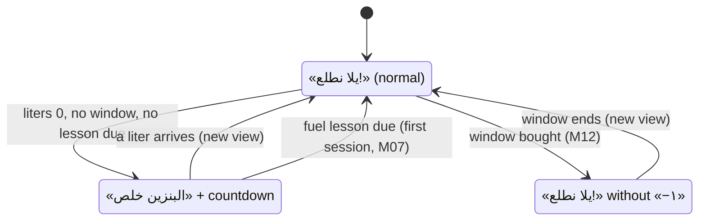
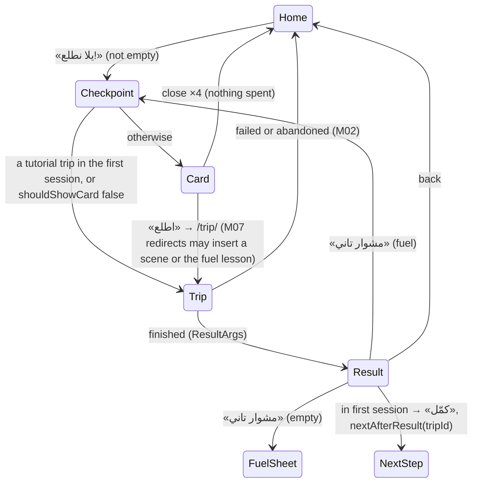
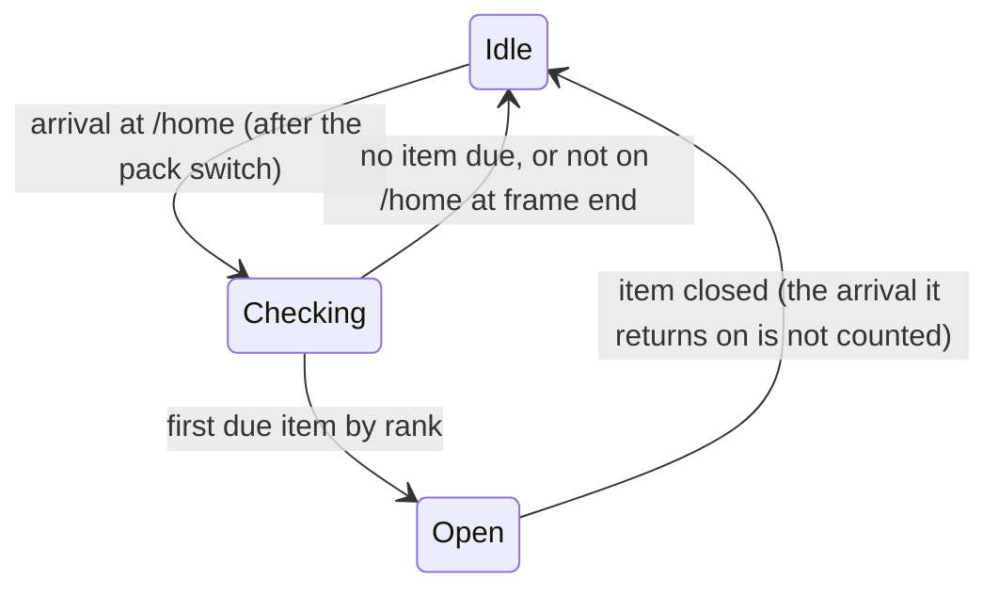

# Data Model: Home, Pre-trip Card and Result Screen (M08)

M08 stores almost nothing:

- **No database change.** The app database stays at its current `schemaVersion`, and no drift
  table or column is added.
- **No operation type,** no content-schema change and no engine change.
- **No new tunable.** `pre_trip_card_mode` already exists.

Everything below is derived from the active pack, the economy's view, the account, the server
status and the trip's result. The one exception is a device preference.

## What is stored

| Value | Where | Writer | Notes |
| --- | --- | --- | --- |
| The pre-trip card setting | settings store, `pref.pre_trip_card` = `always` \| `new_only` | `PreTripCardModeNotifier` | Missing or invalid: the `pre_trip_card_mode` tunable (R6). A device preference, like `pref.digit_style`. |
| The last finished trip this run | memory, `lastFinishedTripProvider` (keepAlive) | the result screen, when a finished trip's `ResultArgs` opens | Lost on restart by design. The fallback is derived (R3). |
| The arrival queue's "an item is open" flag | memory, `HomeArrivalQueue` | the queue | R9 |

## Derived values (pure, in `domain/` folders)

### `PlayerProgress` (`core/progress/domain/player_progress.dart`)

The two things the unlock rules read, built from `EconomyView` by the application layer, as the
server's `PlayerView` is.

| Field | Type | From |
| --- | --- | --- |
| `bestStars` | `Map<String, int>` | `view.progress[tripId].bestStars` |
| `owned` | `Set<(SkuKind, String)>` | `view.owns(kind, skuId)` over the ownership rows |

Rules over it: [contracts/progress-rules.md](./contracts/progress-rules.md).

### `NextTrip` (`features/home/domain/next_trip.dart`)

| Field | Type | Notes |
| --- | --- | --- |
| `tripId` | `String` | Startable (`tripUnlocked`) |
| `lineId` | `LineId` | The line Home's card and scene show |
| `index` | `int` | 1-based position in `tripsOf(line)` (the «المشوار {n}») |
| `isReplay` | `bool` | Every open line finished (rule step 6) |

The inputs are the pack, `PlayerProgress` and `lastFinishedTripId?`, the in-memory value or else the
trip with the latest `firstCompletedAtMs`. M07's `nextTutorialTrip` replaces it during the first
session. Null only for a pack with no startable trip.

### `LineCardFigures`

| Field | Rule |
| --- | --- |
| `lineName` | the line's `name.ar-EG` |
| `tripIndex`, `tripTotal` | `NextTrip.index`; `tripsOf(line).length` |
| `finished` | the trips of the line with `bestStars ≥ 1` |
| `starsEarned`, `starsMax` | Σ `bestStars` over the line's trips; 3 × `tripTotal` |

### `SavingsTarget` (`features/home/domain/savings_target.dart`)

A sealed value, used by Home's savings card and the result's apartment card.

| Variant | Fields | When |
| --- | --- | --- |
| `ChapterGoalTarget` | `chapter` (order, title), `goalKind`, `subjectName`, `opensInChapter`, `progress` | the current chapter is before `apartmentOpens()` |
| `ApartmentPieceTarget` | `chapter`, `itemId`, `itemName`, `priceJenehat` | from `apartmentOpens()` on, with a room goal |
| `NoTarget` | — | a pack without chapters |

- `progress` is `Amount(have: jenehat, of: price)` for a vehicle, chapter or room goal, and
  `Count(done: finished, of: total)` for a line goal.
- `affordable` holds when `progress` is an `Amount` with `have ≥ of`, or for a piece when
  JENEHAT ≥ price.

### `HomeModel` (`features/home/application/home_model.dart`)

What `HomeScreen` renders; a provider over the inputs below.

| Field | Type | From |
| --- | --- | --- |
| `driverName` | `String` | M07's `driverNameProvider` («الأسطى» when there's no name) (R8) |
| `driverLevel` | `int` | `profile.driverLevel ?? 1` |
| `jenehat`, `bonat` | `int` | `EconomyView` |
| `fuel` | `FuelView` | `EconomyView.fuel` |
| `fuelState` | `FuelState`: `normal` \| `empty` \| `unlimited` | `liters < 1` with no window and no lesson due → `empty`; a window → `unlimited` |
| `reach` | `online` \| `offline` \| `maintenance` | `serverStatusProvider` |
| `next` | `NextTrip?` | as above |
| `line` | `LineCardFigures?` | of `next.lineId` |
| `vehicle` | `VehicleId` | `next`'s trip's `vehicle_id` |
| `signStation` | `String?` | the line's last station name; null for the tuktuk |
| `savings` | `SavingsTarget` | as above |
| `storySceneWaiting` | `bool` | seam, false until M10 |
| `apartmentDot` | `bool` | `savings.affordable` |
| `showDebug` | `bool` | `flavor != prod` |

### `MetSet` (`features/pre_trip/domain/met_set.dart`)

`({Set<Archetype> archetypes, Set<EventId> events})`: the archetypes and events of every trip in the
active pack with `bestStars ≥ 1`.

### `TripBriefing` (`features/pre_trip/domain/briefing.dart`)

What the card renders for one trip.

| Field | Type | Rule |
| --- | --- | --- |
| `tripId`, `lineName`, `tripIndex` | | the header |
| `isStory` | `bool` | `kind == story`: the chip and the condition bar |
| `storyRuleNoFights` | `bool` | `rules.no_fights_required` |
| `stops` | `List<StopPrice>` | the definition's `stations` in drop-off order (`at_seconds`) |
| `ruleLines` | `List<RuleLine>` | `student`, `bag`, `childFree`, each only when it applies (below) |
| `newSubject` | `NewSubject?` | R5 |
| `starsEarned` | `int` 0–3 | `bestStars` |
| `boosters` | `List<BoosterTile>` | the four in-trip boosters in the artboard's order, with `count` from `inventory` |
| `buyOffer` | `BuyOffer?` | the first tile with `count == 0`: `booster`, `priceBonat` from the catalog. Null when every count is > 0, or when `boostersLocked` |
| `boostersHidden` | `bool` | M07's `firstSession.boostersLocked` (FR-032) |

- `StopPrice` is `(slot 1–4, stationName, farePiasters)`. The slot gives the colour and the letter
  أ ب ج د (008.5 R1).
- `NewSubject` is sealed:
  - `NewArchetype(archetype, look)`;
  - `NewEvent(eventId, icon)`.

  The name and sentence come from ARB, keyed by the id.

The card describes what the engine does (FR-028, FR-029). RULES §6.1 applies only the student
discount. `bag_fare_piasters` and `child_free_age` are authored but no engine archetype carries a
bag or a child yet (`bags_lady` and `mother_kids` aren't in `capabilities.json`). So:

- the `student` line shows when the discount is above 0 and a student rides;
- the `bag` and `childFree` lines are built only for an archetype listed in the domain's
  `bagArchetypes` and `childArchetypes` tables, which are empty today;
- a test pins both tables against `capabilities.json`, so the lines appear the day the engine
  supports them.

### `CardDecision`

`shouldShowCard(trip, metSet, mode)`: `story` → show; `newSubject != null` → show;
`mode == always` → show; otherwise open the trip directly.

### `ResultArgs` (`features/result/domain/result_args.dart`)

Handed from the trip to the result route as `extra` (R14).

| Field | Type | Notes |
| --- | --- | --- |
| `result` | `TripResult` | the engine's |
| `startTxn` | `TxnId` | matches `lastResult.startTxn` for the ×2 state |
| `replay` | `ReplayRecord` | the trip at its end, for the quote |
| `bestStarsBefore` | `int` | read just before `recordResult` |
| `jenehatBefore` | `int` | read just before `recordResult` |

Only finished trips build one (`ExitToResult` exists only for `finished`).

### `ResultSummary` (`features/result/domain/summary.dart`)

| Field | Rule |
| --- | --- |
| `header` | the trip index and the line name |
| `title` | the last stop's name, from the line's stations |
| `stars` | 3 × `StarRow(earned, conditionKey)` from `starFlags` (`reached`, `noFights`, `noMistakes`) |
| `breakdown` | `faresPiasters`, `tipsPiasters`, `overpaidPiasters`, `fights` |
| `mistakeLines` | per `mistakes` entry: `look`, `labelKey`, `feminine`, `kind`, `amountPiasters`; plus count lines for `fights`, `missedStops`, `lostFares` |
| `summary` | `MistakesSummary(count, family: fights \| mistakes \| losses)`, or null when nothing went wrong |
| `payJenehat` | `earningsJenehat`, or doubled when `lastResult.doubled` for this start |
| `firstThreeStars` | `stars == 3 && bestStarsBefore < 3` |
| `apartment` | `SavingsTarget` after the pay, with `barFrom = jenehatBefore`, `barTo = jenehat now` |

### `Quote` (`features/result/domain/quote.dart`)

`(passengerId, look, labelKey, speechKey, variant, amountPiasters?, stationId?)`. The rule is in R14.
The text is resolved in presentation from the speech pool, as M02 R13 resolves it.

### `ShareImageSpec`

`(tripIndex, lineName, lastStop, stars, quote?, payJenehat)`: the inputs of the `ShareCard` widget.
It is drawn at 360×360 and captured at a pixel ratio of 3.

## Seams (application layer, no-op defaults)

See [contracts/seams.md](./contracts/seams.md): `ArrivalItem` (with M07's two items),
`BetweenTripsCheckpoint`, `HomeDailyRow`, `MorningPiggySlot`, `ResultDoubleSlot`, `ResultTaskSlot`,
`StoryAfterResult`, `storySceneWaiting`, `ShareGateway`. M07's first session is read directly, not
through a seam (research R8).

## States and transitions

### Home's button

### From Home to a trip

### The arrival queue

