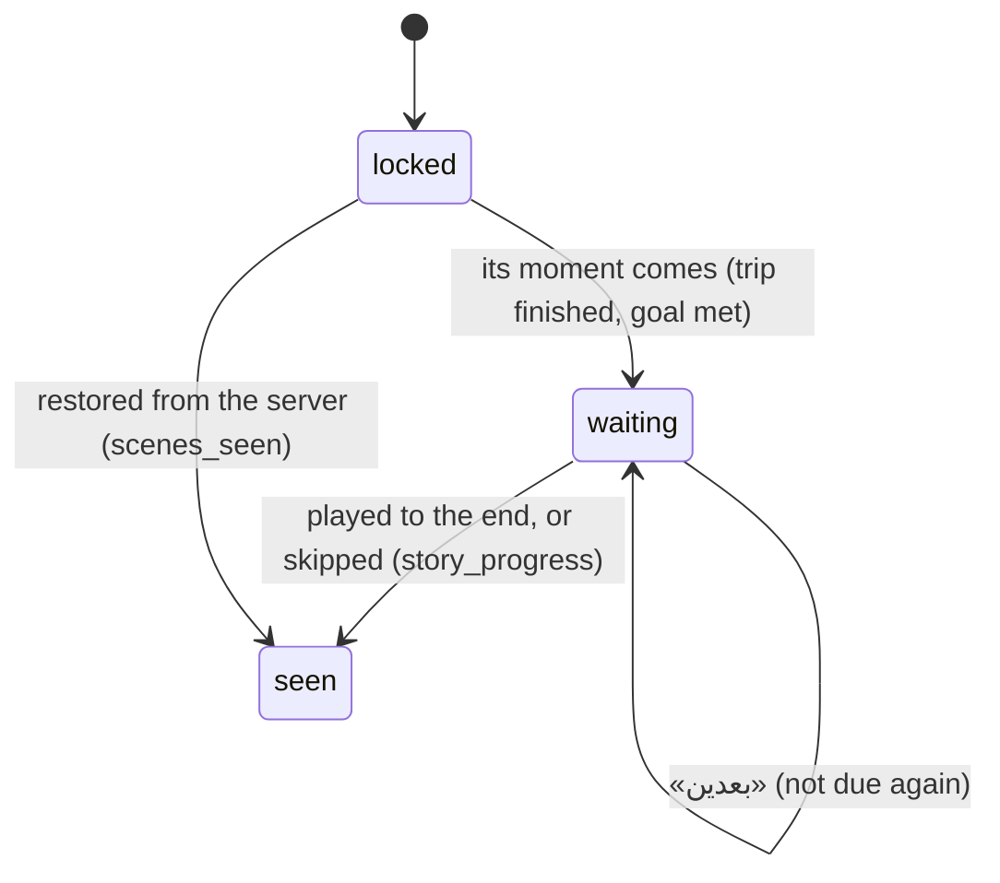
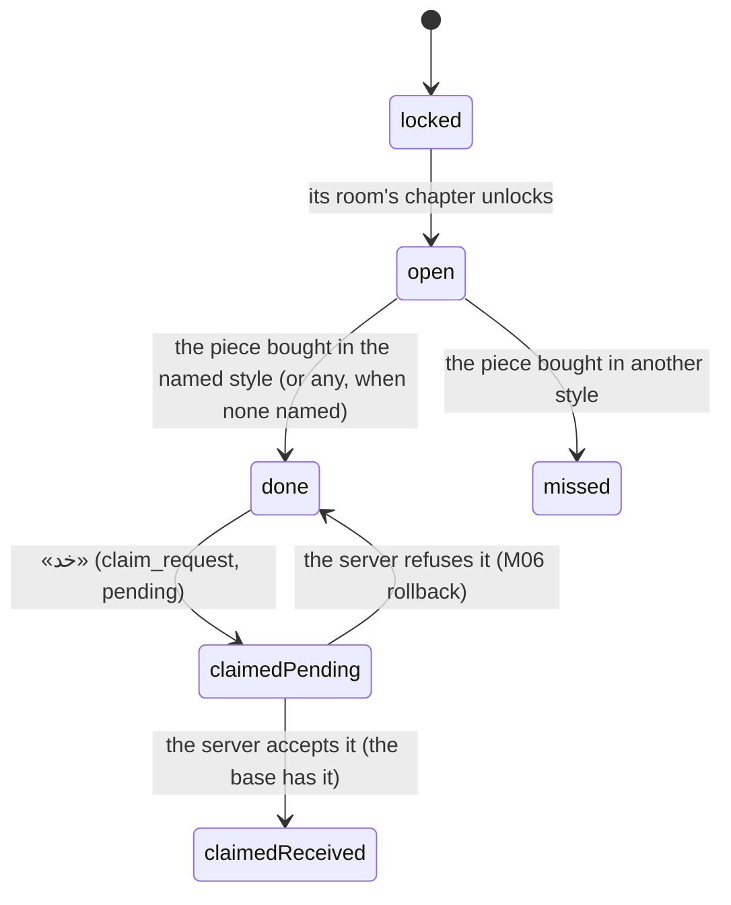

# Data Model: Apartment, Story Chapters, Scenes and Family Requests (M10)

What M10 stores, what it reads from the pack, and what it derives. Decisions are in
[research.md](./research.md); the content fields' exact JSON is in
[contracts/content-fields.md](./contracts/content-fields.md).

## 1. Content (the pack, read only)

All fields come from the pack through `ContentSource`. **New** marks M10's additions (R16).

| Entity | Fields used | New |
| --- | --- | --- |
| `Chapter` | `chapter_id`, `order`, `title`, `goal`, `story_trip_id`, `completion_bonat`, `scenes` | `goal_art?`, `goal_line?` (`speaker`, `text`), `ready_line?`, `tagline?`, `story_trip_info?` |
| `Scene` | `scene_id` (unique in the pack, V-C11), `panels[3..5]`, `plays?` | `title` |
| `Panel` | `art` (slug), `lines[0..8]` (≤ 2 spoken, V-C12) | — |
| `Room` | `room_id`, `name`, `order`, `chapter_id`, `completion_bonat` | `art?`, `done_line?` |
| `Item` | `item_id`, `room_id`, `name`, `order`, `variants[1..3]` | `slot` (`x`, `y`, `w`, `h` in 358×300), `comment?` |
| `ItemVariant` | `variant_id`, `name`, `art` | `comment?` |
| `FamilyRequest` | `request_id`, `room_id`, `item_id`, `variant_id?`, `text`, `reward_bonat` | `character` |
| `StoryTripInfo` | — | `title`, `condition?`, `fail_reason?`, `riders[1..2]` |
| `StoryRider` | — | `character`, `seat`, `comments?` (`short_change?`, `false_accusation?`, `fight?`, `missed_stop?`, `impatient?`: speech keys) |
| `Catalog` | the `item` and `chapter` prices in JENEHAT | — |
| `SpeechPool` | `speech_key`, `lines` (riders' comments) | — |

`StoryCharacter` (new enum): `usta`, `salma`, `bride_father`, `bride_mother`, `moallem`, `belya`.

## 2. The economy's state (on the phone, synced)

`EconomyState` (`lib/core/economy/domain/economy_state.dart`) gains two fields, folded from
`ledger_ops` over the base and replaced by the server's state (R5):

| Field | Type | From | To the server |
| --- | --- | --- | --- |
| `scenesSeen` | `Map<String chapterWire, Set<String sceneId>>` | `story_progress` ops; `state.story.chapters[].scenes_seen` | `story_progress {chapter_id, scene_id, content_version}` |
| `requestsClaimed` | `Set<String requestId>` | `claim_request` ops; `state.story.requests_claimed` | `claim_request {request_id, content_version}` |

Ownership (`Owned.variantId` for items) and trip progress are M05's, unchanged.

`EconomyView` gains the projection's `scenesSeen` and `requestsClaimed`, which the screens read.
It also gains `confirmed`, a read-only view of the **base** with its ownership, progress, `scenesSeen`
and `requestsClaimed`. The phone uses `confirmed` to tell a pending completion or claim from a
received one (R6).

### Drift schema 5 (`schemaVersion` 4 → 5)

| Table | Change | Writer |
| --- | --- | --- |
| `ledger_ops` | the `op_type` check admits `story_progress` and `claim_request` (table rebuilt, rows kept) | the economy store |
| `player_state` | `+ scenes_seen TEXT NOT NULL DEFAULT '{}'` (JSON object of arrays), `+ requests_claimed TEXT NOT NULL DEFAULT '[]'` (JSON array) | the economy store |
| `projection_base` | none (its canonical `state` JSON carries the two fields) | the economy store |

### Operations

| Op | Request | Local refusals (in order) | Stored when refused? |
| --- | --- | --- | --- |
| `story_progress` | `StoryProgressRequest(chapterId, sceneId)` | `unknown_sku`, `already_recorded` (the chapter's unlock is checked by `StoryService` first) | no |
| `claim_request` | `ClaimRequest(requestId)` | `unknown_sku`, `already_granted`, `not_eligible` | no |

Neither changes a balance on the phone. The server's answers and its BONAT grant arrive through M06
(contracts/economy-ops.md).

## 3. M07's first-session flags (unchanged table, new caller)

`first_session.scenesDue` and `.scenesSeen` (`DriftFirstSessionStore`, still the only writer).

- M10 adds goal scenes to `scenesDue` through `FirstSessionService.addSceneDue` (`StoryDueWatcher`).
- `StoryService.recordSeen` marks `scenesSeen` through `FirstSessionService.sceneSeen`.

The economy's `scenesSeen` is the source of truth for "seen" (R3).

## 4. In memory only (keepAlive providers, not persisted)

| Provider | Holds | Why not stored |
| --- | --- | --- |
| `pieceStyleMemoryProvider` | the style last picked per piece in this run | a convenience; a restart forgets it harmlessly (R10) |
| `roomTabProvider` | the selected room tab | the view opens on the current chapter's room anyway |
| `goalBarSeenProvider` | the bar value last shown per chapter | only for the bar's animation (R8) |

## 5. Derived values (pure domain, recomputed per view)

### Scene (`lib/core/progress/domain/story.dart`)

```text
SceneMoment = opening | afterTrip(tripId) | goalMet
SceneState  = locked | waiting | seen

unlocked(scene) =
  opening      → true
  afterTrip(t) → finished(t)                 (≥ 1 star)
  goalMet      → chapterComplete(chapter)

state = !unlocked ? locked : (seen ? seen : waiting)
seen  = scene ∈ economy.scenesSeen[chapter]
storyOrder = chapters by (order, chapter_id), then the chapter's scene list order
```



- **Due** (M07's list): an `afterTrip` scene on a first finish seen here (M07), or a goal scene whose
  chapter is complete in the projection and not in the base, when its goal isn't a room (M10).

### Family request (`lib/core/progress/domain/requests.dart`)

`requestStates(c, p, variantOf, requestsClaimed)`. `variantOf` is `EconomyView.variantOf`
(`String? Function(String itemId)`), because `PlayerProgress` holds what is owned but not its style.

```text
locked  : !chapterUnlocked(room.chapter)
claimed : request ∈ economy.requestsClaimed
done    : owns(item) && (variant == null || variantOf(item) == variant) && !claimed
missed  : owns(item) && variant != null && variantOf(item) != variant && !claimed
open    : otherwise
count on «الطلبات» = |open| + |done|
```



### Reward (`lib/core/progress/domain/rewards.dart`)

```text
PendingReward = { source: room(roomId) | chapter(chapterId) | request(requestId), bonat }
room    pending ⇔ roomComplete(projection) ∧ ¬roomComplete(confirmed)        bonat = room.completion_bonat
chapter pending ⇔ chapterComplete(projection) ∧ ¬chapterComplete(confirmed)  bonat = chapter.completion_bonat
request pending ⇔ claimed(projection) ∧ ¬claimed(confirmed)                  bonat = request.reward_bonat
pendingTotal = Σ bonat
```

### Apartment (`lib/features/apartment/domain/`)

Every value that shows a style (`RoomModel`'s owned pieces, `PieceSheetModel`'s request marks) takes
`variantOf` beside `PlayerProgress`, as `requestStates` does.

| Value | Rule |
| --- | --- |
| `ApartmentView` | `goal` while `currentChapter.order < apartmentOpens.order` (or no room chapter), else `rooms`; `end` flag when the current chapter is complete |
| `GoalViewModel` | M08's `savingsTarget` (goal, amount or count, progress, affordable) + chapter art, character line, ready line, the action (`buyChapter` / `openVehicleSheet` / none) |
| `RoomModel` | the room; its pieces by `order`, each `owned(variant)` / `nextTarget(shortfall, progress, affordable)` / `missing(price)`; `owned/total`; the strip's goal scene; the requests count; `pendingTotal` |
| `PieceSheetModel` | the piece, its variants, the selected one, سلمى's line, the price, the balance, `requestMark(variantId → asker)`, `missesRequest(selected)` |
| `ChapterRow` | `done(thumbnail, hasScenes)` / `current(goal…)` / `locked(name)` for the seven glossary chapters |
| `AlbumCard` | per scene in story order: `unlocked(firstPanelArt, chapterNumber, title)` / `locked(chapterNumber, title)`; the count |

### Story trip (`lib/features/trip/domain/`)

| Value | Rule |
| --- | --- |
| `TripFacts.storyInfo` | the `StoryTripInfo` of the chapter whose `story_trip_id` is this trip, else null |
| `RiderComment` | from a `ReputationChanged` of cause `shortChange`, `falseAccusation`, `fight`, `missedStop` or `impatient`: the first rider whose `comments` names a pool for it; line index `xorshift32(seed ^ n) % len` |
| the failure reason | `storyInfo.failReason` when present, else M02's `tripFailStoryRule` |

## 6. Identity and ordering

- Chapters by `(order, chapter_id)`. The glossary's seven `ChapterId`s order the timeline, including
  those the pack lacks.
- Rooms by `RoomId` order (`salon`, `kitchen`, `bedroom`) for tabs; items by `order` within a room.
- Scenes are unique by `scene_id` (V-C11), and recorded by `(chapter_id, scene_id)`, the server's key.
- Requests are unique by `request_id`.
- Ids the active pack lacks, in ownership, progress or the story state, are kept and skipped by
  readers (M04's rule).
